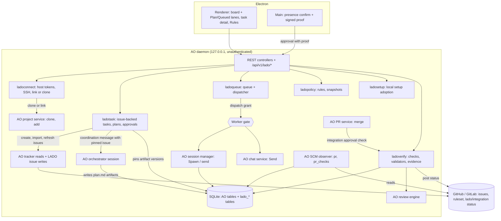

# LADO — Technical design (AO extension spec)

- Version: 2.0
- Date: 2026-10-19
- Base: this repository at `55b02b848` (fork of `OrchestratorInc/agent-orchestrator`)
- Related: [PRD.md](PRD.md), [HARNESS.md](HARNESS.md), [adr/](adr/)
- Previous version: [v1/TDD.md](v1/TDD.md) (1.1). Removed from v1: the conditional-fork wording, the module list, the logical DDL, the TypeScript runtime contract and the IPC command list (they redefined parts of AO), and the PoC day plan and adoption decision.

Paths: Go code under `backend/internal/` is cited without that prefix. Other paths start at the repo root. Line numbers are at `55b02b848`.

## 1. Extension rules (D1)

LADO keeps merging upstream. Every LADO change is either a new file inside one of AO's layers, or a few hook lines in a shared file.

### 1.1 Where new code goes

| Layer | LADO files | AO pattern to copy |
|---|---|---|
| Domain | `domain/lado_*.go` | `domain/automation.go` |
| Ports | `ports/lado_gate.go` (worker gate interface), `ports/lado_issues.go` (issue write port) | `ports/agent_accounts.go`, `ports/tracker.go` |
| Services | `service/ladoconnect/` (repository connection: host tokens, SSH check, link or clone), `service/ladotask/` (issue-backed tasks, plans, approvals), `service/ladoqueue/` (queue, dispatcher), `service/ladopolicy/` (rules, resolution, snapshots), `service/ladosetup/` (local setup inventory, adoption, restore), `service/ladoverify/` (checks, validators, evidence) | `service/automation/` |
| Adapters | `adapters/tracker/github/lado_issues.go`, `adapters/tracker/gitlab/lado_issues.go` (issue writes); a commit status file in `adapters/scm/github/` (§7.1) | AO's existing writes: `adapters/scm/github/merge_action.go`, `adapters/scm/gitlab/merge_action.go` |
| Session manager | `session_manager/lado_gate.go` holds the optional gate field and its checks | — |
| Storage | `storage/sqlite/migrations_lado/*.sql`, `storage/sqlite/queries/lado_*.sql`, `storage/sqlite/store/lado_*_store.go` | `storage/sqlite/store/awake_store.go`; narrow store interfaces as in `daemon/awake_wiring.go:13` |
| HTTP | `httpd/controllers/lado_*.go` with DTOs in `lado_*_dto.go` (not in `httpd/controllers/dto.go`) | `httpd/controllers/cues.go:23-65`, `httpd/controllers/artifact_versions_dto.go` |
| API spec | `httpd/apispec/specgen/lado_operations.go` returning `[]operation` | `cueOperations` in `httpd/apispec/specgen/build.go:1619` |
| Daemon | `daemon/lado_wiring.go` | `daemon/awake_wiring.go`, `daemon/automation_wiring.go` |
| Renderer | `frontend/src/renderer/components/lado/`, `frontend/src/renderer/components/settings/RulesSection.tsx`, new route files in `frontend/src/renderer/routes/` | `frontend/src/renderer/routes/_shell.automations.tsx`, `frontend/src/renderer/components/settings/*Section.tsx` |
| Electron main | `frontend/src/main/lado-presence.ts`, `frontend/src/main/lado-autostart.ts` (login item), `frontend/src/main/lado-desktop.ts` (Background settings and IPC), `frontend/src/shared/lado-desktop.ts` (types) | `frontend/src/main/daemon-owner.ts`, `frontend/src/main/update-settings.ts` |

Names start with `lado` (packages, files, tables, routes, i18n keys). LADO code never uses the word "harness" for its own concepts, because `sessions.harness` and `domain.AgentHarness` already mean "agent adapter". It says `rule`, `policy` or `setup`.

### 1.2 Hook lines in shared files

This is the complete list of upstream files LADO edits. Each edit stays a few lines that call into LADO code.

| File | Hook |
|---|---|
| `httpd/api.go` | `APIDeps` field (:26-90), `API` field (:119-153), constructor entry (:164-216), `Register` call (:255-283) |
| `httpd/apispec/specgen/build.go` | Append `ladoOperations()` in `operations()` (:706-732) |
| `httpd/lan_listener.go` | Add `/api/v1/lado/` to `lanControlBlockedPrefixes` (:72-85) |
| `daemon/daemon.go` | `APIDeps` literal (:982-1036), including the desktop token and its origin for presence proofs (:199-213, [adr/0002](adr/0002-human-presence-approval-channel.md)); start and stop of the dispatcher |
| `daemon/scm_wiring.go`, `daemon/tracker_wiring.go` | Add the stored host tokens to the GitHub and GitLab token chains, after the `AO_GITHUB_TOKEN` and `AO_GITLAB_TOKEN` overrides (`scm_wiring.go:47-63`, `tracker_wiring.go:21-87`), and the stored self-managed GitLab hosts to the allowlist (§5.1) |
| `storage/sqlite/db.go` | Drop LADO change triggers before upstream's first repair (:300); run the LADO track after `reconcileSchema` (:364) (§4.1) |
| `backend/sqlc.yaml` | Add `internal/storage/sqlite/migrations_lado` to `schema` |
| `session_manager/manager.go` | Gate call at the top of `Spawn` (:945) and `send` (:4899); LADO section in `buildSystemPrompt` (:5692), which spawn, restore (:3458), Chat start and agent switching all call; launch-home hook next to account env (:6036-6058) |
| `service/chat/service.go`, `service/chat/side.go` | Gate call in `Send` (:1213), `SendForOwner` (:1304), `SendSideQuestion` (`side.go:1610`) |
| `httpd/controllers/conversations.go` | Clamp turn settings on `PATCH .../conversation/settings` (:135); in LADO execution sessions, require the `app://renderer` origin and record the actor on approval resolve (:912-939) |
| `service/pr/action_service.go` | Integration approval check before merge (:95-155) |
| `service/project/clone.go` | Pass `core.sshCommand` to `git clone` when the connection names an SSH key file (:165-166) |
| `adapters/agentaccount/share.go` | Read shared entries from the LADO managed home after adoption (:35-38, :62-76) |
| `frontend/src/renderer/components/settings/settingsCatalog.tsx`, `frontend/src/renderer/stores/ui-store.ts` | Rules section entry (:63+) and section id (:27-43) |
| `frontend/src/renderer/lib/event-transport.ts` | Route `payload.kind` values starting with `lado_` (next to :330-336) |
| `frontend/src/renderer/routes/_shell.projects.$projectId.tsx` | Render LADO lanes before the session board |
| `frontend/src/renderer/components/TaskComposer.tsx` | In LADO projects, submit creates an issue-backed task instead of a session; Import issues opens the issue picker (§5.1) |
| `frontend/src/renderer/components/CreateProjectFlow.tsx` | Entry to the LADO connect dialog next to Clone (§5.1) |
| `frontend/src/main.ts` | Presence IPC with the per-launch desktop token (:1397); the Background settings object, its IPC registration, and its keep-daemon default at the three `keepDaemonAlive` calls |
| `frontend/src/preload.ts` | Expose `lado.desktop` and the presence confirmation call to the renderer |
| `frontend/src/renderer/lib/bridge.ts`, `frontend/src/renderer/test/setup.ts`, `frontend/e2e/support/fake-bridge.ts` | `lado` stubs, because each one satisfies the full `AoBridge` type |
| `frontend/src/renderer/components/settings/GeneralSettingsSection.tsx` | Render the LADO Background group after Sessions |
| `frontend/src/renderer/i18n/*.json` | LADO keys appended at the end of each of the 8 locale files |
| `CLAUDE.md`, `AGENTS.md` | The Start at login exception to the `~/.ao`-only rule (§10) |
| `frontend/forge.config.ts`, `frontend/src/shared/posthog-config.ts` and the files in §11 | Fork distribution defaults |

The separate migration track (§4.1) means no upstream migration test needs an edit.

### 1.3 Generated files

`backend/internal/httpd/apispec/openapi.yaml`, `frontend/src/api/schema.ts`, `frontend/src/renderer/routeTree.gen.ts` and `backend/internal/storage/sqlite/gen/*` are never merged by hand. On a conflict, take either side and regenerate: `npm run sqlc`, `npm run api`, and the renderer build for the route tree.

### 1.4 Upstream sync

```bash
git remote add upstream git@github.com:OrchestratorInc/agent-orchestrator.git   # once
git fetch upstream
git switch -c sync/upstream-<date> main
git merge upstream/main
# generated files: take one side, then regenerate
npm run sqlc && npm run api
npm run lint && npm run frontend:typecheck
```

`Untrivial-ai/agent-orchestrator`, the name in several defaults, redirects to `OrchestratorInc/agent-orchestrator`. The hotspots in the last 30 days were `httpd/controllers/dto.go` (70 commits), `httpd/apispec/specgen/build.go` (41) and `daemon/daemon.go` (40). LADO stays out of `httpd/controllers/dto.go` and keeps its other edits to the hook lines above.

### 1.5 Contract tests that constrain LADO

- `TestRouteSpecParity` (`httpd/apispec/parity_test.go:41-95`) fails when a mounted route has no spec operation, or the reverse. It builds the router with nil dependencies, so LADO controllers must mount their routes even when their service is nil, and answer with `apispec.NotImplemented` (`httpd/controllers/cues.go:62-65`).
- `TestBuild_MatchesEmbedded` (`httpd/apispec/specgen/build_test.go:71-81`) and the `api-drift` and `sqlc-drift` CI jobs (`.github/workflows/go.yml:274-319`) fail on stale generated files.
- The renderer i18n coverage test (`frontend/src/renderer/i18n/renderer-coverage.test.ts:114-115`) fails on hardcoded English in JSX. LADO strings go in all 8 locale files.

## 2. Architecture



AO stays the owner of sessions, worktrees, PR facts and review runs. The tracker stays the owner of issue text and state; LADO keeps pinned copies and the facts it last observed. LADO owns the records before a session exists, the links from a session to its task and plan, rules, verification results and the audit log.

## 3. Domain model and derived state (D7)

### 3.1 Records

| Record | Table | Points at |
|---|---|---|
| Task | `lado_tasks` | `projects.id`; canonical issue id (`observe/trackerintake/observer.go:260-274`), required and unique among tasks that are not cancelled; the issue's last observed title, state and snapshot hash |
| Issue snapshot | None: a blob in the LADO store (§4.5) | Canonical JSON of the issue's canonical id, title and body at the time a plan was requested |
| Plan revision | `lado_plan_revisions` | AO artifact version (session id, path, version, sha256) and a pinned blob, plus `base_ref`, `base_sha` and the sha256 of the issue snapshot it was planned from |
| Plan approval | `lado_plan_approvals` | Plan revision and its sha256; presence proof id |
| Queue entry | `lado_queue_entries` | Plan approval and rule snapshot; claim facts |
| Execution | `lado_executions` | `sessions.id` (primary key), task, plan revision, approval, queue entry, snapshot, base SHAs at dispatch |
| Rule snapshot | `lado_policy_snapshots` | Canonical JSON and its sha256 (HARNESS §8) |
| Integration approval | `lado_integration_approvals` | Execution, PR URL, head SHA; presence proof id |
| Check run | `lado_check_runs` | Execution, head SHA, command or validator, exit code, log blob sha256 |
| Evidence link | `lado_evidence_links` | AO rows: `pr_checks` key, `review_run.id`, artifact version, `lado_check_runs.id`, commit SHA |
| Audit event | `lado_audit_events` | Any of the above |
| Local setup | `lado_setup_items`, `lado_setup_adoptions` | HARNESS §9 |

`lado_executions` follows the precedent of `sessions.issue_id` (`0001_init.sql:25`): AO's session row stays as it is, and the link lives next to it.

Repository connections have no table. The repository is the project's `origin`, as in AO (`service/project/service.go:800-810`), and tokens are stored per host (§4.5, §5.1).

### 3.2 Derived state

Nothing below is stored as a state column. Each state is computed at read time, as AO does for sessions (`AGENTS.md:111`).

| State | Derived from |
|---|---|
| Draft | Task exists, no plan revision |
| Planned | The latest plan revision has no valid approval |
| Review required | Queue entry has `review_required_reason` (snapshot no longer matches, base moved, issue edited since planning, plan superseded) |
| Blocked | Queue entry has `blocked_reason` (mandatory enforcement unsupported, unresolved conflict, LADO prerequisites missing) |
| Approved | Valid approval of the latest revision, no queue entry yet |
| Queued | Queue entry without an active lease or session |
| Dispatching | Queue entry with an active lease |
| Cancelled | Task has `cancelled_at` |
| Running | Execution exists and AO places the session in `building` (`backend/pkg/contract/kanban.go:12-29`) |
| Validating | PR exists and the head SHA has pending required checks, LADO checks or required review |
| Integration pending | Required checks, LADO validators and review policy pass for the head SHA; no integration approval for it |
| Integrating | Integration approval exists for the current head SHA; PR not merged |
| Completed | PR merged, and its merged head SHA has an integration approval |
| Closed unmerged | Not Completed, and the task has a closing disposition, the PR closed without merge, or the issue is closed while no execution runs |
| Failed | Dispatch attempts exhausted, or the session terminated without a PR and the task is not closed |

An approval is valid only while its revision is the task's latest and the pinned blob's sha256 still equals the approved hash. An issue edit does not invalidate it, because the approval covers the plan and not the issue; the dispatcher compares issue snapshots before it spawns (§5.3).

### 3.3 Board placement

AO's lanes are derived server-side (`DeriveKanbanPresentation`, `backend/pkg/contract/kanban.go:236-276`) and the renderer orders them in `packages/product-ui/src/session-presentation.ts:336-341`. LADO does not add a session column, because its cards are tasks. The project route renders two LADO lanes in front of AO's grid:

- **Plan**: Draft, Planned, Review required, Blocked. The human acts next.
- **Queued**: Approved, Queued, Dispatching. LADO acts next.

After dispatch the task leaves the LADO lanes and its session card appears in AO's lanes, with the plan revision and snapshot shown on the card. A task card is a new card type that shows the issue reference and title: add it to the DESIGN.md decisions log before building it.

## 4. Storage (D6, amended)

Recorded in [adr/0004](adr/0004-data-same-db-separate-migration-track.md).

### 4.1 Separate migration track

- Directory `storage/sqlite/migrations_lado/`, embedded like `migrations/` (`storage/sqlite/db.go:32-33`), files `NNNN_lado_<name>.sql` numbered from 0001 within the track.
- A goose v3.27.1 provider (`backend/go.mod:18`) in `storage/sqlite/lado_migrate.go`: `goose.NewProvider` with `WithTableName("lado_goose_db_version")` and `WithDisableGlobalRegistry(true)`. Upstream keeps the package-level goose state and `goose_db_version`.
- `migrate` in `storage/sqlite/db.go` (:292-365) gets two hook calls:
  1. Before upstream's first history repair (:300), drop every `lado_cdc_*` trigger. Upstream's repairs before `goose.Up` also rebuild tables by copy and rename, for example `conversation_turns` (:696) and `review` (:1138), so the drop cannot wait until `goose.Up` (:357-361).
  2. After `reconcileSchema` (:364), run the LADO track and then recreate the LADO change triggers (§4.3). `reconcileSchema` (:2026) still changes upstream tables: it adds missing columns, replays the effects of skipped migrations, and rewrites the `sessions` CHECK through `writable_schema` (:2093).

  Every database applies all of upstream (repairs, migrations, reconcile) first and LADO second, whether fresh or upgraded. Building step 2 showed this: the first design put both hooks around `goose.Up` alone.
- sqlc reads both directories in that order (`backend/sqlc.yaml` `schema` list).

Why not 9000-range numbers in the shared table: `migrate_snapshot_test.go:60-68` walks every integer version up to the highest, so 9001 would mean about 8,800 extra steps and 9,001 database images held in memory; `migrate_burned_versions_test.go:266-274` requires each number in a ledger that upstream appends to in every migration; and `WithAllowMissing` applies upstream's later migrations after LADO's only on upgraded databases.

### 4.2 Tables

- Table names start with `lado_`. No LADO migration adds a column, trigger or CHECK value to an upstream table.
- LADO rows refer to upstream rows by id (`sessions.id`, `projects.id`, PR URL) **without** a `FOREIGN KEY`. Foreign keys are on (`storage/sqlite/db.go:40`) and upstream rebuilds tables by copy and rename (`0103_review_run_cdc.sql:5-60`) and deletes session rows; a constraint from LADO would block or break those migrations. Foreign keys are used only between LADO tables. Reads handle a missing upstream row ("session missing").
- LADO project settings live in `lado_project_settings` (`project_id`, LADO mode, build/test/lint commands, integration policy), not in `projects.config`, because AO replaces that JSON as a whole (`service/project/service.go:754`).
- Query files (`storage/sqlite/queries/lado_*.sql`) stay ASCII-only. sqlc v1.31.1 (`storage/sqlite/gen/*.sql.go` headers) miscounts byte offsets after a non-ASCII character, and the generated SQL compiles but is cut in the wrong places. Diff `gen/` after every `npm run sqlc`. Found in step 2: a `§` in a header comment cut `LIMIT 1;` short and truncated the column name `prev_sha256` in the generated code.

### 4.3 Change events

AO's rule applies: change events come from DB triggers into `change_log` (`AGENTS.md:116`). LADO triggers sit on LADO tables only and use existing event types, because `change_log.event_type` has a fixed CHECK list (`0103_review_run_cdc.sql:30-48`) that each upstream rebuild re-declares.

- Rows tied to an execution: `session_updated` with that session id and payload `{"kind":"lado_execution", ...}`.
- Rows without a session (tasks, plans, queue, rules): `session_updated` with `session_id` NULL, one row per affected project, payload `{"kind":"lado_task", ...}`. This copies `0151_global_agent_model_catalog_cdc.sql:6-28`.
- `change_log.project_id` must reference an existing project (`0103_review_run_cdc.sql:32`).
- The renderer routes `lado_*` kinds in `frontend/src/renderer/lib/event-transport.ts`, next to the `model_catalog` branch (:330-336).

LADO change triggers follow one rule, because an upstream rebuild of `change_log` by copy and rename fails while a trigger it does not know writes to that table:

- A LADO trigger whose body names an upstream table, in practice every `change_log` writer, is named `lado_cdc_*` and exists only as a statement in `ladoCDCTriggers` (`storage/sqlite/lado_migrate.go`). LADO migrations never create one.
- On every open, LADO drops every trigger matching `lado_cdc_*` before upstream runs and creates exactly the statements in `ladoCDCTriggers` after the LADO track (§4.1). Editing or removing a statement takes effect on the next open, with no migration.
- Triggers that touch only LADO tables, such as the audit log's append-only guards (§4.4), stay in migrations.
- `TestMigrateDropsLadoChangeTriggersBeforeUpstreamRebuilds` keeps a control: upstream `0103` fails with an unknown trigger on `change_log`. If upstream ever stops failing, the control says the drop step can go.

### 4.4 Audit log

`lado_audit_events` (`id`, `at`, `actor`, `action`, `subject_kind`, `subject_id`, `payload_json`, `prev_sha256`) is append-only: BEFORE UPDATE and BEFORE DELETE triggers on this LADO table raise an error. It is never pruned. `change_log` cannot serve as the audit log because it is pruned after 7 days or 100,000 rows (`cdc/retention.go:12,22`).

`prev_sha256` chains the entries:

- The first entry's `prev_sha256` is 64 zeros. Every later entry holds the sha256 of the entry before it.
- An entry is hashed in a canonical form: each field as a netstring (`<byte length>:<bytes>,`), in the order `id`, `at` (UTC, RFC 3339 with nanoseconds), `actor`, `action`, `subject_kind`, `subject_id`, `payload_json` (as stored; an empty payload is stored as `{}`), `prev_sha256`. The length prefixes make the encoding unambiguous, so no choice of field values gives two entries the same bytes. Changing the form breaks every stored chain.
- Appending reads the latest entry and inserts the next one in one transaction under the store's write lock.
- Verification reads the log in `id` order and reports the first entry whose `prev_sha256` does not match. The chain has no key: it detects an edit to any entry that has a successor, but not an edit to the newest entry, or a writer that rewrites every later entry too. Anchoring it outside the machine is T2 work ([adr/0001](adr/0001-threat-model-t1-first.md)).

### 4.5 Files

All under AO's state directory (`~/.ao`, or `AO_DATA_DIR`; `config/config.go:138-141,611-617`):

| Path | Content |
|---|---|
| `<state>/lado/blobs/<sha[0:2]>/<sha>` | Pinned plans, issue snapshots, knowledge snapshots, check logs (same layout as `artifactversions/blobs.go:24-33`) |
| `<data>/github-pat.json` | AO's own GitHub token file (`service/githubpat/githubpat.go:62-64`; `<data>` is `~/.ao/data` unless `AO_DATA_DIR` is set). LADO stores the github.com token through it |
| `<state>/lado/credentials/gitlab-tokens.json` | Tokens for gitlab.com and self-managed GitLab hosts, with the same permissions as AO's GitHub file: 0600 in a 0700 directory (`service/githubpat/githubpat.go:108-117`). The directory is separate because `<state>/lado/` itself is 0750 (`frontend/src/main/lado-desktop.ts`) |
| `<state>/lado/harness/` | Managed local setup (HARNESS §9.3) |
| `<state>/lado/backups/<adoption-id>/` | Originals and manifest from adoption |
| `<state>/lado/desktop.json` | Desktop Background settings: keep agents running after quit (§10) |

The human-presence key has no file: it is derived in memory from the desktop app's per-launch token ([adr/0002](adr/0002-human-presence-approval-channel.md)).

## 5. Work flow

### 5.1 Repository connection, tasks, plans, knowledge

Recorded in [adr/0006](adr/0006-issues-as-work-items.md). Work items are issues on the project's connected repository; there is no separate proposal step.

**Connect a repository (PRJ-006).** The connect dialog takes the repository's SSH URL, an access token for its host, and optionally an SSH key file.

- **Host.** Provider and host come from the URL, parsed the way AO parses `origin` (`domain/repository_identity.go:24,36`). github.com, gitlab.com and self-managed GitLab are supported. GitHub Enterprise is not, because AO's GitHub API base is fixed to api.github.com (`adapters/scm/github/client.go:21-22`).
- **Token.** One per host, shared by every project on that host.
  - LADO checks it with the provider's `GET /user`, as the trackers' `Preflight` does, then reads the repository.
  - The github.com token goes into AO's own token store (`service/githubpat`). GitLab tokens go into `<state>/lado/credentials/gitlab-tokens.json` (§4.5).
  - Stored tokens join AO's token chains after the `AO_GITHUB_TOKEN` and `AO_GITLAB_TOKEN` overrides (§1.2), so AO's PR observer and tracker use them too. Today those use only env and the `gh`/`glab` CLIs, and nothing reads AO's stored GitHub token (`service/githubpat/githubpat.go:384` has no caller).
  - The token must be able to read the repository, its pull requests and branch rules, create issues and post commit statuses. On GitLab that takes the `api` scope. The dialog lists what is missing.
  - A self-managed GitLab host joins AO's GitLab host allowlist. AO reads that list once at startup (`config/config.go:95-106`), so a newly connected host takes effect when the daemon next starts.
- **SSH.** LADO runs `git ls-remote` on the URL with prompts off (`GIT_TERMINAL_PROMPT=0`, `ssh -o BatchMode=yes`), like AO's clone (`service/project/clone.go:165-166`). An unknown host key fails with instructions; LADO never accepts host keys itself. With a key file, LADO sets `core.sshCommand` (`ssh -i <key> -o IdentitiesOnly=yes`) in the repository's local config, so every git command in that repository and its worktrees uses the key, agents' pushes included. LADO stores the path, never the key.
- **Checkout.** A registered project whose `origin` names the same repository is linked. Otherwise LADO clones through AO's clone flow (`POST /api/v1/projects/clone`, `service/project/clone.go`), which also registers the project. The destination is AO's default, `~/ao/projects` or the last one used (`frontend/src/renderer/components/CreateProjectFlow.tsx:128-133`). The clone is the developer's checkout, not app state; AO's state for it stays under `~/.ao`.
- **Tokens stay in the daemon.** They never reach an agent's environment, prompt, worktree or a log. Agents keep pushing with the machine's git credentials, as in AO.

**Create a task (TASK-001, TASK-002).** In a LADO project the New Task composer (`frontend/src/renderer/components/TaskComposer.tsx`) creates an issue on the connected repository instead of a session. The first line becomes the title and the rest the body. The agent and model choice are saved as task preferences.

- **One issue per request.** LADO writes the task row without an issue ref, creates the issue through the write port with a `<!-- lado-task:<task-id> -->` marker in its body, then stores the issue ref. If the daemon stops in between, startup looks for the marker among the repository's recent issues and links the match, or deletes the row if there is none. Rows without an issue ref never appear on the board.
- If the tracker refuses the issue, the row is deleted and the composer keeps the text.

**Import issues.** Import lists the repository's open issues through `Tracker.List` (`adapters/tracker/github/tracker.go:250` follows pagination and caches by ETag) and leaves out issues that already have a task that is not cancelled. Importing creates tasks and writes nothing to the tracker. It replaces tracker intake, which stays off in LADO projects ([adr/0003](adr/0003-enforcement-points.md)).

**Track issues.** LADO refreshes the issue of every open task on a timer, and whenever the task view opens, through `Tracker.Get`. It stores the observed title, state and snapshot hash on the task.

- AO has no such observer. Intake lists open issues only to spawn workers (`observe/trackerintake/observer.go:183-217`), and `ApplyTrackerFacts` has no caller (`lifecycle/reactions.go:645`).
- GitHub reports a `not_planned` close as cancelled and other closes as done; GitLab reports every close as done (`adapters/tracker/github/tracker.go:216-240`, `adapters/tracker/gitlab/tracker.go:263-268`). Both count as closed in §3.2.

**Request a plan.** LADO reads the issue and pins a snapshot in its blob store: canonical JSON of the canonical id, title and body. It then sends the project's orchestrator a daemon-originated coordination message that carries the snapshot inside AO's trust-boundary text (`session_manager/prompt.go:191-195`) and asks for `lado/<task-id>/plan.md` in the orchestrator's artifact directory. The desktop already starts an orchestrator when a project is added (`frontend/src/renderer/routes/_shell.tsx:608-689`).

- **Orchestrator prompt.** A LADO section in `buildSystemPrompt` states the plan schema, and states that the orchestrator must not run `ao spawn` or `ao send` to workers. The gate enforces the second part (§6).
- **Pinning.** AO records artifact versions after a file is stable across two polls (`artifactversions/capture.go:104-178`, poller every 30 s). For each new version of a LADO path, LADO creates the next revision with the issue snapshot hash of the request, copies the blob into its own store, checks the sha256 and validates the schema. An invalid plan cannot be approved. A user edit in the artifact viewer (`source=user`, `0200_session_artifact_version_source.sql`) is a new revision too.
- **Plan schema.** Markdown with YAML front matter: `task`, `issue` (canonical id), `base_ref`, `steps`, `acceptance_criteria`, `affected_paths` (globs), `test_commands`, `risk`, `permission_ceiling`, `review` (required or not, reviewer).

**The issue is not the plan.** Anyone with access can edit an issue at any time, so:

- Approval covers the pinned plan blob only. The issue enters as the snapshot the plan was made from, whose hash the revision records.
- Before spawning, the dispatcher compares the current issue with that snapshot (§5.3). An edit sends the entry to Review required. The human then requests a new plan, or confirms the current plan against the edited issue; that creates a new revision with the same plan text and the new snapshot, which needs its own approval.
- The worker gets the pinned plan and snapshot (§5.3). A plan that LADO copies into an issue comment (TASK-006) is never read back.
- Edits after dispatch do not reach the running worker. The task shows that the issue changed.

**Knowledge snapshot (PRJ-002).** Same mechanism as a plan, with `lado/knowledge.md`, pinned with the commit SHA of the base.

### 5.2 Approval

Approving a plan revision goes through the human-presence channel ([adr/0002](adr/0002-human-presence-approval-channel.md)). One transaction writes the approval (revision, sha256, proof id), resolves rules into a snapshot (HARNESS §8), creates the queue entry and appends the audit event. If resolution hits a fatal conflict, the entry is created with `blocked_reason` and the user sees why.

### 5.3 Queue and dispatcher

The queue copies the automation claim/lease pattern: `GetNextClaimableAutomationRun` and `ClaimAutomationRun` (`storage/sqlite/queries/automations.sql:111-137`) run in one transaction under the store write lock (`storage/sqlite/store/automation_store.go:180-210`) with a 2-minute lease (`service/automation/scheduler.go:19`). LADO adds a retry cap; AO counts `attempt_count` but never checks it.

`lado_queue_entries` columns: `id`, `task_id`, `plan_approval_id`, `policy_snapshot_id`, `enqueued_at`, `attempt_count`, `claimed_at`, `lease_expires_at`, `lease_token`, `dispatched_session_id`, `review_required_reason`, `blocked_reason`, `failed_at`, `error_message`, `cancelled_at`.

Before spawning, the dispatcher checks in this order:

1. The approval is still valid (§3.2).
2. The issue is open, and its current snapshot hash equals the one the plan revision recorded. Edited: Review required. Closed: no dispatch, and the task shows Closed unmerged. If the issue cannot be read, the entry stays Queued and is retried.
3. Re-resolving the rules gives the same snapshot hash. Otherwise: Review required.
4. The base ref has not moved past the plan's `base_sha` in a way policy forbids. Otherwise: Review required.
5. Admission: per-project and global concurrency caps, and memory pressure (`service/usage/memory.go:73-152`). AO has no admission control today.
6. The chosen agent supports every mandatory enforcement in the snapshot (HARNESS §7). Otherwise: Blocked.

Then it calls `Manager.Spawn` with `ClientRequestID = "lado:<queue-entry-id>"` and `ClientRequestHash` = sha256 of the plan hash and the rule snapshot hash. AO already replays an existing session for a known client request id (`session_manager/manager.go:949-957`), so a retry after a crash never creates a second session.

- The prompt is the plan body, and asks the worker to link the issue from its PR.
- `IssueID` is the canonical issue id and `IssueContext` the pinned issue snapshot, rendered the way AO renders a fetched issue (`service/session/issue_context.go:206-227`). With `IssueContext` set, AO skips its live issue fetch (`service/session/issue_context.go:16-35`) and appends the snapshot to the prompt inside its trust-boundary text (`session_manager/prompt.go:51-56`).
- The agent config, including an explicit permission mode, comes from the rule snapshot.

After `Spawn` returns, one transaction inserts `lado_executions` and sets `dispatched_session_id`. On restart, the dispatcher looks up claimed entries by client request id (`GetSessionByClientRequestID`) and either links the found session or releases the claim.

Cancelling a task with a running execution kills the session through AO. Dirty worktrees are preserved, as AO already does (`session_manager/workspace_cleanup.go:179-188`). Cancelling never closes or edits the issue.

## 6. Worker gate (D5)

Recorded in [adr/0003](adr/0003-enforcement-points.md).

### 6.1 Interface

`ports/lado_gate.go`:

```go
// WorkGate authorizes work in LADO projects. A nil gate keeps upstream behavior.
type WorkGate interface {
	AuthorizeSpawn(ctx context.Context, cfg SpawnConfig) error
	AuthorizeSend(ctx context.Context, target domain.SessionID, origin SendOrigin) error
	ClampTurnSettings(ctx context.Context, target domain.SessionID, s ChatTurnSettings) (ChatTurnSettings, error)
}
```

`Manager` holds an optional `WorkGate`. Projects with LADO mode off are never affected.

### 6.2 Spawn

In a LADO project a new worker session needs a dispatch grant: a `ClientRequestID` of the form `lado:<entry>` that matches a lease the dispatcher holds right now. The rest of the table explains which existing paths that rejects.

| Spawn path (how recognized) | LADO project |
|---|---|
| LADO dispatcher (grant) | Allow |
| Orchestrator start (`Kind` orchestrator) | Allow |
| `ao spawn` from an orchestrator, `/orchestrators/delegate` (`ParentSessionID` set, `ports/session.go:27-30`; `service/session/delegation.go:66-123`) | Reject |
| Automation run (`AutomationRunID` set; `service/automation/scheduler.go`) | Reject |
| Tracker intake (`observe/trackerintake/observer.go:206-211`) | Reject. LADO settings also refuse turning intake on |
| Cue invocation (`service/cue/invoke.go`) | Reject |
| Sessions route, `ao spawn` by a person | Reject with "create a task" |
| Restore of an existing session | Not a spawn; allowed |
| Review launch (own launcher, `review/review.go:674`) | Not a spawn; review policy applies (§8.5) |

### 6.3 Send

The gate classifies a message with fields AO already has: `MessageDeliveryOptions.AuthoredByUser` and `SenderSessionID` (`ports/chat.go:482-487`), `ChatUserMessage.Origin` = human, automation, daemon or provider (`domain/conversation.go:115-122`), and coordination delivery ids (`domain.CoordinationDeliveryID`).

| Origin | Target is a LADO execution |
|---|---|
| Human | Allow |
| Daemon nudge about the session's own PR: CI failure, review comments (`lifecycle/reactions.go:180-240`, reaching `Manager.send` through `daemon/lifecycle_wiring.go:445-463`) | Allow |
| Report relay to the orchestrator (coordination) | Allow |
| Another session (`SenderSessionID` set, for example `ao send` from the orchestrator) | Reject |
| Automation | Reject |

The same check runs in chat `Service.Send`, `SendForOwner` and `SendSideQuestion`. Review conversations stay AO's.

### 6.4 Turn settings

`PATCH .../conversation/settings` (`httpd/controllers/conversations.go:135`) can change the approval mode per turn (`ports.ChatTurnSettings.Approval`, `ports/chat.go:497-505`). For a LADO execution the gate caps it at the snapshot's permission ceiling.

### 6.5 Explicit permission mode

LADO executions always get an explicit permission mode from the snapshot. An empty mode becomes `auto` (`session_manager/manager.go:2330-2332`), and Claude's `default` passes no flag, which lets `~/.claude/settings.json` decide (`adapters/agent/claudecode/claudecode.go:160-162`).

### 6.6 Codex permission modes

Today Codex `default` behaves like `bypass`:

- TUI: `--dangerously-bypass-approvals-and-sandbox` (`backend/pkg/agentruntime/command.go:198-208`).
- App-server: approval `never` with sandbox `danger-full-access` (`adapters/chatdriver/codexappserver/driver.go:602-654`).
- Projects store Codex `default` as bypass (`service/project/service.go:1087-1092`), and the editor shows it that way (`frontend/src/renderer/components/ProjectSettingsEditor.tsx:237-239`).
- AO's `accept-edits` and `auto` use `on-request` with `workspace-write` and no network (`adapters/chatdriver/codexappserver/driver.go:609-646`).

The first plan mapped `default` to `workspace-write` with network on and the common git directory writable. Measured on 2026-10-19 with `codex-cli 0.163.0` on Linux (`codex sandbox`, no model call), in both a plain repository and a linked worktree:

| Sandbox | `git add` / `git commit` | Network |
|---|---|---|
| `workspace-write` | Fails: `.git` is read-only | Blocked |
| `workspace-write`, `writable_roots` = the common git directory | Fails: `.git` stays read-only | Blocked |
| `workspace-write`, `network_access = true` | Fails | Works |
| `danger-full-access` (AO `default` and `bypass`) | Works | Works |

Codex keeps `.git` read-only under `workspace-write` whatever the writable roots, and the sandbox settings have no field to change that (`adapters/chatdriver/codexappserver/codexproto/protocol.gen.go:3979-3984`). In that sandbox a commit or push only runs after an approval escalates it.

**Decision (2026-10-19): the global mapping stays upstream's.** Sessions outside LADO projects keep AO's behavior, as §6.1 requires. LADO executions get an explicit mode from the snapshot (§6.5). The Codex ceiling for LADO projects, and whether it grants network access or relies on escalation for git, is decided with the rules core (§15 step 5). Windows needs its own measurement.

## 7. Integration (D5)

### 7.1 Remote: GitHub ruleset

A LADO project's base branch needs a ruleset that requires a pull request and these status checks: the CI checks and `lado/integration`. It must also block force pushes and deletion.

- LADO reads the ruleset (`GET /repos/{owner}/{repo}/rules/branches/{branch}`) when LADO mode is turned on and before each integration approval. AO reads no branch protection for GitHub today. Without the ruleset, the project shows "unprotected: detection only" and each integration needs an explicit acknowledgement.
- After an integration approval, LADO posts a `success` commit status `lado/integration` on the approved head SHA, through a new file in `adapters/scm/github/`. A new push changes the head SHA, which has no status, so GitHub blocks the merge again.
- AO's mergeability fact already turns blocked when GitHub reports `BLOCKED` (`adapters/scm/github/observer_provider.go:631-633,652-667`), so the board stays truthful.
- GitLab projects get issues and tasks (§5.1) but no remote merge control yet. They show "unprotected: detection only", so each integration needs the explicit acknowledgement. The GitLab design, protected branches with external status checks ([adr/0003](adr/0003-enforcement-points.md)), comes later.

### 7.2 AO merge route

`POST /api/v1/prs/{id}/merge` (`httpd/controllers/prs.go:26-55`) runs `service/pr/action_service.go:95-155`, which checks the head SHA, CI, comments and mergeability, but not approval (`domain/pr.go:248-264`). In a LADO project the hook also requires an integration approval for `expectedHeadSha`.

### 7.3 Local base ref (detection)

At dispatch LADO records the SHAs of `refs/heads/<base>` and `origin/<base>`. In VALIDATING and before an integration approval it compares them again and reads `git reflog refs/heads/<base>` for entries after dispatch. Unexpected movement blocks the execution and writes an audit event. If the reflog is off (`core.logAllRefUpdates`), the project shows "detection unavailable".

### 7.4 Integration runs (MERGE-002)

Conflict resolution and regression work after a merge attempt is a new task with its own plan approval, run as a normal execution.

## 8. Verification and evidence (D7)

### 8.1 Required checks (VER-001)

LADO reads the required status checks from the base branch ruleset and compares them with `pr_checks` rows for `commit_hash` = head SHA (`0001_init.sql:72-83`, primary key `(pr_url, name, commit_hash)`). AO already fetches checks through `statusCheckRollup` (`adapters/scm/github/observer_provider.go:394-407,561-592`). All required checks passed on the head SHA → pass.

### 8.2 Local runner (repos without CI)

LADO runs the project's configured commands in the execution worktree at the head SHA. The tree must be clean. The daemon starts the process, not the agent. LADO records the exit code, duration and log blob in `lado_check_runs`. On Windows the runner uses a Job Object so the whole process tree stops, because AO's ConPTY host kills only its direct child (`adapters/runtime/conpty/host_conpty_windows.go:103-105`).

### 8.3 Commit and path validators

In VALIDATING, LADO checks the commits in `base_sha..head_sha` against the snapshot's commit rules (for example Korean messages with English conventional prefixes, HARNESS §5), and the changed paths against the plan's `affected_paths` and the protected paths. Git hooks inside the worktree are only advisory, since `--no-verify` skips them. A violation keeps the execution out of Integration pending.

### 8.4 Agent reports are claims

The worker's `ao report --done` (`storage/sqlite/migrations/0153_reports.sql`, required by `session_manager/prompt.go:323-324`) is a claim, not evidence. Deterministic checks decide.

### 8.5 Review policy (VER-002, VER-003)

When the snapshot requires review, LADO starts an AO review for the head SHA (`httpd/controllers/reviews.go:108-117`). It counts `review_run` rows per execution against a round cap. `approved` passes; `changes_requested` needs revision; failed or cancelled runs are retried up to the cap, then INCONCLUSIVE. The reviewer works in the worker's workspace (`review/review.go:1386`); upstream's reviewer gateway (`reviewgateway/`, `docs/adr/0002-secure-interactive-reviewer-gateway.md`) is the path to isolating it.

### 8.6 Evidence links

`lado_evidence_links` (`id`, `execution_session_id`, `criterion`, `ref_kind`, `ref_key`, `sha`, `created_at`). `ref_kind` is one of `pr_check`, `review_run`, `artifact_version`, `lado_check_run`, `commit`. Each acceptance criterion in the plan links to evidence or is marked "inferred". Evidence whose SHA differs from the current head is stale (EVD-002).

## 9. Rules and local setup: integration points

HARNESS.md has the semantics. The code touch points are:

- **Resolution** at queue admission, stored in `lado_policy_snapshots` (§5.2).
- **Prompt rules**: the LADO section in `buildSystemPrompt` (`session_manager/manager.go:5692`; text assembled in `session_manager/prompt.go:74`), after AO's "## Project Rules" (`session_manager/prompt.go:82-98`). On restore it is rebuilt from the stored snapshot, not from live rules.
- **Adopted local setup**: the launch-home hook next to account env (`session_manager/manager.go:6036-6058`) and the share source in `adapters/agentaccount/share.go` ([adr/0005](adr/0005-local-harness-adoption.md)).
- **Tool policy**: permission mode, Codex sandbox, and `LaunchConfig.AllowedTools/DisallowedTools` (`ports/agent.go:707-735`; Claude TUI flags at `backend/pkg/agentruntime/command.go:279-287`, used today only by reviewers).
- **Capabilities**: `ports.ChatCapability` (`ports/chat.go:170-234`) and the optional adapter interfaces in `ports/agent.go`.

## 10. Windows (D8)

- **Chat mode first.** Codex app-server and Claude ACP run in detached per-session hosts (`docs/architecture.md:10-14`). TUI comes later because the ConPTY host kills only its direct child (`adapters/runtime/conpty/host_conpty_windows.go:103-105`).
- **Keep the daemon.** `AO_KEEP_DAEMON` is off unless set (`frontend/src/main/daemon-owner.ts:12-15`). On Windows, closing the last window quits the app (`frontend/src/main.ts:3521-3525`) and the daemon stops 5 s later (`daemon/daemon.go:1083-1097`). Packaged LADO builds treat keep-daemon as on unless `AO_KEEP_DAEMON` turns it off; dev builds keep upstream's default so a dev loop leaves no daemon behind. The owner becomes `persistent` (`frontend/src/main.ts:1429,1439`). Reopening the app does not reattach to that daemon: a new launch replaces a daemon from another launch gracefully and keeps its persistence mode (`frontend/src/shared/daemon-takeover.ts:44-57`), while Chat hosts keep in-flight turns (`docs/architecture.md:10-14`). The dispatcher therefore has to survive a daemon restart on every app launch (PRD gate 13).
- **Login start.** AO had none (searched `setLoginItemSettings`, `openAtLogin`, `autostart`). Settings > General > Background adds **Start at login** (off by default, packaged builds only) and **Keep agents running after quit** (on by default; `AO_KEEP_DAEMON` wins when set). Windows and macOS use `app.setLoginItemSettings`; Linux writes one `agent-orchestrator.desktop` entry in the XDG autostart directory, an exception to the `~/.ao`-only rule that the owner approved on 2026-10-19 and that `CLAUDE.md` and `AGENTS.md` record. The app opens its window normally at login; AO's tray is macOS-only (`frontend/src/main/tray-lifecycle.ts:5-7`). The keep-running choice is stored in `<state>/lado/desktop.json`.
- **CI.** Only part of the Go suite runs on Windows (`.github/workflows/go.yml:174-178`). Add the LADO packages to that job.
- **Local setup paths.** `%USERPROFILE%\.claude`, `%USERPROFILE%\.claude.json`, `%USERPROFILE%\.codex`. Adoption refuses to run while Claude or Codex processes hold those files.

## 11. Distribution defaults (D9)

| Default | Location | LADO value |
|---|---|---|
| Release and update repository | `frontend/forge.config.ts:24` (`DEFAULT_RELEASE_REPO`; `AO_RELEASE_REPO` overrides at build time) | `LJY981008/agent-orchestrator-fork` |
| Desktop download for `ao start` | `cli/start.go:31` | Fork |
| Version floor download URL | `desktop-version-floor.json:4` | Fork |
| Version floor manifest the app fetches, and its fallback download page | `frontend/src/main/desktop-version-floor.ts:4-5,15-16` (read from upstream's `main`, so upstream could force-quit fork builds) | Fork |
| macOS differential update metadata | `frontend/src/main/mac-differential-v2-protocol.ts:5` (accepted only from this repository) | Fork |
| Feature-build list when no `app-update.yml` is bundled | `frontend/src/main/feature-builds.ts:10` | Fork |
| Linux package homepage | `frontend/forge.config.ts:342,354` | Fork |
| Report-a-problem issue URL | `frontend/src/renderer/lib/report-problem.ts:26` | Fork |
| Report-a-problem support email and Discord | `frontend/src/renderer/lib/report-problem.ts:25,27-28` (upstream's maintainers) | Email goes to the fork owner with no CC; the Discord destination is removed |
| Repository link on Home | `frontend/src/renderer/components/HomePage.tsx:47` | Fork |
| PostHog key | `frontend/src/shared/posthog-config.ts:1` | Removed; telemetry off by default |
| Remote telemetry export | `frontend/src/main.ts:1279` (`posthog` in packaged builds) | Off in every build; explicit env still opts in |
| Sentry DSN for daemon crash reports | `frontend/src/shared/sentry-config.ts:12-13`, stamped on the daemon at `frontend/src/main.ts:1286` | Removed |
| Keep the daemon after quit | `frontend/src/main/daemon-owner.ts:12-15` | On in packaged builds (§10); dev builds keep upstream's default |
| Pricing manifest | `pricing/fetch.go:16` (upstream raw URL) | Keep; data only |
| Release guard workflow | `.github/workflows/release-latest-guard.yml:17,67` | Already skipped outside upstream |

The mobile app keeps its own PostHog and Sentry constants under `packages/mobile/`; it is outside LADO's Windows desktop scope and unchanged.

Before public distribution: check file-level notices under the root Apache-2.0 license, and keep the private `ao-cloud` submodule out of builds (carried over from v1 §20).

## 12. Upstream PR candidates (D10)

1. Codex `accept-edits` and `auto` cannot commit: Codex keeps `.git` read-only under `workspace-write`, and AO grants that sandbox no network (§6.6). Report it with the measurement.
2. Approval resolve: record who resolved, and optionally refuse resolves without a browser `Origin` (`httpd/controllers/conversations.go:912-939`).
3. Optional spawn/send policy hook in `Manager` with a nil default (§6.1).
4. `ao pr merge` sends an empty body (`cli/pr.go:49`) while the route requires `prUrl` and `expectedHeadSha` (`httpd/controllers/prs.go:45-47`). Reproduce before reporting.
5. The migration snapshot test walks integer versions (`storage/sqlite/migrate_snapshot_test.go:60-68`); walking embedded versions would avoid work on the gaps that already exist.
6. Account sharing creates missing entries in the user's real `~/.claude` (`adapters/agentaccount/share.go:62-76`); a configurable source would help both projects.
7. AO stores a GitHub token (`service/githubpat`, `PUT /api/v1/github/pat`) that its PR observer and tracker never read (`service/githubpat/githubpat.go:384` has no caller). Adding it to the token chains (§5.1) helps both projects.
8. Issue writes. Upstream defers them to its issue #40 (`adapters/tracker/github/tracker.go:26-29`, `domain/projectconfig.go:59-61`). If upstream designs a write port, LADO's port (§1.1) should take its shape, and LADO's GitHub and GitLab adapters can be offered there.

## 13. HTTP surface

All under `/api/v1/lado/`, blocked on the LAN listener. Routes marked P need a human-presence proof.

| Route | Purpose |
|---|---|
| `POST /lado/connections/check` | Check a token, repository access and SSH; writes nothing |
| `POST /lado/connections` | Store the host token, set the SSH key, then link or clone the project |
| `GET /lado/credentials`; `PUT, DELETE /lado/credentials/{host}` | Host tokens. No response ever includes a token |
| `GET, POST /lado/tasks`; `GET, PATCH /lado/tasks/{id}`; `POST /lado/tasks/{id}/cancel` | Tasks. `POST` creates the issue, then the task |
| `GET /lado/projects/{id}/issues`; `POST /lado/tasks/imports` | Open issues without a task; import them as tasks |
| `POST /lado/tasks/{id}/plan-requests` | Ask the orchestrator for a plan |
| `GET /lado/tasks/{id}/plans`, `GET /lado/plans/{revision}` | Plan history |
| `POST /lado/plans/{revision}/approve` (P) | Plan approval |
| `GET /lado/queue` | Queue view |
| `GET /lado/executions/{sessionId}` | Links, checks, evidence |
| `POST /lado/executions/{sessionId}/integration-approve` (P) | Integration approval |
| `GET, POST /lado/rules`; `PATCH /lado/rules/{id}`; `PUT /lado/bindings`; `GET /lado/effective` | Rules |
| `GET /lado/setup/inventory`, `POST /lado/setup/scan`, `GET /lado/setup/conflicts` | Local setup |
| `POST /lado/setup/adoptions` (P), `POST /lado/setup/adoptions/{id}/restore` (P) | Adopt and restore |
| `GET, PUT /lado/projects/{id}/settings` (PUT is P when it turns LADO mode off) | Project settings |

The CLI gets read-only commands at most. There is no approval command, by design.

## 14. Tests for the acceptance gates

| PRD §8 gate | Test |
|---|---|
| 1 Spawn paths | `session_manager` gate tests per spawn path (§6.2), plus `service/ladoqueue` integration test |
| 2 Plan hash | `service/ladotask` tests: edit after approval → new revision, old approval invalid |
| 3 Resolution | `service/ladopolicy` table tests (HARNESS §15) |
| 4 Snapshot stability | `service/ladoqueue`: rule edit after admission → Review required, snapshot row unchanged |
| 5 Send origins | Gate tests over `Manager.send` and chat `Send` with each origin (§6.3) |
| 6 Agent claims | `service/ladoverify`: report `done` with a failing required check stays Validating |
| 7 Merge | AO merge route test with and without integration approval; manual check against a sandbox GitHub repo with the ruleset |
| 8 Local base | `service/ladoverify` with a temp repo: `git update-ref` from a worktree → blocked |
| 9 Commit validator | Temp repo, commit with `--no-verify` → blocked |
| 10 Presence | Controller tests: no proof, wrong signature, expired, replayed nonce (also after a daemon restart), daemon token not from the app → rejected |
| 11-12 Windows | Manual run on a real Windows install, recorded under `docs/pr-evidence/` |
| 13 Restart | Fault test: kill the daemon between `Spawn` and the link insert → one session, linked after restart |
| 14 Adoption | `service/ladosetup` with a fake home: backup and manifest before removal; restore is byte-identical; credential files untouched |
| 15 Unsupported enforcement | Dispatcher test with an agent lacking a required capability → Blocked |
| 16 One issue per task | `service/ladotask` with a fake issue writer: stop between issue creation and the ref update → one issue, linked after restart; import → no tracker write |
| 17 Issue edits | `service/ladoqueue`: issue body edited after approval → Review required; the spawn config carries the pinned snapshot as `IssueContext` |
| 18 Token isolation | Dispatch with a stored token: its value is absent from the launch environment, the prompt, the worktree and LADO logs |

Storage tests seed from `migratedDatabaseSnapshot(t, version)` (`storage/sqlite/migrate_snapshot_test.go:34`) and run `Open` or `migrate` on the copy. One fresh `Open` replays every upstream migration, about 12 to 17 s under `-race`. Measured in step 2: the whole `storage/sqlite` package takes about 16 minutes under `-race` on the owner's machine (977 s on `main`); CI splits it into 4 shards with a 20-minute timeout each (`.github/workflows/go.yml:119-141`).

## 15. Build order (agreed 2026-10-19, by dependency)

Each item is its own branch and PR in the fork (`AGENTS.md`: one issue per PR). The `upstream` remote was added on 2026-10-19.

1. Fork defaults, in two PRs:
   - 1a `chore/lado-fork-defaults`: §11, and keep-daemon on by default (§10).
   - 1b was the global Codex `default` mapping. Dropped on 2026-10-19 after measuring it (§6.6); LADO executions set Codex modes through the snapshot instead.
   - 1c `feat/lado-login-start`: login start with a settings toggle (§10).
2. `feat/lado-storage-track`: the LADO migration track and the audit log (§4.1, §4.3, §4.4). It adds no other table; each later step adds the tables it uses.
3. Worker gate with LADO project settings and the mode switch (§6). The switch stays behind a dev flag until step 6: without the dispatcher a LADO project cannot start workers.
4. Issue-backed tasks, plans and approvals, in two PRs:
   - 4a: repository connection (host tokens, SSH check, link or clone), the issue write port for GitHub and GitLab, task creation and import, and issue tracking (§5.1, [adr/0006](adr/0006-issues-as-work-items.md)).
   - 4b: plan requests and revisions, approvals, the presence channel, and the Plan and Queued lanes (§3, §5.1, §5.2). The approval records the approval and its audit event; step 6 adds the rule snapshot and the queue entry to that transaction.
5. Rules core: scopes, toggles, protected gates, resolution and snapshots (HARNESS §3-§8, HAR-001 to HAR-005). It comes before the queue because admission (§5.2) and dispatch (§5.3) need the snapshot's hash, permission ceiling and agent config.
6. Approved queue and dispatcher (§5.3).
7. Local setup adoption (HARNESS §9, HAR-010 to HAR-015).
8. Verification, evidence and integration approval (§7, §8). Steps 7 and 8 do not depend on each other.

The first proposal had seven steps. It left keep-daemon and login start (§10) out of every step, and put the rules system (its step 6) after the approval and queue steps that need its snapshot.
