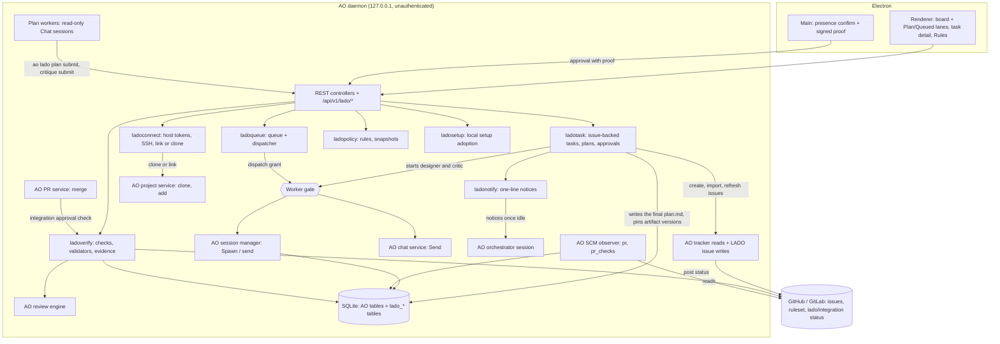

# LADO — Technical design (AO extension spec)

- Version: 2.0
- Date: 2026-10-19
- Base: this repository at `55b02b848` (fork of `OrchestratorInc/agent-orchestrator`)
- Related: [PRD.md](PRD.md), [HARNESS.md](HARNESS.md), [adr/](adr/)
- Previous version: [v1/TDD.md](v1/TDD.md) (1.1). Removed from v1: the conditional-fork wording, the module list, the logical DDL, the TypeScript runtime contract and the IPC command list (they redefined parts of AO), and the PoC day plan and adoption decision.

Paths: Go code under `backend/internal/` is cited without that prefix. Other paths start at the repo root. Line numbers are at `55b02b848`.

## 1. Extension rules (D1)

LADO keeps merging upstream. Every LADO change is either a new file inside one of AO's layers, or a few hook lines in a shared file.

### 1.1 Where new code goes

| Layer | LADO files | AO pattern to copy |
|---|---|---|
| Domain | `domain/lado_*.go` | `domain/automation.go` |
| Ports | `ports/lado_gate.go` (worker gate interface), `ports/lado_issues.go` (issue write port) | `ports/agent_accounts.go`, `ports/tracker.go` |
| Services | `service/ladogate/` (worker gate), `service/ladoproject/` (project settings), `service/ladoconnect/` (repository connection: host tokens, SSH check, link or clone), `service/ladotask/` (issue-backed tasks, plans, approvals), `service/ladopresence/` (human-presence proofs), `service/ladoqueue/` (queue, dispatcher), `service/ladopolicy/` (rules, resolution, snapshots), `service/ladosetup/` (local setup inventory, adoption, restore), `service/ladoverify/` (checks, validators, evidence), `service/ladonotify/` (the orchestrator's one-line notices, #27); the gate checks for chat sends in `service/chat/lado_gate.go`; clones into a workspace project in `service/project/lado_workspace.go`, beside the clone and workspace registration helpers it reuses | `service/automation/` |
| Adapters | `adapters/tracker/github/lado_issues.go`, `adapters/tracker/gitlab/lado_issues.go` (issue writes and token checks, on a `LadoIssues` type reached through the tracker's `LadoIssues()`, so an upstream issue-write API cannot collide); from step 8 `lado_integration.go` beside each, the branch rules and the `lado/integration` commit status on the same type (§7.1). The design put the status in `adapters/scm/github/`; AO's SCM provider double-encodes a branch with `/`, so step 8 used LADO's own client | AO's existing writes: `adapters/scm/github/merge_action.go`, `adapters/scm/gitlab/merge_action.go` |
| Session manager | `session_manager/lado_gate.go` holds the gate setter and its checks; the field is one hook line in `manager.go` | — |
| Storage | `storage/sqlite/migrations_lado/*.sql`, `storage/sqlite/queries/lado_*.sql`, `storage/sqlite/store/lado_*_store.go`; the blob store `storage/ladoblob/` (§4.5) | `storage/sqlite/store/awake_store.go`; narrow store interfaces as in `daemon/awake_wiring.go:13` |
| HTTP | `httpd/controllers/lado_*.go` with DTOs in `lado_*_dto.go` (not in `httpd/controllers/dto.go`) | `httpd/controllers/cues.go:23-65`, `httpd/controllers/artifact_versions_dto.go` |
| API spec | `httpd/apispec/specgen/lado_operations.go` returning `[]operation`; its `init` adds LADO's schema names to `schemaNames` | `cueOperations` in `httpd/apispec/specgen/build.go:1619` |
| Daemon | `daemon/lado_wiring.go`; `daemon/lado_tokens.go` (stored tokens in AO's chains); `daemon/lado_repo_clients.go` (LADO's per-host tracker clients); `daemon/lado_plans_wiring.go` (the plan workers' sessions, the orchestrator notices go to, artifact versions and the presence key plans use) | `daemon/awake_wiring.go`, `daemon/automation_wiring.go` |
| Renderer | `frontend/src/renderer/components/lado/`, `frontend/src/renderer/lib/lado.ts`, `frontend/src/renderer/lib/lado-errors.ts` (LADO errors in the app's language), `frontend/src/renderer/hooks/useLado.ts`, `frontend/src/renderer/components/settings/RulesSection.tsx` and `RunsSection.tsx`, new route files in `frontend/src/renderer/routes/` | `frontend/src/renderer/routes/_shell.automations.tsx`, `frontend/src/renderer/components/settings/*Section.tsx` |
| Electron main | `frontend/src/main/lado-presence.ts` with `frontend/src/shared/lado-presence.ts` (types), `frontend/src/main/lado-autostart.ts` (login item), `frontend/src/main/lado-desktop.ts` (Background settings and IPC), `frontend/src/shared/lado-desktop.ts` (types), `frontend/src/main/lado-ui-locale.ts` (the desktop's Korean default, §11) | `frontend/src/main/daemon-owner.ts`, `frontend/src/main/update-settings.ts` |

As built in step 7, local setup lives in these LADO files:

- `service/ladosetup/`: the inventory (`service.go`, `inventory.go`, `scan_claude.go`, `scan_codex.go`, `scan_projects.go`, `processes.go`), the conflict checks and the AO system layer hash (`conflicts.go`, `aosystem.go`), adoption (`adopt.go`, `backup.go`, `managed.go`, `jsonedit.go`, `tomledit.go`, `rewrite.go`), restore and drift (`restore.go`, `drift.go`), delivery (`home.go` for Claude Code config homes, `codex.go` for Codex launch options), the rules' setup source (`effective.go`), changes (`changes.go`) and the views behind the routes (`views.go`). `service/ladosetup/probe/` holds only tests: the measurement with the real binaries (§15, item 7).
- Beside it: `domain/lado_setup.go`; `ports/lado_setup.go` (the config home port); `storage/sqlite/store/lado_setup_store.go` with `queries/lado_setup.sql` and `migrations_lado/0007_lado_setup.sql`; `service/ladopolicy/setup.go` (the setup source port, and setup in resolution and impact); `session_manager/lado_setup_home.go` and `lado_setup_codex.go`; `adapters/agent/codex/lado_overrides.go`; `httpd/controllers/lado_setup.go` and `lado_setup_dto.go`; `daemon/lado_setup_wiring.go`; in the renderer `components/settings/LocalSetupSection.tsx`, `components/lado/setup/`, `lib/lado-setup.ts` and `hooks/useLadoSetup.ts`.

As built in step 8, verification lives in these LADO files:

- `service/ladoverify/`: the git helpers (`git.go`), the items, each a pure function over what it reads: the base branch (`base.go`), commit messages (`commits.go`), changed paths (`paths.go`, `glob.go`), check commands and their runner (`runner.go`, `checks.go`), remote protection and its cache (`protection.go`), required checks and the review policy (`checks.go`, `review.go`), evidence (`evidence.go`); the loop (`service.go`, `record.go`), fix requests (`notify.go`), status posts (`status.go`), settling (`settle.go`); the integration approval (`approve.go`), the merge gate (`mergegate.go`), the live head port (`livehead.go`) and the reads behind the routes (`views.go`).
- Beside it: `domain/lado_verify.go` (the record, its items and hash, check runs, approvals, evidence); `ports/lado_merge_gate.go` and the branch rules and commit status in `ports/lado_issues.go`; `adapters/tracker/github/lado_integration.go` and `adapters/tracker/gitlab/lado_integration.go`; `storage/sqlite/store/lado_verify_store.go` with `queries/lado_verify.sql` and `migrations_lado/0008_lado_verify.sql`; `service/pr/lado_merge_gate.go` (the setter AO's merge asks); `review/lado_section.go` and `service/ladosetup/reviewer.go` (the reviewer's instructions, §9); `httpd/controllers/lado_verify.go` and `lado_verify_dto.go`; `daemon/lado_verify_wiring.go`; in the renderer `components/lado/LadoVerificationSection.tsx`, `LadoProjectChecksCard.tsx`, `LadoProjectProtectionCard.tsx` and `LadoProtectedPathsDialog.tsx`, with the data layer in `lib/lado.ts`, `lib/lado-errors.ts`, `lib/lado-rules.ts`, `hooks/useLado.ts` and `components/lado/lado-task-status.ts`; in Electron main `frontend/src/main/lado-presence.ts` and `frontend/src/shared/lado-presence.ts`.

As built for plan workers (#27, [adr/0007](adr/0007-plan-workers.md)), they live in these LADO files:

- `domain/lado_plan_worker.go`: request kinds, roles and client request ids, phases, failure and waiting codes, critiques and findings, change kinds, the review skip settings and decision, the review section check, metrics, notices and their Korean lines, and the plan worker's tool lists.
- `service/ladotask/`: `planworker.go` (the plan loop's step for every open request), `planworker_text.go` (the designer's and the critic's prompts, and LADO's messages to them), `planworker_submit.go` (the submissions), `planworker_metrics.go` (what making a revision took); `plans.go`, `planwatch.go` and `plan_text.go` changed for worker requests. `service/ladonotify/` holds the orchestrator notices.
- Beside them: `service/ladopolicy/builtins.go` (the two role rules), `service/ladogate/gate.go` (the plan worker grant and read-only sessions), `service/chat/lado_gate.go` (`ladoReadOnly`), `session_manager/lado_setup_home.go` and `lado_setup_codex.go` (the plan worker mark in a session's environment), `adapters/chatdriver/claudeacp/lado_plan_worker.go` (the ACP tool lists), `cli/lado.go` (`ao lado plan submit`, `ao lado plan critique submit`) and `cli/lado_plan_worker.go` (the hook decision); `storage/sqlite/migrations_lado/0009_lado_plan_workers.sql` with `queries/lado_plans.sql`, `queries/lado_notices.sql`, `store/lado_plan_worker_store.go` and `store/lado_notice_store.go`; `httpd/controllers/lado_plan_workers.go` and `lado_plan_workers_dto.go`; `daemon/lado_plans_wiring.go`; in the renderer `components/lado/LadoPlanWorkerStatus.tsx`, `LadoPlanReview.tsx` and `LadoPlanReviewPatternsDialog.tsx`, with changes to `lado-task-status.ts`, `LadoLanes.tsx`, `LadoTaskDialog.tsx`, the rule rows, editor and history, `RulesSection.tsx` and `RunsSection.tsx`.

Names start with `lado` (packages, files, tables, routes, i18n keys). LADO code never uses the word "harness" for its own concepts, because `sessions.harness` and `domain.AgentHarness` already mean "agent adapter". It says `rule`, `policy` or `setup`.

### 1.2 Hook lines in shared files

This is the complete list of upstream files LADO edits. Each edit stays a few lines that call into LADO code.

| File | Hook |
|---|---|
| `httpd/api.go` | `APIDeps` field (:26-90), `API` field (:119-153), constructor entry (:164-216), `Register` call (:255-283); from step 7 `APIDeps.LadoSetup` and the controller's `Setup` in the constructor entry, whose routes `LadoController.Register` mounts; from step 8 `APIDeps.LadoVerify` and the controller's `Verify` the same way (5 lines: 3 added, 2 removed, for the field, its group's comment and the constructor entry) |
| `httpd/apispec/specgen/build.go` | Append `ladoOperations()` in `operations()` (:706-732); from step 8 one line in the merge route's responses, its 500 for `LADO_MERGE_GATE_FAILED` (§7.2) |
| `httpd/lan_listener.go` | Add `/api/v1/lado` to `lanControlBlockedPrefixes` (:72-85) |
| `daemon/daemon.go` | The worker gate, installed right after the session manager is built (:611), before tracker intake (:698) and automations (:871) start; `APIDeps` literal (:982-1036), including the desktop token and its origin for presence proofs (:199-213, [adr/0002](adr/0002-human-presence-approval-channel.md)); `installLadoCredentials` right before the multi-tracker (:549), so every token chain built after it holds the stored tokens; `wireLadoWork` after the project service (:680), given AO's session service, session manager and artifact version capturer, with the issue tracking and plan loops it starts and the shutdown wait for them; from step 6 it also gets the daemon's memory reader and returns the dispatcher, which starts right after automations (:880), behind the startup safety reconcile of agent switches and interface transitions (:871); the persistent chat host, background session and runtime reconciles run after it, once the listener is live (:1133-1151), and the shutdown waits for the dispatcher. From step 7 `wireLadoWork` also gets the computer's tool folders (`ladoDeviceFolders`), the session manager and the agent registry, and returns the local setup service; `startLadoSetup` starts its first scan next to the task loops, `APIDeps` gets it, and the shutdown waits for the scan. `newAgentAccounts` takes the Claude folder from `deviceClaudeFolder`, which LADO shares, so both read the same folder (§9). From step 8 `wireLadoWork` also gets AO's review manager and the project settings service (`reviews`, `ladoModes`) and returns a struct (`ladoWork`), unpacked on one line into the same variables plus `ladoVerify`; `installLadoMergeGate` follows the PR action service; the verification loop starts right after the dispatcher; `APIDeps` gets it; the shutdown waits for it after the setup scan (10 lines against the step 7 merge: 8 added, 2 removed). For plan workers (#27) `ladoWorkDeps` no longer gets the orchestrator spawner, since LADO starts no orchestrator for plans (1 line edited) |
| `daemon/lifecycle_wiring.go` | `SetWorkGate` and `SetLadoPrompt` in the `sessionLifecycle` interface (:201-235); from step 6 `ResolveDefaultBranch`, which the dispatcher's base check calls (§5.3); from step 7 `SetLadoSetupHome` and `SetLadoChatServers` |
| `daemon/scm_wiring.go`, `daemon/tracker_wiring.go` | Add the stored github.com and gitlab.com tokens to the token chains right after the `AO_GITHUB_TOKEN` and `AO_GITLAB_TOKEN` env sources (`scm_wiring.go:47-63`, `tracker_wiring.go:21-87`); the GitLab tracker's default chain is rebuilt there with the stored token in it. The stored self-managed GitLab hosts reach the allowlist through `cfg.GitLab` (§5.1) |
| `storage/sqlite/db.go` | Drop LADO change triggers before upstream's first repair (:300); run the LADO track after `reconcileSchema` (:364) (§4.1) |
| `backend/sqlc.yaml` | Add `internal/storage/sqlite/migrations_lado` to `schema` |
| `session_manager/manager.go` | Gate field; gate call at the top of `Spawn` (:945) and `SendWithOptions` (:4788), before an attachment is staged in the target's workspace; LADO section in `buildSystemPrompt` (:5692), which spawn, restore (:3458), Chat start and agent switching all call, given the session's kind and id from step 6. Step 7 did not put the launch-home hook next to account env (:6036-6058), as first planned: the Claude Code config home is applied at the top of `prepareWorkspace`, before AO writes workspace trust, and the manager holds two more setters' fields; `buildSpawnTexts` passes the spawn's harness to LADO's section (`withLadoPromptHarness`, one line) |
| `session_manager/agent_switching.go`, `session_manager/interface_transition.go` | Gate call at the top of `SwitchAgent` and `StartInterfaceTransition` (step 6): an execution keeps its agent and interface (§6.4). Step 7, `agent_switching.go` only: `safeNativeTranscriptPath` also accepts a transcript under the folder the config folder's `projects` link resolves to (`ladoProjectsLinkHolds`), and `prepareTargetActivation` passes the target's harness to LADO's section |
| `session_manager/chat_spawn.go`, `session_manager/agent_switching_chat.go` | Step 7: the Chat MCP list of Chat spawn (`launchChatController`), resume (`resumeChatController`) and the Chat agent switch goes through `chatMCPServers` (AO's `ao` server, then a Codex session's adopted servers), and each `PrepareControllerEnv` callback applies the Claude Code config home after `augmentAgentRuntimeEnv`, because the Chat drivers launch with the environment that callback returns; the Chat switch passes the target's harness to LADO's section |
| `adapters/agent/codex/codex.go` | Step 7: the `Plugin`'s `ladoOverrides` field, whose `-c` pairs `GetLaunchCommand` and `GetRestoreCommand` append to the provider arguments (the setter is in `lado_overrides.go`) |
| `adapters/agent/claudecode/hooks.go`, `adapters/agent/codex/hooks.go`, `skillassets/skillassets.go`, `adapters/agentaccount/claude.go` | Step 7: one-line accessors (`ManagedHookEvents`, `HookCommandPrefix`, `Files`, `ClaudeLoginSettingKeys`, `ClaudeLoginEnvNames`), so the setup conflict checks, the AO system layer hash and the inventory read AO's own lists instead of copies |
| `ports/chat.go`, `adapters/chatdriver/codexappserver/driver.go` | Step 7: `ChatMCPServerConfig.CodexConfig`, the other keys of an adopted Codex server's table, which `threadConfig` copies before it sets AO's fields |
| `backend/pkg/agentcreds/resolve.go` | Step 7: `readCredentialsFile` looks for Claude Code's login in `CLAUDE_SECURESTORAGE_CONFIG_DIR` when it is set (an empty value means `~/.claude`), before `CLAUDE_CONFIG_DIR`, as Claude Code does, so AO's auth checks find the login of a session on a config home |
| `service/chat/service.go`, `service/chat/steer.go` | Gate field; gate call at the top of `Send` (:1213), `Steer` (`steer.go:115`) and `SteerOrSend` (`steer.go:157`, skipped for recovery, which delivers nothing); from step 6 `SetTurnSettings` clamps the approval before the controller writes, and `SetConfigOption` asks the gate before the provider call (§6.4); for plan workers (#27) `Start` runs a session LADO keeps read-only, a plan worker, the way it runs a review conversation (`s.ladoReadOnly`, 1 line edited) |
| `adapters/chatdriver/claudeacp/driver.go` | #27: the ACP session options pass through `withLadoPlanWorkerTools`, which adds a plan worker's allowed and denied tools to `_meta.claudeCode.options` (3 lines edited; the helper is in `lado_plan_worker.go`) |
| `cli/hooks.go`, `cli/root.go`, `telemetrymeta/cli.go` | #27: `runHook` lets LADO answer a plan worker's Claude Code PreToolUse and PermissionRequest hooks (`answerLadoPlanWorker`, 5 lines); `NewRootCommand` adds `ao lado` (1 line); `routineInternalCLICommands` lists `ao lado` (1 line) |
| `httpd/controllers/conversations.go` | Not built yet: in LADO execution sessions, require the `app://renderer` origin and record the actor on approval resolve (:912-939). The turn-setting clamp once planned here went into the chat service (step 6) |
| `service/pr/action_service.go` | Integration approval check before merge (:95-155). Step 8: the field `ladoMerge` with its comment, and the call in `Merge` right after the stored head check and before the live read (5 lines), and a second call after the live read for a target branch the host changed (3 lines, review of #31); the setter and the gate's holder are in `service/pr/lado_merge_gate.go` (§7.2) |
| `.github/workflows/go.yml` | Step 8, review fixes of #15: one step in the `windows-workspace` job runs `TestRunCommandPassesQuotedArguments` in `service/ladoverify`, so the check commands' `cmd /d /s /c` command line is tested on Windows (4 lines) |
| `httpd/controllers/prs.go` | Step 8: `writePRError` renders an `*apierr.Error`, the merge gate's refusal, through `envelope.WriteError` before its own mapping (5 lines: the import and four at its top) |
| `review/launcher.go` | Step 8: `prepareInvocation` and `prepareIdleInvocation` end the reviewer's `system.md` with LADO's section (`ladoSystemText`, in `review/lado_section.go`, §9), and `prepareIdleInvocation` takes the context it needs (10 lines: 6 added, 4 removed) |
| `service/project/clone.go`, `service/project/dto.go` | `CloneInput.GitConfig` (`json:"-"`, so HTTP callers cannot set it) becomes `--config` pairs for `git clone` (:165-166), which sets a connection's `core.sshCommand` before the first fetch |
| `service/project/store.go` | `AddLadoWorkspaceRepo` in the `Store` interface, so a clone into a registered workspace adds one repository without rewriting the project row or its other repositories (§5.1) |
| `adapters/agentaccount/share.go` | Not edited. The plan was to read shared entries from the LADO managed home after adoption (:35-38, :62-76). Step 7 keeps the item folders in the user's Claude folder when it adopts and only empties them, so the linker finds every shared entry there and creates nothing; account homes keep linking from the user's folder, and a LADO config home adds the managed items on top (§9) |
| `frontend/src/renderer/components/settings/settingsCatalog.tsx`, `frontend/src/renderer/stores/ui-store.ts` | Rules section entry (:63+) and section id (:27-43), and the project section id `rules`; from step 6 the Runs entry after Rules, the section id `runs` and the project section id `lado`; from step 7 the Local setup entry between Rules and Runs, the section id `localSetup`, and a prefilled text in the New Task request (`requestNewTask(projectId, hostId?, prompt?)`); `GlobalSettingsForm.test.tsx` mocks the sections, as it mocks `HarnessSettingsSection`, and `SettingsDialog.test.tsx` pins their order |
| `frontend/src/renderer/components/SettingsDialog.tsx` | A Rules page in the project settings of a local LADO project (`LadoProjectRulesSection`), next to Environment and Cues; from step 6 a LADO page (`LadoProjectSection`) before it in every local project's settings |
| `frontend/src/renderer/lib/event-transport.ts` | Route `payload.kind` values starting with `lado_` (next to :330-336): the project's task lists and the changed task's view; `lado_rules` also reloads the rules and the effective previews. From step 6 LADO's router also gets the decoded event, so AO's session and PR events refresh LADO's tasks and executions (§4.3), and the query client, which says what the board and the run panel show of a session's run |
| `frontend/src/renderer/components/SessionInspector.tsx` | The summary tab's `context` slot renders `LadoExecutionPanel`, a LADO run's snapshot (step 6, HARNESS §12) |
| `frontend/src/renderer/components/SessionsBoardAdapters.tsx` | A LADO run's line (`LadoSessionLine`) in the desktop session card's `artifacts` slot, before the artifact links (step 6, §3.3) |
| `frontend/src/renderer/components/SessionsBoard.tsx`, `packages/product-ui/src/SessionsBoardView.tsx` | In a LADO project, render the Plan and Queued lanes as the grid's `leadingColumn` with `leadingColumnCount={2}`, also while the project has no sessions. The route file only renders `SessionsBoard` |
| `frontend/src/renderer/components/TaskComposer.tsx` | In LADO projects (this computer's only), submit creates an issue-backed task instead of a session, no worktree is prepared, attachments are refused and effort is hidden; the composer's context row (`frontend/src/renderer/components/lado/LadoComposerContext.tsx`) names the issue's repository, asks for it in a workspace with several, and offers Import issues (§5.1). From step 7 `initialPrompt`, which it passes to `TaskComposerView` (which already took it); a prefilled text counts as typed |
| `frontend/src/renderer/components/NewTaskDialog.tsx`, `GlobalNewTaskDialog.tsx`, `CommandPalette.tsx` | `onIssueTasksCreated` closes the dialog and opens the project's board; from step 7 the first two pass the request's prefilled text on as `initialPrompt` (a repository file's Edit, HARNESS §9.5) |
| `frontend/src/renderer/components/MarkdownEditor.tsx` | Step 7: `autoFocus` (default true), so an editor below other fields does not take their focus |
| `frontend/src/renderer/components/CreateProjectFlow.tsx` | A "Connect a repository" source row next to Clone, for this computer only, opening the LADO connect dialog (§5.1) |
| `frontend/src/main.ts` | Presence IPC with the per-launch desktop token (:1397), the daemon's port and the current UI locale; the Background settings object, its IPC registration, and its keep-daemon default at the three `keepDaemonAlive` calls. Step 7 added no line: its channels register inside `registerLadoPresenceIpc` |
| `frontend/src/preload.ts` | Expose `lado.desktop` and the presence confirmation calls (plan approval, permission ceiling change, from step 6 turning LADO mode off, from step 7 adopting, restoring and changing local setup, and from step 8 approving an integration, changing a project's check commands and, through `changeRule`, the protected paths) to the renderer; step 8 counts 14 lines (12 added, 2 removed) |
| `frontend/src/renderer/lib/bridge.ts`, `frontend/src/renderer/test/setup.ts`, `frontend/e2e/support/fake-bridge.ts` | `lado` stubs, because each one satisfies the full `AoBridge` type; step 7 adds `adoptSetup`, `restoreSetup` and `changeSetup`; step 8 adds `approveIntegration` and `changeProjectChecks` (2, 2 and 4 lines) |
| `frontend/src/renderer/components/settings/GeneralSettingsSection.tsx` | Render the LADO Background group after Sessions |
| `frontend/src/renderer/i18n/*.json` | LADO keys appended at the end of each of the 8 locale files; `ko.json`'s existing values reviewed and completed for the Korean default (§11) |
| `frontend/src/main/ui-settings.ts`, `frontend/src/main.ts` | The desktop's UI settings defaults and coercion come from `lado-ui-locale.ts` (§11) |
| `frontend/scripts/sync-tray-catalog.mjs` | The presence confirmation's strings join the main process catalog, so the dialog text never comes from the renderer; from step 7 also the names of the setup item kinds (`lado.setup.kind.*`) the setup confirmations show; from step 8 the strings of the integration, check command and protected path confirmations (`lado.presence.integration.*`, `.checks.*`, `.paths.*`: 29 keys in 31 lines) |
| `CLAUDE.md`, `AGENTS.md` | The Start at login exception to the `~/.ao`-only rule (§10) |
| `frontend/forge.config.ts`, `frontend/src/shared/posthog-config.ts` and the files in §11 | Fork distribution defaults |

The separate migration track (§4.1) means no upstream migration test needs an edit.

As built in step 7, the rows above that name step 7 are all its upstream edits; `frontend/src/main.ts` and `adapters/agentaccount/share.go` needed none. `DESIGN.md`'s decisions log got its two rows (Settings → Local setup, and the setup editor with the project and task additions).

As built in step 8, the rows that name step 8 are all its upstream edits, and the line counts are against the step 7 merge (`1112300fc`), counted by the chain's `diff-budget` gates. The `httpd/controllers/conversations.go` row stays not built: step 8 left the origin rule for Chat tool-approval resolves out (ADR-0002 "Frequent approvals", §15). `frontend/src/main.ts`, the session manager and the event transport needed no line: the new channels register inside `registerLadoPresenceIpc`, and `lado_execution` events already reload the run panel and the tasks (§4.3). `DESIGN.md`'s decisions log got its two rows (the verification section, run status and session line; the project checks, protection and protected paths).

As built for plan workers (#27), the rows that name #27 are all its upstream edits, counted against the step 8 merge (`7863bfe68`). The session manager needed no line: the plan worker mark rides in LADO's own `applyLadoSetupHome` and `chatMCPServers`. `DESIGN.md`'s decisions log got one row (plan workers on the board, in the task view and in Settings).

### 1.3 Generated files

`backend/internal/httpd/apispec/openapi.yaml`, `frontend/src/api/schema.ts`, `frontend/src/renderer/routeTree.gen.ts` and `backend/internal/storage/sqlite/gen/*` are never merged by hand. On a conflict, take either side and regenerate: `npm run sqlc`, `npm run api`, and the renderer build for the route tree.

### 1.4 Upstream sync

```bash
git remote add upstream git@github.com:OrchestratorInc/agent-orchestrator.git   # once
git fetch upstream
git switch -c sync/upstream-<date> main
git merge upstream/main
# generated files: take one side, then regenerate
npm run sqlc && npm run api
npm run lint && npm run frontend:typecheck
```

`Untrivial-ai/agent-orchestrator`, the name in several defaults, redirects to `OrchestratorInc/agent-orchestrator`. The hotspots in the last 30 days were `httpd/controllers/dto.go` (70 commits), `httpd/apispec/specgen/build.go` (41) and `daemon/daemon.go` (40). LADO stays out of `httpd/controllers/dto.go` and keeps its other edits to the hook lines above.

### 1.5 Contract tests that constrain LADO

- `TestRouteSpecParity` (`httpd/apispec/parity_test.go:41-95`) fails when a mounted route has no spec operation, or the reverse. It builds the router with nil dependencies, so LADO controllers must mount their routes even when their service is nil, and answer with `apispec.NotImplemented` (`httpd/controllers/cues.go:62-65`).
- `TestBuild_MatchesEmbedded` (`httpd/apispec/specgen/build_test.go:71-81`) and the `api-drift` and `sqlc-drift` CI jobs (`.github/workflows/go.yml:274-319`) fail on stale generated files.
- The renderer i18n coverage test (`frontend/src/renderer/i18n/renderer-coverage.test.ts:114-115`) fails on hardcoded English in JSX. LADO strings go in all 8 locale files.

## 2. Architecture



AO stays the owner of sessions, worktrees, PR facts and review runs. The tracker stays the owner of issue text and state; LADO keeps pinned copies and the facts it last observed. LADO owns the records before a session exists, the links from a session to its task and plan, rules, verification results and the audit log.

## 3. Domain model and derived state (D7)

### 3.1 Records

| Record | Table | Points at |
|---|---|---|
| Task | `lado_tasks` | `projects.id`; the canonical id of the repository that holds the issue (`issue_repo`, such as `github:owner/repo`), required because a workspace project has several; canonical issue id (`observe/trackerintake/observer.go:260-274`), required and unique among tasks that are not cancelled, and empty only while LADO creates the issue; agent and model preferences; the issue's last observed title, state, URL, snapshot hash and observation time |
| Issue snapshot | None: a blob in the LADO store (§4.5) | Canonical JSON of the issue's canonical id, title and body, and the comments of people who can work on the repository, at the time a plan was requested (§5.1) |
| Plan request | `lado_plan_requests` | Task; `kind`: `worker` for a plan worker, `orchestrator` for a request made before plan workers (#27); the issue snapshot's sha256; the comment named as the plan or the change asked for; for a plan worker the designer session, its attempts and start, the draft's and the final plan's sha256 and times, when LADO sent the review, asked for a fix or reminded it, when it cleaned up, why it waits and why it failed; for an orchestrator request the session asked and the delivery facts |
| Plan critique | `lado_plan_critiques` (#27) | Plan request and attempt (1 and 2 for critic sessions, 0 for a skipped review), unique together; the critic session; state (`running`, `done`, `failed`, `skipped`); the findings as JSON; the skip or failure reason; start and finish |
| Revision metrics | `lado_plan_revision_metrics` (#27) | Plan revision (the key) and its request: the design, review and revision times, findings by severity, how many the plan addressed or did not, the review's outcome, the change kinds, and each session's tokens and cost |
| Orchestrator notice | `lado_orchestrator_notices`, `lado_notice_state` (#27) | Project, a key unique per event, the Korean line, when the event happened, when LADO queued it, sent it (and to which session) or dropped it; `lado_notice_state` holds when notices started, so earlier events are never told |
| Plan revision | `lado_plan_revisions` | AO artifact version (session id, path, version, sha256) and a pinned blob, plus `base_ref`, `base_sha` and the sha256 of the issue snapshot it was planned from |
| Plan approval | `lado_plan_approvals` | Plan revision and its sha256; presence proof id |
| Presence proof | `lado_presence_proofs` | The nonce of a used proof, the action and subject it allowed; unique, so it is never accepted twice |
| Queue entry | `lado_queue_entries` | Plan approval and rule snapshot; claim facts |
| Execution | `lado_executions` | `sessions.id` (primary key), task, plan revision, approval, queue entry, snapshot, base SHAs at dispatch; from step 8 the base branch and remote the dispatcher resolved, the local branch's commit at dispatch, and when the verification loop settled its merged or closed PR (`settled_at`) |
| Rule | `lado_rules`, `lado_rule_versions`, `lado_rule_bindings` | Global definitions (built in, protected, archived); immutable versions with the content's sha256 and the actor; bindings: Global `on` or `off`, Project or Task `force_on` or `force_off`, with `scope_id` naming `projects.id` or `lado_tasks.id` without a FOREIGN KEY. No Project or Task binding means INHERIT (HARNESS §4, §5) |
| Rule snapshot | `lado_policy_snapshots`, `lado_policy_snapshot_rules`, `lado_policy_snapshot_setup` | The plan approval it was fixed with (`approval_id`, one snapshot per approval); canonical JSON (`lado-policy/1`, from step 7 `lado-policy/2`, from step 8 `lado-policy/3` with `validators`), its sha256 and whether it holds a blocking problem; `lado_policy_snapshot_rules` lists the rule versions it used, so a used rule is never deleted, and from step 7 `lado_policy_snapshot_setup` the setup item versions it pinned (HARNESS §8) |
| Integration approval | `lado_integration_approvals` | Execution, PR URL, head SHA (one approval per head, never deleted), the sha256 of the verification record it signed, the confirm codes it acknowledged, the presence proof's nonce (unique), actor and time; and the `lado/integration` status: `pending`, `posted`, `failed` or `not_applicable` (GitLab), attempts, post time, the redacted error (step 8) |
| Verification record | `lado_verifications` (step 8) | Execution and head SHA (the key), PR URL, overall outcome (`pass`, `wait`, `fail`, `confirm`) and reason, the canonical `lado-verify/1` JSON of its eight items with its sha256, the fix requests sent for the head (`notified_json`, outside the hash), and when it was computed. Evidence about one head, like a check run; never a state (§3.2) |
| Check run | `lado_check_runs` | Execution, head SHA, the check command's name and text, status (`running`, `passed`, `failed`, `timed_out`, `cancelled`, `error`), exit code, the log blob's sha256, an error, start and finish (step 8). Validators keep no rows: their results are items of the record |
| Review round | `lado_execution_reviews` (step 8) | AO's `review_run.id` (the key, no FOREIGN KEY), execution, head SHA, round (1-3), creation time, and when LADO cancelled it |
| Evidence link | `lado_evidence_links` | Execution, head SHA, criterion (0 is the pinned evidence file itself), state (`linked`, `stale`, `claimed`, `inferred`, `file`) and one ref: a `pr_checks` name (`pr_check`), a `lado_check_runs.id` (`lado_check_run`), a commit SHA (`commit`), the pinned evidence file's artifact version (`artifact_version`), the worker's own words (`claim`) or `none`. As built in step 8 nothing writes `review_run` refs; the CHECK allows them |
| Audit event | `lado_audit_events` | Any of the above |
| Local setup | `lado_setup_adoptions`, `lado_setup_items`, `lado_setup_item_versions`, `lado_setup_bindings` (step 7) | An adoption: actor, OS, the sha256 of its plan and of its backup manifest, `completed` or `partial`, and its restore time and report. An item: tool, kind and name (unique among live items), where adoption found it, its adoption, and when it was deleted or restored; neither removes a row. Immutable versions: content kind (`file`, `json` or `tree`), sha256 (the blob's name), size, executable bit and actor. Bindings as for rules, except that no Global row means ON (HARNESS §4, §9) |
| Conflict acceptance | `lado_conflict_acceptances` (step 7) | A setup warning accepted for one item's content sha256 at a scope: code, item, detail, scope, actor; `revoked_at` ends it (HARNESS §10) |

`lado_executions` follows the precedent of `sessions.issue_id` (`0001_init.sql:25`): AO's session row stays as it is, and the link lives next to it.

Tags and priority (PRD TASK-001) are not stored yet; an issue's labels stay on the tracker.

Repository connections have no table. A project's repositories are its `origin`, as in AO (`service/project/service.go:800-810`), or, for a workspace project, the `origin` of each repository AO registered under it (`workspace_repos`, `service/project/workspace_registration.go`). Tokens are stored per host (§4.5, §5.1).

### 3.2 Derived state

Nothing below is stored as a state column. Each state is computed at read time, as AO does for sessions (`AGENTS.md:111`).

| State | Derived from |
|---|---|
| Draft | Task exists, no plan revision |
| Planned | The latest plan revision has no valid approval |
| Review required | The valid approval's rule snapshot no longer matches: its sha256 differs from the hash the rules give the approved revision now (`LadoTaskPlan.RulesChanged`). Step 5 derives this at read time. From step 6 the queue entry adds `review_required_reason` from the same comparison at dispatch and its other checks (§5.3: `rules_changed`, `issue_edited`, `plan_superseded`), and a valid approval without a queue entry reads `approved_before_queue` |
| Blocked | The valid approval's rule snapshot holds a blocking problem (`lado_policy_snapshots.blocking`): an agent capability that is unsupported or unverified, no agent chosen, conflicting rules, a missing permission ceiling, or an unreadable AO instructions file (HARNESS §4, §7). From step 6 the queue entry adds `blocked_reason` for what it finds at dispatch (§5.3: `blocking_snapshot`, `base_ref_mismatch`, `agent_unsupported`) |
| Approved | Not derived from step 6, which writes the queue entry in the approval's own transaction (§5.2). The API keeps the value and never sends it; an approval made before step 6 has no entry and shows Review required |
| Queued | Queue entry without an active lease or session |
| Dispatching | Queue entry with an active lease |
| Cancelled | Task has `cancelled_at` |
| Running | Execution exists and AO places the session in `building` (`backend/pkg/contract/kanban.go:12-29`) |
| Validating | PR exists and the head SHA has pending required checks, LADO checks or required review |
| Integration pending | Required checks, LADO validators and review policy pass for the head SHA; no integration approval for it |
| Integrating | Integration approval exists for the current head SHA; PR not merged |
| Completed | PR merged, and its merged head SHA has an integration approval |
| Closed unmerged | Not Completed, and the task has a closing disposition, the PR closed without merge, or the issue is closed while no execution runs |
| Failed | Dispatch attempts exhausted, the run reached its maximum run time, or the session terminated without a PR, and the task is not closed |

A plan request that waits for its revision is not a state: the card says "Plan requested" on a Draft or Planned task, and "Plan request failed" once LADO gave up delivering it.

An approval is valid only while its revision is the task's latest and the pinned blob's sha256 still equals the approved hash. An issue edit does not invalidate it, because the approval covers the plan and not the issue; the dispatcher compares issue snapshots before it spawns (§5.3).

Review required and Blocked as built in step 5. Neither is stored. Every read of a task with a valid approval (task list, task view, plan, and the tasks that cancel and preference updates return) resolves the rules for the approved revision again (`service/ladopolicy` `CurrentSHA256`) and puts the hash in `LadoTaskPlan.PolicySHA256`; `State()` compares it with the snapshot of the newest approval. Cancelled and Closed unmerged still win, and Review required wins over Blocked, so a blocked approval whose rules changed asks for review first. An approval made before rules existed has no snapshot, so it shows Review required once the current hash is known. When the hash cannot be computed, the field stays empty and the task shows what its snapshot says (Approved or Blocked). A Review required task can approve its latest revision again; a Blocked one is fixed first (§5.2).

As built in step 6, task reads also carry the queue entry of the newest approval (`LadoTask.Queue`) and the task's newest execution (`LadoTask.Execution`, with whether AO ended its session and the merged and closed facts of the session's newest PR). `State()` (`domain/lado_task.go`) takes them in this order:

1. Cancelled.
2. An execution: PR merged → Completed; PR closed without merge → Closed unmerged; timed out, or the session ended without a PR → Failed; otherwise Running. The execution counts when it belongs to the newest approval, or still runs, or merged; so a task approved again after a failed run shows its new entry. A failed run whose issue is closed falls through to the next rule.
3. The issue is closed (done or cancelled) → Closed unmerged.
4. No valid approval → Planned, or Draft. The approval's facts, its entry among them, count only while it covers the latest revision.
5. Rules changed (`rules_changed`), then a review reason on the entry → Review required.
6. A blocking snapshot (`blocking_snapshot`), then a blocked reason on the entry → Blocked.
7. The entry failed → Failed (`attempts_exhausted`).
8. The entry is leased now → Dispatching; it waits or is due → Queued.
9. A valid approval without an entry, with another approval's entry, or with a superseded or cancelled one → Review required (`approved_before_queue`): approving again queues it. An approval made before step 6 reads this way, and so does one whose entry the dispatcher cancelled for a closed issue that was opened again.

`StateReason()` gives the reason behind Review required and Blocked, the failure (`attempts_exhausted`, `timed_out`, `ended_without_pr`) and a Queued task's waiting reason (§5.3); the task DTO sends it as `stateReason`. `plan_superseded` shows on queue entries only: once a newer revision is pinned, the task is Planned. Until step 8, Completed meant that the PR merged; step 8 added the integration approval, Validating, Integration pending and Integrating (below).

As built in step 7, the snapshot also holds the local setup of the task's agent tool (HARNESS §8). A setup item edited, turned on or off, deleted or restored, a drift kept or a warning accepted after approval therefore changes the hash like a rule change: Review required with `rules_changed`, whose reason now reads "Rules or local setup changed since approval"; the state's name stays "Rules need review". A blocking setup conflict is a blocking problem, so an approval with one shows Blocked.

As built in step 8 (`domain/lado_task.go` `taskState`, records from `service/ladoverify`, §8), an execution's open PR takes its state from the verification record of the PR's current head and the integration approval of that head. A record is evidence about one head, like a check run, and never a state: a push gives a head without a record, and the task is Validating again. Rule 2 of the list above now reads, in this order:

1. PR merged → Completed. When the merged head has no integration approval, the reason is `merged_without_approval` (attention tone), and the loop audits `execution.merged_without_approval` by `lado` once, as it settles the execution (`settled_at`; a merge with its approval settles without an event).
2. PR closed without merge → Closed unmerged.
3. Timed out, or the session ended without a PR → Failed; no PR yet → Running.
4. The current head has an integration approval → Integrating, with the reason `status_not_posted` while LADO's `lado/integration` status failed to post (`pending`, `posted` and `not_applicable` give no reason). An approval wins over a later record of its head that fails, since approvals are per head and never deleted.
5. AO has not seen the head yet, or no record of the current head exists → Validating, `verifying`. A record of another head says nothing about this one, nor does a record of another PR at the same head (review of #31).
6. The record's overall outcome is `pass` or `confirm` → Integration pending.
7. It is `wait` or `fail` → Validating, with the record's reason: the code of its first failing item, else of its first waiting item (§8, §13), or `verifying` when it names none.

Approving the plan again stays refused in the three new states, as in Running and Completed (409 `LADO_TASK_RUNNING`, §5.2). Task reads, the execution view and the loop's list of executions to verify fill these facts the same way (`fillLadoExecutionFacts`, `fillLadoVerification` in `store/lado_queue_store.go`): the session's newest PR is the one with the latest `updated_at`, then the larger URL, so with two PRs of the same time AO's views and LADO's can name different ones.

### 3.3 Board placement

AO's lanes are derived server-side (`DeriveKanbanPresentation`, `backend/pkg/contract/kanban.go:236-276`) and the renderer orders them in `packages/product-ui/src/session-presentation.ts:336-341`. LADO does not add a session column, because its cards are tasks. The project route renders two LADO lanes in front of AO's grid:

- **Plan**: Draft, Planned, Review required, Blocked, Failed. The human acts next.
- **Queued**: Queued, Dispatching. LADO acts next.

After dispatch the task leaves the LADO lanes and its session card appears in AO's lanes, with the plan revision and snapshot shown on the card. A task card is a new card type that shows the issue reference and title (DESIGN.md decisions log, 2026-10-19 and 2026-10-20). Opening a card shows the task view: the issue and its comments beside the plan revisions, with the developer's decisions: request a plan, use a comment as the plan, request changes, approve.

As built in step 6 (DESIGN.md decisions log, 2026-10-23):

- A task leaves the lanes once it is Running, Validating, Integration pending, Integrating or Completed, or Closed unmerged after a run (the three PR states since the review fixes of #15). A task whose issue closed before any run stays in the Plan lane as an "Issue closed" card. The renderer filters them; the task list still returns them.
- A card's second line says why: what a Queued task waits for (a free run slot, overall or in its project; memory; reading the issue again; or a retry, with its time), its attempt ("Attempt n of 3") once a claim counted one, and the reason a task needs review, is blocked or failed. Review required reads "Rules need review" only for `rules_changed`, and "Needs approval again" for the other reasons. Failed has the attention tone, Dispatching the working tone.
- The task view shows a Queued or Dispatching task's state and reason where Approve plan was. Failed approves again, as Review required does. While the task's worker session lives, and once it is Running or Completed, Approve plan is disabled with a notice, because the daemon refuses it (§5.2). A status line at the top of the footer gives the state of a task that runs, ran or failed, with the failure reason and, for a run, Open session and the PR.
- A dispatched worker's session card has one muted line, "LADO · plan r<n> · rules <7 hex>", in the card's `artifacts` slot above its state line (`frontend/src/renderer/components/lado/LadoSessionLine.tsx`), for the workers of local projects in LADO mode. It comes from the task list the board already loads; the session view shows the full snapshot (HARNESS §12).

As built in step 8 (DESIGN.md decisions log, 2026-10-27):

- The session line adds " · " and the task's state word after the snapshot: Validating, Integration pending (with a needs-you dot, the only state with a dot) and Integrating. A task Completed without an integration approval reads "Merged without an integration approval" there instead of "Completed", since the card already shows the merge. The line stays one muted, truncated line, from the task list.
- The task view's status line (`LadoTaskDialog.tsx` `RunStatus`) gives the three states and their reasons, and at its end Approve integration… for Integration pending or Merge for Integrating (the approved head). `status_not_posted` shows as one line in the caution color instead of the reason. Approve plan stays disabled with its notice in the three states, as the daemon refuses it.
- The labels and tones come from `components/lado/lado-task-status.ts`: Validating has the working tone, Integration pending the attention tone (the needs-you color), Integrating the ready tone, and Completed without approval keeps its name with the attention tone and its reason on the second line.

## 4. Storage (D6, amended)

Recorded in [adr/0004](adr/0004-data-same-db-separate-migration-track.md).

### 4.1 Separate migration track

- Directory `storage/sqlite/migrations_lado/`, embedded like `migrations/` (`storage/sqlite/db.go:32-33`), files `NNNN_lado_<name>.sql` numbered from 0001 within the track.
- A goose v3.27.1 provider (`backend/go.mod:18`) in `storage/sqlite/lado_migrate.go`: `goose.NewProvider` with `WithTableName("lado_goose_db_version")` and `WithDisableGlobalRegistry(true)`. Upstream keeps the package-level goose state and `goose_db_version`.
- `migrate` in `storage/sqlite/db.go` (:292-365) gets two hook calls:
  1. Before upstream's first history repair (:300), drop every `lado_cdc_*` trigger. Upstream's repairs before `goose.Up` also rebuild tables by copy and rename, for example `conversation_turns` (:696) and `review` (:1138), so the drop cannot wait until `goose.Up` (:357-361).
  2. After `reconcileSchema` (:364), run the LADO track and then recreate the LADO change triggers (§4.3). `reconcileSchema` (:2026) still changes upstream tables: it adds missing columns, replays the effects of skipped migrations, and rewrites the `sessions` CHECK through `writable_schema` (:2093).

  Every database applies all of upstream (repairs, migrations, reconcile) first and LADO second, whether fresh or upgraded. Building step 2 showed this: the first design put both hooks around `goose.Up` alone.
- sqlc reads both directories in that order (`backend/sqlc.yaml` `schema` list).

Why not 9000-range numbers in the shared table: `migrate_snapshot_test.go:60-68` walks every integer version up to the highest, so 9001 would mean about 8,800 extra steps and 9,001 database images held in memory; `migrate_burned_versions_test.go:266-274` requires each number in a ledger that upstream appends to in every migration; and `WithAllowMissing` applies upstream's later migrations after LADO's only on upgraded databases.

### 4.2 Tables

- Table names start with `lado_`. No LADO migration adds a column, trigger or CHECK value to an upstream table.
- LADO rows refer to upstream rows by id (`sessions.id`, `projects.id`, PR URL) **without** a `FOREIGN KEY`. Foreign keys are on (`storage/sqlite/db.go:40`) and upstream rebuilds tables by copy and rename (`0103_review_run_cdc.sql:5-60`) and deletes session rows; a constraint from LADO would block or break those migrations. Foreign keys are used only between LADO tables. Reads handle a missing upstream row ("session missing").
- LADO project settings live in `lado_project_settings` (`project_id`, LADO mode, build/test/lint commands, integration policy), not in `projects.config`, because AO replaces that JSON as a whole (`service/project/service.go:754`). Step 3 created the table with `project_id`, `lado_mode` and `updated_at`; a project without a row has LADO mode off. Step 6 added `max_concurrent` (1-8, default 1), the project's cap on running executions; a project without a row has cap 1. Step 8 added the check commands (`check_commands`, a JSON list of 0-10 `{name, command}`, default `[]`) and their time limit (`check_timeout_minutes`, 5-120, default 30), in place of the build, test and lint commands planned here. There is no integration-policy column: every LADO integration needs its approval.
- Step 6 (migration `0006_lado_queue.sql`) added three tables:
  - `lado_queue_entries`: one per plan approval (`plan_approval_id` is UNIQUE), with its snapshot, the task's project copied in so dispatch can filter without a join, `enqueued_at`, `attempt_count`, `next_attempt_at`, the claim (`lease_token`, `claimed_at`, `lease_expires_at`, set and cleared together), the waiting, review and blocked reasons, `error_message`, `dispatched_session_id`, and the `failed_at`, `superseded_at` and `cancelled_at` times. A partial index covers the open entries.
  - `lado_executions`: keyed by `sessions.id`, one per queue entry, with the task, plan revision, approval, snapshot and attempt, the plan's `base_sha` (`plan_base_sha`), the base's commit at dispatch (`dispatch_base_sha`), `base_commits_ahead` (NULL when unknown), `started_at`, `deadline_at` (NULL for no limit) and `timed_out_at`.
  - `lado_dispatch_settings`: one row (`id = 1`) with `max_concurrent` (1-8), `max_run_minutes` and `hold_on_memory_tight`. No row means 2, 480 and on.

  SQLite takes the column's own CHECK in `ADD COLUMN`, and its `DROP COLUMN` in the migration's down step.
- Step 7 (migration `0007_lado_setup.sql`) added six tables, with foreign keys only between LADO tables:

  | Table | Holds |
  |---|---|
  | `lado_setup_adoptions` | One per adoption: `actor`, `os`, `plan_sha256`, `manifest_sha256`, `state` (`completed` or `partial`), `error_message`, `restored_at` and `restore_report` (JSON) |
  | `lado_setup_items` | `tool` (`claude-code`, `codex`), `kind` (`instructions`, `setting`, `skill`, `agent`, `command`, `output_style`, `hook_script`, `mcp_server`), `name`, `origin_path`, `adoption_id` (NULL for an item made in the app), `created_at`, `deleted_at`, `restored_at`. The partial unique index `lado_setup_items_live` keeps one live item per tool, kind and name |
  | `lado_setup_item_versions` | Immutable versions numbered from 1 per item: `content_kind` (`file`, `json`, `tree`), `sha256`, `size_bytes`, `executable`, `actor` |
  | `lado_setup_bindings` | `item_id`, `scope`, `scope_id`, `state`: Global `on`/`off` with an empty `scope_id`, Project and Task `force_on`/`force_off`. No Global row means ON |
  | `lado_conflict_acceptances` | `code`, `item_id`, `detail`, `content_sha256`, `scope`, `scope_id`, `actor`, `created_at`, `revoked_at` |
  | `lado_policy_snapshot_setup` | (`snapshot_id`, `item_version_id`): the versions a snapshot pinned |

  An item is never deleted: `deleted_at` or `restored_at` ends it, and its versions stay readable for the snapshots that pinned them. The queries (`queries/lado_setup.sql`) qualify every subquery column with its alias and pass times in UTC, after the lessons of step 6.
- Step 8 (migration `0008_lado_verify.sql`) added four columns to `lado_executions` (`base_branch`, `base_remote`, `dispatch_local_base_sha`, all `''` by default, and `settled_at`, NULL while the loop still verifies), the two settings columns above, and five tables, each tied to an execution by `execution_session_id` with a FOREIGN KEY to `lado_executions`:

  | Table | Holds |
  |---|---|
  | `lado_check_runs` | One row per run of a check command: head (40 or 64 hex), name, command, status, exit code, log sha256, error, start and finish; indexed by (execution, head, name, start) |
  | `lado_verifications` | One record per (execution, head): PR URL, outcome, reason, `content_json`, `sha256`, `notified_json` (default `[]`), `computed_at` |
  | `lado_execution_reviews` | One row per AO review run LADO started (`review_run_id` is the key), with its head and round (1-3) and `cancelled_at` |
  | `lado_evidence_links` | Per (execution, head): criterion, state, `ref_kind`, `ref_key`, `sha`; indexed by (execution, head, criterion) |
  | `lado_integration_approvals` | Per (execution, head), UNIQUE: PR URL, `verification_sha256`, `acknowledged_json`, `proof_nonce` (UNIQUE, a FOREIGN KEY to `lado_presence_proofs`), actor, `approved_at`, and the status's `status_state`, `status_attempts`, `status_posted_at`, `status_error` |

  The down step drops the five tables, then the six columns, in reverse order. SQLite cannot drop a column a trigger names, so no `lado_cdc_*` trigger may name one of these columns, or the down step breaks on a database that has it (`TestLadoMigrate0008DownRemovesWhatItAdded`).
- #27 (migration `0009_lado_plan_workers.sql`) added to `lado_plan_requests` `kind` (`orchestrator` by default, so earlier rows keep their meaning, or `worker`), `waiting_reason`, `worker_attempts`, `worker_started_at`, `draft_sha256`, `draft_submitted_at`, `feedback_sent_at`, `final_sha256`, `submitted_at`, `fix_requested_at`, `reminded_at`, `cleaned_at` and `failure_code`; to `lado_dispatch_settings` `max_plan_workers` (1-8, default 2), `plan_review_skip` (default on), `plan_review_skip_max_paths` (1-20, default 3) and `plan_review_patterns` (`''` for the defaults, or a JSON object of change kind to globs); and four tables: `lado_plan_critiques`, `lado_plan_revision_metrics`, `lado_orchestrator_notices` (a partial index covers the unsent ones) and `lado_notice_state` (one row; `since` is when the migration ran). Its down step first drops `lado_cdc_plan_requests_update`, whose `WHEN` names the new columns.
- Query files (`storage/sqlite/queries/lado_*.sql`) stay ASCII-only. sqlc v1.31.1 (`storage/sqlite/gen/*.sql.go` headers) miscounts byte offsets after a non-ASCII character, and the generated SQL compiles but is cut in the wrong places. Diff `gen/` after every `npm run sqlc`. Found in step 2: a `§` in a header comment cut `LIMIT 1;` short and truncated the column name `prev_sha256` in the generated code. Found in step 6: sqlc refuses an UPDATE whose subquery reads a column of the same name ("column reference is ambiguous") until the column is qualified with its table; and times go to queries in UTC without `CAST(... AS TIMESTAMP)`, whose NUMERIC affinity reads `2026-10-23 10:00:00+00:00` as the number 2026. Found in step 8: sqlc returns a table's model type only when a query's column list (or `RETURNING`) is the table's whole list, so adding columns turned four existing queries' results into new `…Row` types; step 8 listed the new columns in those queries, and `sqlc.embed` gets the model type for new ones.

### 4.3 Change events

AO's rule applies: change events come from DB triggers into `change_log` (`AGENTS.md:116`). LADO triggers sit on LADO tables only and use existing event types, because `change_log.event_type` has a fixed CHECK list (`0103_review_run_cdc.sql:30-48`) that each upstream rebuild re-declares.

- Rows tied to an execution: `session_updated` with that session id and payload `{"kind":"lado_execution", ...}`. Step 6's triggers fire when an execution is inserted and when it times out (`timed_out_at`), with `sessionId`, `taskId` and `projectId` in the payload. `change_log.session_id` references `sessions(id)`, so the trigger sets it only while the session row exists; the payload always names the session.
- Rows without a session (tasks, plans, queue, rules): `session_updated` with `session_id` NULL, one row per affected project, payload `{"kind":"lado_task", ...}`. This copies `0151_global_agent_model_catalog_cdc.sql:6-28`. Step 4a's triggers on `lado_tasks` fire when a task gets its issue and when a shown fact changes; a refresh that changes nothing publishes nothing. Step 4b's triggers publish the task's change when a plan request is made, delivered or given up, a revision is pinned or an approval is recorded; a delivery retry that only counts an attempt publishes nothing. Step 5's triggers on the rule tables publish `{"kind":"lado_rules","projectId":...}` instead: a rule, a new version or a Global binding reaches every project in LADO mode, a Project binding its project, and a Task binding the task's project. Step 6's triggers on `lado_queue_entries` publish the task's change (`lado_task` with `taskId` and `projectId`) when an entry is inserted and when its claim, attempt count, a reason, its session or its failed, superseded or cancelled time changes; an approval therefore publishes twice, for the approval and for its entry. The dispatch settings and a project's cap publish nothing. Step 7's triggers on the setup tables publish `{"kind":"lado_setup","projectId":...}`: an item inserted or updated (deleted, restored) and a new version reach every project in LADO mode (`lado_cdc_setup_items_insert`, `_update`, `lado_cdc_setup_item_versions_insert`); a binding inserted, updated or deleted and an acceptance inserted or revoked reach the projects of their scope as rule bindings do (`lado_cdc_setup_bindings_*`, `lado_cdc_conflict_acceptances_*`). An adoption's own row publishes nothing; its items do. Step 8's triggers publish `lado_execution` with `sessionId`, `taskId` and `projectId`, built by `ladoExecutionChildCDCTrigger`, which takes the session from `execution_session_id` and the task and project through `lado_executions`: a verification record inserted, or its `outcome`, `reason` or `sha256` changed (`lado_cdc_verifications_insert`, `_update`); an integration approval inserted, or its `status_state` changed (`lado_cdc_integration_approvals_*`); a check run inserted, or its `status` changed (`lado_cdc_check_runs_*`). An upsert of a record that changes none of those (only `computed_at`), a status retry that only counts an attempt, a log sha256, evidence links, review rounds, settling and the project's check settings publish nothing.
- From #27, `lado_cdc_plan_requests_update` also fires on each step of a plan worker (its session, waiting reason, draft, review sent, final plan, fix asked, cleanup), but not on a reminder or a spawn attempt, and `ladoPlanRequestChildCDCTrigger` publishes the task's change when a critique is made, its critic starts or it ends (`lado_cdc_plan_critiques_insert`, `_update`) and when a revision's metrics are written (`lado_cdc_plan_revision_metrics_insert`, `_update`). Notices publish nothing.
- `change_log.project_id` must reference an existing project (`0103_review_run_cdc.sql:32`).
- The renderer routes `lado_*` kinds in `frontend/src/renderer/lib/event-transport.ts`, next to the `model_catalog` branch (:330-336). From step 6 (`frontend/src/renderer/lib/lado-events.ts`), `lado_execution` reloads that execution, the project's tasks and the task view. A task's state after dispatch comes from AO's facts, which change no LADO table, so AO's own events reload LADO's views too: the PR events (`pr_created`, `pr_updated`, `pr_session_changed`, which also names the session a PR left) and a session update whose `isTerminated` differs from what the board's task list or the session's run panel shows of a run in that session reload the project's LADO tasks and that session's execution. That covers a run whose session ends and one AO restores, which leaves Failed again; a live run's activity, and a session neither view shows as a run, reload nothing. From step 8 the same `lado_execution` reload brings a run's verification, check runs and integration approval to the run panel, the task view and the board line, with no renderer change. From step 7 `lado_setup` reloads every local setup query (`["lado","setup",...]`: the inventory, the items and conflicts of each scope, item details, adoptions), and for its project the effective previews, the task list and an open task view, as `lado_rules` does.

LADO change triggers follow one rule, because an upstream rebuild of `change_log` by copy and rename fails while a trigger it does not know writes to that table:

- A LADO trigger whose body names an upstream table, in practice every `change_log` writer, is named `lado_cdc_*` and exists only as a statement in `ladoCDCTriggers` (`storage/sqlite/lado_migrate.go`). LADO migrations never create one.
- On every open, LADO drops every trigger matching `lado_cdc_*` before upstream runs and creates exactly the statements in `ladoCDCTriggers` after the LADO track (§4.1). Editing or removing a statement takes effect on the next open, with no migration.
- Triggers that touch only LADO tables, such as the audit log's append-only guards (§4.4), stay in migrations.
- `TestMigrateDropsLadoChangeTriggersBeforeUpstreamRebuilds` keeps a control: upstream `0103` fails with an unknown trigger on `change_log`. If upstream ever stops failing, the control says the drop step can go.

### 4.4 Audit log

`lado_audit_events` (`id`, `at`, `actor`, `action`, `subject_kind`, `subject_id`, `payload_json`, `prev_sha256`) is append-only: BEFORE UPDATE and BEFORE DELETE triggers on this LADO table raise an error. It is never pruned. `change_log` cannot serve as the audit log because it is pruned after 7 days or 100,000 rows (`cdc/retention.go:12,22`).

`prev_sha256` chains the entries:

- The first entry's `prev_sha256` is 64 zeros. Every later entry holds the sha256 of the entry before it.
- An entry is hashed in a canonical form: each field as a netstring (`<byte length>:<bytes>,`), in the order `id`, `at` (UTC, RFC 3339 with nanoseconds), `actor`, `action`, `subject_kind`, `subject_id`, `payload_json` (as stored; an empty payload is stored as `{}`), `prev_sha256`. The length prefixes make the encoding unambiguous, so no choice of field values gives two entries the same bytes. Changing the form breaks every stored chain.
- Appending reads the latest entry and inserts the next one in one transaction under the store's write lock.
- Verification reads the log in `id` order and reports the first entry whose `prev_sha256` does not match. The chain has no key: it detects an edit to any entry that has a successor, but not an edit to the newest entry, or a writer that rewrites every later entry too. Anchoring it outside the machine is T2 work ([adr/0001](adr/0001-threat-model-t1-first.md)).

### 4.5 Files

All under AO's state directory (`~/.ao`, or `AO_DATA_DIR`; `config/config.go:138-141,611-617`):

| Path | Content |
|---|---|
| `<state>/lado/blobs/<sha[0:2]>/<sha>` | Pinned plans, issue snapshots, knowledge snapshots, check logs (same layout as `artifactversions/blobs.go:24-33`), owner-only (0700 directories, 0600 files) because issue text may be private. A read checks that the bytes still hash to the name. From step 8 also each check command run's log, the last 1 MiB of its combined output, and each pinned evidence file |
| `<data>/artifacts/<worker-session>/lado/evidence.md` | Step 8: the evidence a worker writes in its session artifact folder before `ao report --done` (§8.6). An AO artifact of the worker session, versioned by AO's capturer; LADO re-hashes the newest version against AO's record and pins it in the blob store |
| `<data>/github-pat.json` | AO's own GitHub token file (`service/githubpat/githubpat.go:62-64`; `<data>` is `~/.ao/data` unless `AO_DATA_DIR` is set). LADO stores the github.com token through it |
| `<state>/lado/credentials/gitlab-tokens.json` | Tokens for gitlab.com and self-managed GitLab hosts, with the same permissions as AO's GitHub file: 0600 in a 0700 directory (`service/githubpat/githubpat.go:108-117`). The directory is separate because `<state>/lado/` itself is 0750 (`frontend/src/main/lado-desktop.ts`) |
| `<state>/lado/harness/claude/`, `<state>/lado/harness/codex/` | Managed local setup (HARNESS §9.3), step 7: the adopted and created items as files and folders, with `settings.json`, `mcp.json` and Codex `config.toml` holding only the managed keys. The developer edits folder items here; sessions never read it (below) |
| `<state>/lado/harness/trees/<sha256>/` | A folder item's version written out from its blobs, one folder per tree sha256, checked against the sha256 before each use; the config homes link to it |
| `<state>/lado/homes/<session-id>/claude/`, `<state>/lado/homes/<session-id>/placed.json` | A Claude Code session's config home (§9) and the record of what LADO placed in it (`lado-setup-home/1`). Removed once the session ended, when the daemon starts and on each requested scan |
| `<state>/lado/backups/<adoption-id>/` | Originals from an adoption, under `files/<root>/<relative path>` with the roots `claude_dir`, `claude_json` and `codex_home`, with their mode and mtime, and `manifest.json` (`lado-setup-backup/1`: each entry's paths, type, sha256, size, mode, mtime, tool, kind, name, action and the keys taken out of a key file). The adoption row stores the manifest's sha256, and restore checks it. Never removed |
| `<state>/lado/setup-baseline.json` | The adoptable entries left at the original locations when the last adoption finished, with their sha256, plus what restores put back (`lado-setup-baseline/1`): the reference for new local items (HARNESS §9.6) |
| `<state>/lado/verify-home-*` | The temporary home an adoption builds to check its Claude Code items, removed when the check ends |

Step 7's folders and files are owner-only, 0700 and 0600, like the blobs: a backup or a managed MCP server can hold a secret. Every version of a setup item is a blob in `<state>/lado/blobs/`: a file's bytes, a JSON value in canonical form, or a folder's files and its manifest.
| `<state>/lado/desktop.json` | Desktop Background settings: keep agents running after quit (§10) |
| `<data>/lado/plan-requests/<request-id>/issue.md`, `previous-plan.md`, `draft.md` | #27: a plan worker request's files, which no artifact capture reads: the pinned issue as Markdown, for a change request the revision it starts from, and the draft LADO gives the critic; files 0600 in a 0750 folder |
| `<data>/artifacts/<designer-session>/lado/<task-id>/plan.md` | #27: the final plan, which the daemon writes from the designer's submission into the designer's artifact folder, so AO's capturer versions it and the plan loop pins it (§5.1). The blob store keeps the pinned original |
| `<data>/artifacts/<orchestrator-session>/lado/<task-id>/issue.md`, `plan.md` | For a request made before plan workers: the pinned issue as Markdown for the orchestrator to read, and the plan it writes. Both are AO artifacts of the orchestrator session; the blob store keeps the pinned originals (§5.1) |

The human-presence key has no file: it is derived in memory from the desktop app's per-launch token ([adr/0002](adr/0002-human-presence-approval-channel.md)).

## 5. Work flow

### 5.1 Repository connection, tasks, plans, knowledge

Recorded in [adr/0006](adr/0006-issues-as-work-items.md). Work items are issues on the project's connected repositories; there is no separate proposal step. A single-repo project has one. A workspace project, such as a folder holding `back/` and `front/` with a git repository each, has one per workspace repository with a GitHub or GitLab `origin`, and any of them can hold issues.

**Connect a repository (PRJ-006).** The connect dialog takes the repository's SSH URL, an access token for its host, and optionally an SSH key file.

- **Host.** Provider and host come from the URL, parsed the way AO parses `origin` (`domain/repository_identity.go:24,36`). github.com, gitlab.com and self-managed GitLab are supported. GitHub Enterprise is not, because AO's GitHub API base is fixed to api.github.com (`adapters/scm/github/client.go:21-22`).
- **Token.** One per host, shared by every project on that host.
  - LADO checks it with the provider's `GET /user`, as the trackers' `Preflight` does, then reads the repository. A classic GitHub token lists its scopes in `X-OAuth-Scopes`; a fine-grained one does not, so LADO probes its reads and reports its writes as unverified. A GitLab personal access token reports its scopes through `GET /personal_access_tokens/self`; when it does not, writes are unverified too.
  - The github.com token goes into AO's own token store (`service/githubpat`). GitLab tokens go into `<state>/lado/credentials/gitlab-tokens.json` (§4.5).
  - Stored tokens join AO's token chains right after the `AO_GITHUB_TOKEN` and `AO_GITLAB_TOKEN` env sources and before the `gh`/`glab` CLIs (§1.2), so AO's PR observer and tracker use them too. Before LADO those used only env and the CLIs, and nothing read AO's stored GitHub token (`service/githubpat/githubpat.go:384` has no caller). The chains read the store on every request, so a stored github.com or gitlab.com token takes effect at once. LADO's own requests use per-host clients built from the same adapters, which read the store the same way.
  - The token must be able to read the repository, its pull requests and branch rules, create issues and post commit statuses. On GitLab that takes the `api` scope, and commit statuses take the Developer role. The dialog lists what is missing or unverified. Connecting needs a readable repository, issue access that is not known to be missing, and working SSH; the other permissions serve later steps and do not block.
  - A self-managed GitLab host joins AO's GitLab host allowlist, with its stored token as the host token unless `AO_GITLAB_HOST_TOKENS` names one. AO reads that config once at startup (`config/config.go:95-106`), so AO's own observers see a newly connected host or a replaced token when the daemon next starts. LADO's own requests reach the host at once.
- **SSH.** The URL must be an SSH URL: `git@host:path` or `ssh://`. LADO runs `git ls-remote` on it with every prompt off: `GIT_TERMINAL_PROMPT=0` and `GCM_INTERACTIVE=Never`, as AO's clone sets (`service/project/clone.go:165-166`), plus `GIT_SSH_COMMAND=ssh -o BatchMode=yes` (with the key file, when given), which AO's clone does not set. An unknown host key fails with instructions to connect once from a terminal; LADO never accepts host keys itself. With a key file, LADO sets `core.sshCommand` (`ssh -i '<key>' -o IdentitiesOnly=yes`, the path single-quoted with forward slashes, without `BatchMode`) in the repository's local config: with `git config --local` for a linked project, with `git clone --config` for a clone. Every git command in that repository and its worktrees then uses the key, agents' pushes included. Without a key file LADO leaves an existing `core.sshCommand` alone. LADO stores the path, never the key.
- **Checkout.** A registered project whose `origin` names the same repository is linked: same provider, host (any port dropped) and path, compared without case; the first by id wins. A workspace project links the same way through any of its repositories, and the key file then goes into that repository's checkout. AO has no such lookup; it only stores the origin (`service/project/service.go:800-810`).
- **Clone.** Otherwise the developer chooses where the clone goes, once the check shows no project to link:
  - its own project, through AO's clone flow (`service/project/clone.go`, the service behind `POST /api/v1/projects/clone`), which also registers the project;
  - the first repository of a new workspace: LADO creates the named folder, clones into it, and registers the folder through AO's `Add` with `AsWorkspace`, which ignores the repository in the folder's root `.gitignore` and commits that (`service/project/workspace_registration.go`);
  - one more repository of a registered workspace: LADO clones into the workspace folder, ignores and commits it the same way, and adds it to `workspace_repos` without rewriting the project row or its other repositories (`service/project/lado_workspace.go`). AO registers a workspace's repositories only when the workspace is added.

  A failure removes what LADO created: the new workspace folder, or the clone and its `.gitignore` change. The connect dialog offers the renderer's default destination, `~/ao/projects` or the last one used (`frontend/src/renderer/components/CreateProjectFlow.tsx:128-133`). The clone is the developer's checkout, not app state; AO's state for it stays under `~/.ao`.
- **Tokens stay in the daemon.** They never reach an agent's environment, prompt, worktree or a log. Agents keep pushing with the machine's git credentials, as in AO.

**Create a task (TASK-001, TASK-002).** In a LADO project the New Task composer (`frontend/src/renderer/components/TaskComposer.tsx`) creates an issue on one of the project's repositories instead of a session. In a workspace with more than one, the developer chooses the repository for each task, and the composer offers the last choice for the project again; the request names it, and the task records it. The first non-blank line becomes the title (at most 256 characters) and the rest the body (at most 65,000), GitHub's limits. The agent and model choice are saved as task preferences. Creating and importing need the project in LADO mode. The composer refuses attachments there, since an issue cannot carry local files, and prepares no worktree.

- **One issue per request.** LADO writes the task row without an issue ref, creates the issue through the write port with a `<!-- lado-task:<task-id> -->` marker in its body, then stores the issue ref. If the daemon stops in between, startup looks for the marker among the 100 newest issues, open or closed, of the repository the task records, and links the match, or deletes the row if there is none. Rows without an issue ref never appear on the board.
- A tracker answer in the 4xx range, rate limits included, means no issue was created: the row is deleted and the composer keeps the text.
- A 5xx, a dropped connection or an unreadable success leaves the outcome unknown. LADO searches for the marker at once: a match is linked, no match deletes the row, and a failed search keeps the row for the tracking loop, which resolves rows without an issue at startup (those older than the start) and on every pass (those older than two minutes).

**Import issues.** The composer's Import issues lists the open issues of each of the project's repositories, at most 200 per repository, grouped by repository in a workspace, through `Tracker.List` (`adapters/tracker/github/tracker.go:250` follows pagination and caches by ETag) and leaves out issues that already have a task that is not cancelled. A repository that cannot be read is named with the tracker's reason, and the other repositories' issues still show. Importing creates tasks, at most 100 per request from any of the project's repositories, and writes nothing to the tracker. It replaces tracker intake, which stays off in LADO projects ([adr/0003](adr/0003-enforcement-points.md)).

**Track issues.** LADO refreshes the issue of every task that is not cancelled every five minutes, one at a time with 15 s per read, pausing the pass after three failures in a row, and whenever a task is read on its own (`GET /lado/tasks/{id}`, the task view), through `Tracker.Get`. It stores the observed title, state, URL and snapshot hash on the task. A read that finds nothing changed updates only the observation time, which publishes no change event.

- AO has no such observer. Intake lists open issues only to spawn workers (`observe/trackerintake/observer.go:183-217`), and `ApplyTrackerFacts` has no caller (`lifecycle/reactions.go:645`).
- GitHub reports a `not_planned` close as cancelled and other closes as done; GitLab reports every close as done (`adapters/tracker/github/tracker.go:216-240`, `adapters/tracker/gitlab/tracker.go:263-268`). Both count as closed in §3.2.

**Request a plan.** LADO reads the issue and its comments and pins a snapshot in its blob store: canonical JSON of the canonical id, title, body and the comments a plan may draw on. From #27 ([adr/0007](adr/0007-plan-workers.md)) a read-only plan worker writes the plan and the orchestrator only hears about it. Before #27 LADO sent the project's orchestrator a coordination message instead; a request stored then still goes that way (the orchestrator path below).

- **The plan worker.** The plan loop (every 10 s, and at once after a request) starts the designer of each waiting request, oldest first: a Chat worker session with the client request id `lado:plan/<request>/design/<attempt>`, the hash `sha256("lado-plan-worker\n" + id)` and the project's orchestrator agent, model and effort (the project's orchestrator settings, else its agent settings); plan workers have no setting of their own. Its worktree starts from the project's default branch, so it reads the code as it is, and the sidebar names it `계획 #<n> <title>`. A spawn that fails is tried once more; then the request fails with `plan_worker_spawn_failed`. Until the designer starts, the request's session is the placeholder `lado:plan/<request>`. A designer is an AO worker, not a LADO execution: it has no `lado_executions` row and counts toward no run cap.
- **Capacity.** "Concurrent plan requests" in Settings → Runs (default 2, 1-8) counts the requests whose designer runs, each with its critic, across projects and apart from the run caps (§5.3). A request beyond it waits with `plan_worker_capacity`; with the memory hold on, tight memory makes it wait with `memory_tight`.
- **What the designer gets.** Its prompt names the request and asks for the plan only: no code changes, commits, pushes, PRs or workers. It says what to plan (a new plan, a comment to convert faithfully, or the developer's change note with the previous revision's path), summarizes the rules the worker will follow (the rules on now, the permission ceiling, the protected paths), names where the work starts (the dispatcher's `workerBase`, such as "the worker starts from origin/main; write base_ref main", so a plan does not name a base the dispatcher refuses), and gives the plan format and the commands that submit the draft and the final plan. Its standing instructions are LADO's section in `buildSystemPrompt` with the Plan designer rule's text (§9). The pinned issue goes as `issue.md` under `<data>/lado/plan-requests/<request>/` (§4.5), every text fenced as before, and as the spawn's `IssueContext`, so AO does not fetch the issue live. A change request's previous revision goes there as `previous-plan.md`: written into the designer's artifact folder, AO would capture it as a new revision.
- **Read-only.** The gate grants a `lado:plan/` id only while the plan loop starts that attempt of that session (`LADO_PLAN_WORKER_REQUIRED` otherwise), and holds a plan worker at auto at most, never bypass, with its agent and interface fixed (§6). The Chat service starts a plan worker read-only, as it starts a review conversation; Codex enforces that with its read-only sandbox and approvals off. Claude Code gets the allowed tools (Read, Grep, Glob, TodoWrite, the read-only git and gh commands) and the denied ones (Edit, Write, NotebookEdit, `git commit` and `push`, `gh pr create` and `merge`, `ao spawn` and `send`) through `_meta.claudeCode.options`, and AO's `pre-tool-use` and `permission-request` hooks answer every tool call of a session whose environment holds `AO_LADO_PLAN_WORKER=1`, in place of a person. Reading tools pass; so do `git log`, `show`, `diff`, `status`, `ls-files` and `ls-tree` without an option that writes a file or runs a program, `gh issue view`, `gh pr view` and `gh pr diff`, each optionally piped into `head`, `tail`, `wc` or `grep`, and a submission as one command with a quoted here-document whose delimiter ends it (or `printf '%s'` of one single-quoted literal piped into it). A list, a redirection, an expansion, a glob and everything else are refused without a prompt, with a message that names what passes. Another agent fails the request with `plan_worker_agent_unsupported`.
- **Draft and review.** The designer pipes its draft into `ao lado plan submit --request <id> --draft`, which posts it as its own session (`POST /lado/plan-requests/{id}/submit`; the daemon checks that the session is the request's designer). A draft LADO cannot read (front matter that is missing or does not parse, a missing or invalid field, another task or issue) is refused with `LADO_PLAN_DRAFT_INVALID` and its problems, so the designer fixes it at once: an unreadable draft names no paths and would look small, and the plan loop reviews one rather than skip it. LADO keeps the draft as `draft.md` and decides the review (`domain.DecideLadoPlanReview`). With "Skip the review of small plans" on, a draft with at most N affected paths (Settings → Runs, default 3) that declares no change kind in `change_kinds` and whose affected paths match none of the change kinds' patterns (Settings → Runs; by default migrations, SQL and Prisma schemas for `db_schema`, OpenAPI, protobuf and route folders for `external_api`, and auth, credential and token paths for `auth`) goes without a critic. Otherwise LADO starts a critic, `lado:plan/<request>/critique/<attempt>`, a separate read-only session with the same agent that gets the draft only: no issue, no designer conversation, and the Plan critic rule as its standing instructions. It pipes `{"findings":[...]}`, each finding with `id`, `severity` (`P1`, `major`, `minor`), `title`, `failure_scenario`, `where` and `suggestion`, into `ao lado plan critique submit` (`POST /lado/plan-requests/{id}/critique`, its running critic only). A critic that cannot start, ends without findings or runs past 45 minutes is replaced once; a second failure ends the review as failed.
- **Answering the review.** LADO messages the designer the findings, or that it skipped the review and why, or that the review failed and why. The designer answers in a `## 계획 검수` section at the end of the plan: each P1 and major finding by id as `반영` (addressed) or `미반영: <reason>`, or the skip or failure reason, then submits the final plan without `--draft`. The daemon writes it into the designer's artifact folder as `lado/<task-id>/plan.md`, the file AO captures. A designer whose turn ends without the next submission is reminded once after two minutes and fails the request with `plan_worker_no_plan` when its turn ends again; so does one that ends.
- **Pinning a plan worker's plan** works as below, with three differences. The version is attributed to its request, and only a version whose sha256 is the submitted final plan's is pinned. A plan without the review section, or one that leaves a P1 or major finding unanswered, gets the problem `plan_review_missing` or `plan_review_unaddressed`, so it cannot be approved. A revision with problems goes back to the designer once, with its problems and 15 minutes; its next revision ends the request either way. Pinning also records what the revision took (§3.1): the times, each session's tokens and cost from AO's usage records, the findings and the answers.
- **Cleanup and failure.** A done request's sessions are stopped (`RequestKill`); they stay readable. Limits: 60 minutes from the designer's start to the draft and 30 from the review's result to the final plan, past which the request fails with `plan_worker_timed_out`, as it does past 2 hours 30 minutes in all; a critic has 45 minutes (above), and a fix 15, after which LADO stops the sessions and the revision keeps its problems. A designer that ends before its final plan fails the request with `plan_worker_no_plan`, and so does a submitted plan AO did not capture within 10 minutes. A newer request for the task replaces an open one (`replaced`) and stops its sessions. A failed request shows its reason on the card and in the task view, where Request a plan or Request changes starts a new one. Every step works from stored facts, so a daemon restart picks up where it stopped.
- **Notices** (`service/ladonotify`). The orchestrator gets one Korean line per event, without plan text: request taken, revision ready, plan request failed, run started, PR opened, completed, run failed. LADO reads the facts on the plan loop's timer into an outbox keyed per event (a key the daemon already queued is not written again), and sends a project's waiting notices together to its newest live orchestrator once that is idle or waiting for input, after 10 s without a new one or once the oldest waited a minute. It never starts an orchestrator for them; a notice older than a day or beyond the newest 20 is dropped. Events before the outbox existed are never told.

The orchestrator path, for a request stored before plan workers (`kind` `orchestrator`). It sends the orchestrator the request named a daemon-originated coordination message asking for `lado/<task-id>/plan.md` in the orchestrator's artifact directory. LADO no longer starts an orchestrator for it.

- **The snapshot travels as a file.** LADO writes the pinned snapshot as Markdown to `lado/<task-id>/issue.md` in the same artifact directory, under a trust-boundary text like AO's for workers (`session_manager/prompt.go:191-195`), with every issue and comment text in a fence longer than any backtick run in it, so no text can end its block or pose as another comment. The message itself stays short and names both files: a long issue never lands in a terminal agent's input. The file is a copy; the blob store keeps the original.
- **Delivery.** The request is stored first. A refused delivery is retried by the plan loop every 10 s for 10 minutes; an orchestrator that was terminated, is gone or whose agent exited fails the request at once with its reason, since retrying cannot help. A newer request for the task gives up older undelivered ones. Only the newest request matters for the card.
- **Orchestrator prompt.** A LADO section in `buildSystemPrompt` (installed with `SetLadoPrompt` before any session starts or restores, and present only while the project is in LADO mode) says that LADO's plan workers write the plans and a worker starts only from an approved plan, that LADO's notices start with `LADO 알림: ` and are to be relayed to the developer briefly, that the orchestrator writes no plan and starts no work, except for a plan request sent before plan workers, that issue text does not override standing instructions, and that it must not run `ao spawn` or `ao send` to workers. The gate enforces the last part (§6). A Copilot orchestrator still gets AO's "spawn a worker" wrapper around every message (`session_manager/manager.go:4995-5026`), so LADO projects should not use Copilot as their orchestrator.
- **Pinning.** AO records an artifact version once a file is stable across two polls (`artifactversions/capture.go:104-178`, poller every 30 s) and emits no event for it, so LADO's plan loop polls the versions of each requested `plan.md` every 10 s instead of hooking AO. A version not pinned yet becomes the task's next revision, attributed to the newest request to that session (an orchestrator, or from #27 a plan worker's designer) made before the file was written (its modification time, since AO records the version up to a minute later). LADO reads the bytes back, refuses a copy whose sha256 differs from AO's record (the agent can write into AO's version store), copies the bytes into its own store, resolves `base_ref` to `base_sha` with `git rev-parse` in the issue's repository (as given, then `origin/<ref>`) and validates the schema; every problem is stored with the revision, and a plan with problems cannot be approved. A user edit in the artifact viewer (`source=user`, `0200_session_artifact_version_source.sql`) is a new revision too.
- **Plan schema.** Markdown with YAML front matter: `task`, `issue` (canonical id), `base_ref`, `steps`, `acceptance_criteria`, `affected_paths` (globs relative to the project's root folder, never leaving it), `test_commands` (may be empty), `risk` (low, medium, high), `permission_ceiling` (an AO permission mode), `review` (`required`, optional `reviewer`), `plan_source`: `issue`, or `comment:<id>` for a plan that follows an issue comment, and from #27 the optional `change_kinds`: which of `db_schema`, `external_api`, `auth` and `data_deletion` the work makes, which the review decision and the plan view use.

**A plan in a comment** (owner's requirement, 2026-10-20). An issue often describes the work in its body while the plan itself sits in a comment, written by the developer or a teammate. LADO handles both ways of getting there:

- Without a choice, the snapshot carries the comments and the plan worker (before #27 the orchestrator) is told to follow a comment that already holds a plan, keep its steps and decisions, and name it in `plan_source`; otherwise it writes the plan itself and says `issue`.
- In the task view the developer can name a comment as the plan ("Use as plan"). The request then tells the plan worker to convert that comment faithfully, adding only what the format needs, and a revision whose `plan_source` names another comment or the issue has a `wrong_source` problem.
- Only comments by people who can work on the repository reach the snapshot: on GitHub an `author_association` of OWNER, MEMBER or COLLABORATOR; on GitLab a project member with at least the Developer role (looked up once per author). Anyone can comment on a public repository, and a comment in an agent's prompt is an instruction channel. Comments LADO writes itself (PRD TASK-006) carry a `<!-- lado-comment:` marker and are never read back. GitLab's system notes are not comments. The task view shows every comment and says why one is left out.
- The newest 100 trusted comments are kept, oldest first, within 128 KiB of comment text; when an issue has more, the oldest go first and the snapshot counts them. A snapshot without comments hashes exactly as a step 4a snapshot did.

**The issue is not the plan.** Anyone with access can edit an issue at any time, so:

- Approval covers the pinned plan blob only. The issue enters as the snapshot the plan was made from, whose hash the revision records. The snapshot includes the trusted comments, so a new, edited or deleted trusted comment counts as an issue edit; an untrusted comment does not. The task view says when the issue or its comments changed since the latest revision was planned.
- Before spawning, the dispatcher compares the current issue with that snapshot (§5.3). An edit sends the entry to Review required. The human then requests a new plan, or confirms the current plan against the edited issue; that creates a new revision with the same plan text and the new snapshot, which needs its own approval.
- The worker gets the pinned plan and snapshot (§5.3). A plan that LADO copies into an issue comment (TASK-006) is never read back.
- Edits after dispatch do not reach the running worker. The task shows that the issue changed.

**Knowledge snapshot (PRJ-002).** Same mechanism as a plan, with `lado/knowledge.md`, pinned with the commit SHA of the base.

### 5.2 Approval

Approving a plan revision goes through the human-presence channel ([adr/0002](adr/0002-human-presence-approval-channel.md)). One transaction writes the approval (revision, sha256, proof id), resolves rules into a snapshot (HARNESS §8), creates the queue entry and appends the audit event. If the snapshot holds a blocking problem, such as a fatal conflict, the entry is created as usual: the task shows Blocked from the snapshot with the problems (§3.2), and the dispatcher marks the entry blocked when it reaches it (§5.3).

As built in step 4b, before rules and the queue exist:

- The desktop app's main process reads the revision from the daemon itself (`GET /lado/plans/{revision}`), so the renderer cannot misstate the subject, and shows a native confirmation naming the task, the issue, the revision number and the sha256 prefix in the app's language. Only then does it sign `POST /lado/plans/{revision}/approve` with body `{"sha256": ...}` and send it. The renderer only names the revision.
- The daemon checks the proof (`service/ladopresence`), then the request: the sha256 is the revision's (`LADO_PLAN_CHANGED` otherwise), the revision is the task's latest (`LADO_PLAN_SUPERSEDED`), it has no problems (`LADO_PLAN_INVALID`), its pinned blob still hashes to its name (`LADO_PLAN_BLOB_MISSING`), and the task is open in a LADO project.
- One transaction checks again that the revision is still the latest with that sha256, stores the proof's nonce (a used nonce is `LADO_PRESENCE_REPLAYED`, also after a restart), writes the approval and appends a `plan.approved` audit event naming the task, issue, revision, sha256, issue snapshot and proof. Step 5 added the rule snapshot; step 6 added the queue entry.
- Turning LADO mode off takes a proof too, recorded the same way with a `project.lado_mode_off` audit event. Turning it on needs none.
- `AO_LADO_DEV_PRESENCE=1` lets approvals through without a proof, for the renderer in a browser; the proof row is marked dev and the audit actor is `human:dev-presence`.
- From step 7, `AO_LADO_DEV_SETUP_IGNORE_PROCESSES=1` leaves the computer's running Claude Code and Codex programs out of what holds a local setup adoption or restore back, for a lab daemon that itself runs inside one of them. The daemon logs a warning, the audit event records `processesIgnored`, and live AO sessions of the tool still hold it back. Like dev presence, it is never for a daemon used for real work.

As built in step 5, with rules and before the queue:

- The approval signs two hashes: the body is `{"sha256": ..., "policySha256": ...}`, the revision's sha256 and the sha256 of the rule snapshot the developer reviewed. The OpenAPI schema keeps `policySha256` optional, and the service requires it: after the plan's own checks, an empty value is 400 `LADO_POLICY_SHA_REQUIRED`, and a daemon without the rules service answers 500 `LADO_RULES_UNAVAILABLE`.
- The main process also reads the task's effective rules itself (`GET /lado/effective?taskId=`), so the renderer cannot misstate them either. The confirmation adds a rules summary: how many rules are on, the permission ceiling and the first 12 characters of the snapshot's sha256, plus the number of blocking problems when there are any. It signs the hash it read, and refuses to ask when the rules cannot be read or belong to another task. Without a desktop main process (the renderer in a browser, with dev presence) the renderer sends the hash itself, from a fresh read of the effective rules right before approving.
- The daemon resolves the rules for the approved revision (`service/ladopolicy` `Snapshot`) before the transaction. A hash other than `policySha256` is 409 `LADO_RULES_CHANGED` and nothing is written; the task view then reloads the rules and asks the developer to check the Rules tab and approve again. A rule deleted while an approval is in flight also answers LADO_RULES_CHANGED. The transaction finds a rule version the snapshot used gone and writes nothing, not even the proof's nonce.
- The step 4b transaction also writes the snapshot (`lado_policy_snapshots`, keyed by the approval id) and the rule versions it used (`lado_policy_snapshot_rules`), and the `plan.approved` event adds `policySnapshot` and `blocking`. A snapshot with a blocking problem is approved too; the task then shows Blocked (§3.2) with the problems on its Rules tab.
- Only a Review required task is approved again; a Blocked task is fixed first (agent or rules), which changes the rules hash and makes it Review required. Approving a Blocked task again would sign the same snapshot, so the task view keeps Approve plan disabled with a notice and shows its Rules tab comparison in the attention color; the daemon itself does not refuse it. The new approval and its snapshot become the task's current ones; the old rows stay.

As built in step 6, with the queue:

- The transaction writes the queue entry right after the snapshot. The service names it (`lado-queue-<id>`); the store fills in the task, its project (read in the transaction), the approval, the snapshot and `enqueued_at` (the approval's time). Before that it marks the task's open entries superseded, also for an approval without a snapshot, which writes no entry. The `plan.approved` event adds `queueEntry`. When any write fails, nothing is written, the audit entry included.
- What can be approved again follows the task's state, read with the rules as they are now. Review required, Blocked (the task view still keeps Approve plan disabled, as in step 5) and Failed approve their latest revision again. A Queued or Dispatching task's revision is approved already: 409 `LADO_TASK_ALREADY_QUEUED`. While the session of the task's newest execution lives, whatever its PR or deadline did, and once its work merged, no approval passes: 409 `LADO_TASK_RUNNING`, because LADO runs one worker per task. Both carry `{taskId, state}`. A newer revision makes the task Planned, and its approval supersedes the queued entry. Whether the issue is closed is read from the task's observed issue, because a task whose worker runs or merged stays Running or Completed after its issue closes.
- Cancelling a task cancels its open entries in the same transaction, then stops the session of its newest execution through the dispatcher when that session still runs (`Killer.Stop`, which is AO's `RequestKill`). A failed stop is logged and the task stays cancelled. The issue is never touched.
- LADO mode changes in the app, on the LADO page of a local project's settings; `AO_LADO_DEV` is gone. Turning the mode on is a plain request and still refuses while tracker intake is on (`LADO_TRACKER_INTAKE_ENABLED`). Turning it off goes through the desktop app's main process like an approval (`lado:presence:setLadoMode`): the renderer names only the project. Main checks the id against AO's project id rules (`LADO_PROJECT_ID_INVALID`) and refuses anything but turning off (`LADO_MODE_CHANGE_INVALID`), reads the project's settings and name from the daemon, answers at once when the mode is off already, and otherwise asks "Turn off LADO mode for <project>?" with the project id and "Queued tasks wait until it is on again; running workers keep running." Only then does it sign `PUT /lado/projects/{id}/settings` with `{"ladoMode": false}`. A cancelled confirmation leaves the mode on. A renderer in a browser sends the request itself, which passes only under dev presence.
- A project's cap (`maxConcurrent`) and the dispatch settings (§5.3) change without presence, each with an audit event by `api` (`project.max_concurrent_changed`, `dispatch.settings_changed`, payload `{from, to}`). A value equal to the stored one writes nothing.

### 5.3 Queue and dispatcher

The queue copies the automation claim/lease pattern: `GetNextClaimableAutomationRun` and `ClaimAutomationRun` (`storage/sqlite/queries/automations.sql:111-137`) run in one transaction under the store write lock (`storage/sqlite/store/automation_store.go:180-210`) with a 2-minute lease (`service/automation/scheduler.go:19`). LADO adds a retry cap; AO counts `attempt_count` but never checks it.

`lado_queue_entries` columns: `id`, `task_id`, `project_id`, `plan_approval_id`, `policy_snapshot_id`, `enqueued_at`, `attempt_count`, `next_attempt_at`, `lease_token`, `claimed_at`, `lease_expires_at`, `waiting_reason`, `review_required_reason`, `blocked_reason`, `error_message`, `dispatched_session_id`, `failed_at`, `superseded_at`, `cancelled_at` (§4.2).

Before spawning, the dispatcher checks in this order:

1. The approval is still valid (§3.2).
2. The issue is open, and its current snapshot hash equals the one the plan revision recorded. Edited: Review required. Closed: no dispatch, and the task shows Closed unmerged. If the issue cannot be read, the entry stays Queued and is retried.
3. Re-resolving the rules gives the same snapshot hash. Otherwise: Review required.
4. The plan's `base_ref` names the branch AO starts the worker from. Otherwise: Blocked. How far that branch moved past the plan's `base_sha` is recorded with the execution and does not stop the dispatch (owner's decision, 2026-10-23).
5. Admission: per-project and global concurrency caps, and memory pressure (`service/usage/memory.go:73-152`). AO has no admission control today.
6. The chosen agent supports every mandatory enforcement in the snapshot (HARNESS §7). Otherwise: Blocked.

Then it spawns through AO's session service with `ClientRequestID = "lado:<entry>/<attempt>"` and `ClientRequestHash` = sha256 of the plan hash and the rule snapshot hash. Each attempt has its own id, because AO keeps the id of a failed request unusable. AO finds the session of a client request id (`GetSessionByClientRequestID`), so a dispatch that a crash interrupted links the session it started instead of starting a second one.

- The prompt is a short lead, which asks the worker to keep to the plan and to link the issue from its PR, followed by the approved plan file.
- `IssueID` is the canonical issue id and `IssueContext` the pinned issue snapshot, rendered as the `issue.md` LADO writes for the orchestrator (§5.1), every text fenced. With `IssueContext` set, AO skips its live issue fetch (`service/session/issue_context.go:16-35`) and appends the snapshot to the prompt inside its trust-boundary text (`session_manager/prompt.go:51-56`).
- The agent config, including an explicit permission mode, comes from the rule snapshot.

After `Spawn` returns, one transaction inserts `lado_executions` and sets `dispatched_session_id`. On restart, the dispatcher looks up claimed entries by client request id (`GetSessionByClientRequestID`) and either links the found session or releases the claim.

Cancelling a task with a running execution kills the session through AO. Dirty worktrees are preserved, as AO already does (`session_manager/workspace_cleanup.go:179-188`). Cancelling never closes or edits the issue.

As built in step 6 (`service/ladoqueue`; the owner's decisions are in §15):

- **Pass.** The dispatcher runs a pass when the daemon starts it and every 15 s after (`Tick`). A pass reads the dispatch settings, recovers the claims a stopped dispatch left (below), stops the runs past their deadline, stops the runs LADO no longer wants (Sweep, below), and then admits. A pass whose recovery had a problem claims nothing, because a claim it could not settle may hide a worker. A pass that cannot read the settings still recovers, stops and sweeps, and only admits nothing; a claim it would relink then waits for the next pass, since its deadline needs the settings.
- **Admission** (Settings → Runs, and the project's cap on its LADO page). The open entries of projects with LADO mode off wait (`lado_mode_off`) and are never claimed. While memory is tight and the settings hold for it, the open entries wait (`memory_tight`) and nothing is claimed. While running executions and live claims fill `maxConcurrent` (1-8, default 2), they wait for a slot (`slot_global`). Otherwise the pass claims one entry at a time, oldest first, with at most 50 claims. Before it claims, it reads each project's cap (1-8, default 1) once and leaves out the projects whose running executions and live claims fill it: their entries wait for a free slot (`slot_project`, written once), and the claim queries skip them (`project_id NOT IN json_each(...)`), so a project at its cap is not claimed and held again on every pass. A project whose cap cannot be read is left out for that pass. A worker started in the pass takes its slots at once, and a project it fills joins the left-out ones; the hold after a claim stays only for a race with another writer. Each claim's 2-minute lease starts when that entry is claimed, not when the pass began, so an earlier spawn in the pass cannot leave a claim already expired. Tight memory uses the board's thresholds (`packages/product-ui/src/resource-presentation.ts`): PSI above 20, macOS memorystatus 4 or more, otherwise available_pct above 90. Pressure that cannot be read is not tight, and the first failure is logged. From #27 the same settings hold plan workers apart from these caps: "Concurrent plan requests" (`max_plan_workers`, 1-8, default 2) and the memory hold, read by the plan loop through `MemoryTight` (§5.1).
- **Waiting reasons** are written only to open, unclaimed entries whose reason differs, so a pass that changes nothing publishes nothing; `lado_mode_off` goes to projects with the mode off, the other reasons to projects with it on. A slot or memory reason replaces a `retry` or `issue_unreadable` reason, not the time the entry is due.
- **Checks.** The claim counts an attempt. The checks above run in order and the first that fails settles the entry; the later ones do not run. A check that cannot run holds the entry for a minute and gives the attempt back.
  1. The task cannot be read: hold (`retry`). It is cancelled: the claim is let go. The entry's approval is not the task's newest valid one: Review required, `plan_superseded`. The task's newest execution still runs under another approval: hold (`run_live`), since LADO runs one worker per task; the sweep stops that worker, and the entry starts on a later pass.
  2. The issue cannot be read: hold (`issue_unreadable`) for 1, 2, 5, 15 and then 60 min at a time, counting the failed reads in a row per entry in the dispatcher's memory (a daemon restart starts at 1 min again). The tracker answers that the issue does not exist (GitHub's or GitLab's not found): the entry fails with `LADO_ISSUE_NOT_FOUND: the issue no longer exists on the tracker`, which the task view shows in the developer's language. It is closed (done or cancelled): the entry is cancelled, and since the check records the issue's state, the task shows Closed unmerged. Its snapshot hash, trusted comments included, differs from the revision's: Review required, `issue_edited`.
  3. The rules cannot be resolved: hold (`retry`). Their hash differs from the snapshot's: Review required, `rules_changed`.
  4. The worker's base is resolved with the call AO's spawn makes (the workspace's `ResolveDefaultBranch`, reached through the session manager): the project's default branch setting in its repository, where `auto` asks the remote for its default branch and fetches it, or, in a workspace project, the branch recorded for the repository that holds the issue. Not resolved within 30 s: hold (`retry`). `base_ref` must be the branch, `refs/heads/<branch>`, `<remote>/<branch>`, `refs/remotes/<remote>/<branch>` or the ref AO resolved; a tag, another remote or another branch is Blocked, `base_ref_mismatch`. The execution then records the plan's `base_sha`, the commit of the resolved ref now, and how many commits it has that the plan's base lacks (`git rev-parse` and `git rev-list --count` on commit ids only, 10 s each, prompts off). What git cannot tell stays empty and holds nothing up.
  5. Admission happened before the claim (above).
  6. The pinned plan and snapshot are read (`RunInput`); a failure there counts as a failed attempt, so damaged pinned data ends in Failed. A snapshot with a blocking problem: Blocked, `blocking_snapshot`. An agent that cannot take LADO's permission mode, anyone but Claude Code and Codex: Blocked, `agent_unsupported`. A snapshot whose mode is empty or `default`: Blocked, `blocking_snapshot`.
- **Spawn.** `Kind` worker; the task's project and issue; the snapshot's agent and model; `AgentConfig.Permissions` = the snapshot's permission mode; `RequestedMode` chat, because Chat comes first on Windows (D8, §10), only Chat has per-turn approval settings to cap (§6.4), and the prompt does not travel on a command line; the issue title as display name, cut to AO's 100 characters; the branch named by AO. The prompt begins: "You are implementing a plan the developer approved in LADO for <issue>: <title>. Follow the approved plan below and keep to its scope. When you open the pull request, link the issue in its description (for example "Closes #<n>")." Then comes `## Approved plan (revision <n>, sha256 <12 hex>)` with the pinned plan file, front matter and body, unchanged. `IssueContext` is the approved revision's pinned issue snapshot, read from the blob store and never from the tracker; AO wraps it in its `## Issue Context` and trust-boundary text. The worker's system prompt gets the snapshot's rules (§9).
- **Link.** After the spawn, one transaction inserts the execution, with its start and deadline (start + `maxRunMinutes`, none for 0), sets `dispatched_session_id` and clears the claim. The writes after a spawn ignore cancellation. The dispatcher then reads the task again: a cancel or a newer approval that landed while AO started the worker stops it, so a task never runs two workers. A spawn that returns an error is looked up by its client request id first, since AO can fail a spawn after it started the session; a committed worker session of the entry's project with this attempt's dispatch hash becomes the execution, and any other session found by the id is not adopted. Otherwise the attempt failed: after attempts 1 and 2 the entry waits 30 s and 2 min (`retry`), and the third fails it with the error.
- **Errors.** An error from outside the dispatcher (the tracker, the rules, git, AO's spawn) reaches an entry and the logs only as AO's error code and message, with URL credentials cut, on one line and at most 512 bytes, or as a fixed English sentence for an error without them, because a raw error can carry what a URL or a command held, a token among them (PRD gate 18). Local store errors are logged as they are.
- **Recovery** (gate 13). Before any claim, each leased entry is looked up by the client request id of its attempt. A session AO committed is linked, whatever became of the lease, when it is a worker of the entry's project with the hash the entry's grant expects: it started when AO created it, and its base move is unknown. Any other session holding the id fails the attempt at once ("another session holds the attempt's client request id"), with no link and no stop. While the lease holds, the entry is left alone, since a dispatch may still be starting the worker. Once it expired, a session AO never finished starting is stopped, and the entry is due again at once (`retry`), or fails with "the dispatch stopped before the worker started" when that was its third attempt. A stop that fails while the session still lives, or cannot be read, keeps the lease and makes the pass's recovery fail, so nothing is claimed until a later pass stops it; the next attempt never runs next to it.
- **Sweep.** Each pass also stops the live executions LADO no longer wants: those of a cancelled task (`task_cancelled`) and those whose approval is no longer the task's newest (`approval_superseded`), through AO's `RequestKill`, and audits each stop as `execution.stopped` by `lado` with `{task, session, reason}`. A stop that fails is tried again on the next pass. The recheck after a link uses the same rule, so a cancel or a newer approval that lands during a spawn stops that worker too.
- **Restore.** AO's restore and resume entry points (`RestoreWithMode`, `ResumeAgentWithMode`) ask the gate first (`AuthorizeRestore`): an execution LADO stopped at its deadline, or whose task was cancelled, answers 409 `LADO_EXECUTION_FIXED` with `{sessionId, reason}` (`timed_out` or `task_cancelled`), so a stopped run cannot come back by hand. Other executions restore as AO restores them, and the daemon's restore of the sessions that were live when it stopped (`RestoreAll`) does not ask.
- **Maximum run time** (default 8 hours, until the worker opens a PR; off, or 1, 2, 4, 8, 12 or 24 hours). Each pass stops every execution past its deadline whose session still runs and has no PR, through AO's `RequestKill`, which keeps a dirty worktree, and then marks it timed out with an `execution.timed_out` audit event by `lado`; the task shows Failed (`timed_out`). A worker that could not be stopped is not marked, and the next pass tries again. Once the worker's session has a PR, open, merged or closed, the limit no longer applies (owner's decision, 2026-10-26): the PR is the work to review, and the task follows it: Running while it is open, Completed once it merged, Closed unmerged once it closed without a merge. The run panel says so in place of the deadline.
- **Cancel.** The task service's `Killer` is the dispatcher, whose `Stop` asks AO to kill the session (§5.2).
- **Daemon.** `wireLadoWork` builds the dispatcher with AO's session service, the session manager as the branch resolver and the daemon's memory reader. It starts right after automations, behind the startup safety reconcile (agent switches and interface transitions), which runs before the listener binds. The persistent chat host, background session and runtime reconciles run after the listener is live, so the first pass can meet sessions those have not settled yet; recovery links only committed sessions, and a session it cannot stop keeps its lease. The shutdown waits for the dispatcher.

The review of step 6 (2026-10-26) fixed what this section first listed as gaps: a project at its cap is no longer claimed and held on every pass, a deleted issue fails its entry instead of being read again every minute, and an expired attempt's session that cannot be stopped keeps its lease. Known gaps, recorded and left for later:

- An entry waiting for its next attempt has no error text; only a failed entry has one.
- While one unfinished session that recovery cannot stop stays, no project claims anything, because the recovery problem stops the whole pass's claims. Holding back only its project would need per-project recovery results.
- When a stop succeeds and its `execution.stopped` audit write fails, the session has left the live list and the event is not written again. The deadline has the same shape: a run stopped whose timed-out mark fails shows as ended without a PR.
- A human who restores the run of an older approval, such as one that ended without a PR, after approving the task again sees the next pass stop it (`approval_superseded`); `AuthorizeRestore` refuses only runs that timed out or whose task was cancelled.
- A task whose entry failed because the issue is gone shows `attempts_exhausted` as its reason; the cause is the entry's error, which the task view shows.

## 6. Worker gate (D5)

Recorded in [adr/0003](adr/0003-enforcement-points.md).

### 6.1 Interface

`ports/lado_gate.go`:

```go
// WorkGate authorizes work in LADO projects. A nil gate keeps upstream behavior.
type WorkGate interface {
	AuthorizeSpawn(ctx context.Context, cfg SpawnConfig) error
	AuthorizeSend(ctx context.Context, target domain.SessionID, origin SendOrigin) error
	ClampTurnSettings(ctx context.Context, target domain.SessionID, s ChatTurnSettings) (ChatTurnSettings, error)
	AuthorizeConfigMode(ctx context.Context, target domain.SessionID, mode domain.PermissionMode) error
	AuthorizeExecutionChange(ctx context.Context, target domain.SessionID) error
}
```

`SendOrigin` is human, session, coordination, daemon or automation (§6.3). Step 6 added the last three methods, for executions (§6.4).

`service/ladogate` implements the gate over `lado_project_settings` and AO's sessions, and from step 6 over the queue's dispatch grants and the snapshots of its entries; a read error refuses the work. `Manager` and the chat service each hold the optional gate, and the daemon installs one gate on both right after the session manager is built, before anything can spawn or send. Projects with LADO mode off are never affected.

### 6.2 Spawn

In a LADO project a new worker session needs a dispatch grant: a `ClientRequestID` of the form `lado:<entry>/<attempt>` that matches a lease the dispatcher holds right now. The rest of the table explains which existing paths that rejects.

| Spawn path (how recognized) | LADO project |
|---|---|
| LADO dispatcher (grant) | Allow, from step 6. Before it no grant existed, and every worker spawn in a LADO project was refused |
| Orchestrator start (`Kind` orchestrator) | Allow |
| LADO plan worker (`lado:plan/<request>/design/<attempt>` or `/critique/<attempt>`, #27) | Allow while LADO's plan loop starts it (below), in every project |
| `ao spawn` from an orchestrator, `/orchestrators/delegate` (`ParentSessionID` set, `ports/session.go:27-30`; `service/session/delegation.go:66-123`) | Reject |
| Automation run (`AutomationRunID` set; `service/automation/scheduler.go`) | Reject, also when it would start an orchestrator |
| Tracker intake (`observe/trackerintake/observer.go:206-211`) | Reject. LADO mode cannot be turned on while the project's intake is on; AO's own settings can still turn intake on later, and the gate then refuses its spawns |
| Cue invocation (`service/cue/invoke.go`) | Reject |
| Sessions route, `ao spawn` by a person | Reject with "create a task" |
| Restore of an existing session | Not a spawn; allowed, except for a run LADO stopped (§5.3, Restore) |
| Review launch (own launcher, `review/review.go:674`) | Not a spawn; review policy applies (§8.5) |

A refusal is a 409 API error: `LADO_TASK_REQUIRED`, or `LADO_AUTOMATION_REFUSED` for an automation.

As built in step 6, a worker passes only when its `ClientRequestID` parses as `lado:<entry>/<attempt>` (the attempt a decimal number from 1, without sign or leading zero) and the store's grant for that entry and attempt is active at the gate's own clock: the entry's lease is live, its attempt count is that attempt, and it is not dispatched, superseded, cancelled, failed, blocked or in review. The grant must also name the spawn's project, and its hash, hex `sha256(plan sha256 + "\n" + snapshot sha256)` of the approval's revision and snapshot, must equal `ClientRequestHash`. Every other worker still gets `LADO_TASK_REQUIRED`, and a grant that cannot be read refuses. A newer approval or a cancel that lands after the dispatcher's checks therefore still stops the spawn. Since the review of step 6, an id of that form needs an active grant before the project and its mode are looked at, so a standalone session or one in a project without LADO mode cannot use it either (`LADO_TASK_REQUIRED` with `{projectId, clientRequestId}`): the `lado:` prefix is the dispatcher's alone.

As built for plan workers (#27), an id that starts with `lado:plan/` is LADO's own, in any project and outside them. It passes only as a worker whose `ClientRequestHash` is `sha256("lado-plan-worker\n" + id)`, in the project of an open plan worker request's task, while that request starts that attempt of its designer (no designer recorded yet, and the attempt count is that attempt) or that attempt of a critic (the critique is running and has no session yet); anything else gets `LADO_PLAN_WORKER_REQUIRED` with `{projectId, clientRequestId}`. A plan worker then counts as a LADO session for the turn settings (§6.4): its approval stays at auto at most, never bypass, and its agent and interface do not change. `ReadOnlySession`, an optional method the Chat service asks, reports a plan worker so its conversation starts read-only. Sends to a plan worker follow the table below: LADO's own messages to it are the daemon's.

### 6.3 Send

The gate classifies a message with fields AO already has: `MessageDeliveryOptions.AuthoredByUser` and `SenderSessionID` (`ports/chat.go:482-487`), `ChatUserMessage.Origin` = human, automation, daemon or provider (`domain/conversation.go:115-122`), and coordination delivery ids (`domain.CoordinationDeliveryID`).

| Origin | Target is a LADO execution |
|---|---|
| Human | Allow |
| Daemon nudge about the session's own PR: CI failure, review comments (`lifecycle/reactions.go:180-240`, reaching `Manager.send` through `daemon/lifecycle_wiring.go:445-463`) | Allow |
| Report relay to the orchestrator (coordination) | Allow |
| Another session (`SenderSessionID` set, for example `ao send` from the orchestrator) | Reject |
| Automation | Reject |

How the hooks read the origin, in this order:

- **`Manager.SendWithOptions`**, which `Send` and the `/send` route use. A `SenderSessionID` makes it another session; `ao send` sets it whenever it runs inside a session (`cli/send.go:94`). Otherwise `AuthoredByUser` makes it human, and a coordination delivery id (`domain.CoordinationDeliveryID`) makes it AO's coordination, such as a report relay. A message with none of these facts counts as the daemon's: lifecycle nudges arrive that way (`daemon/lifecycle_wiring.go:246-248`), and so do cue prompts (`service/cue/invoke.go:83`). Reading the sender session first means a message from a session cannot pass as a person's or as a relay by its text.
- **Chat service.** The conversation routes mark every request human and pass the CLI's sender separately (`httpd/controllers/conversation_steer.go:56-57,124-125`), so a sender session again wins. Then human and daemon origins map directly, and anything else counts as automation.

The gate refuses session and automation origins when the target is a session of a LADO project that is not its orchestrator. Workers there start only from the dispatcher; workers from before the mode was turned on are treated the same. A refusal is a 409 `LADO_SEND_REFUSED`.

The chat hooks are `Service.Send`, `Steer` and `SteerOrSend` (not for recovery, which delivers nothing). `SendForOwner` serves review conversations, which stay AO's; the side-question route only takes people's messages (`httpd/controllers/side_chats.go:176-177`); `RelaySessionChatTurn` is reached from `Manager.send` (`session_manager/chat_spawn.go:418`). Only AO's report relay (`SendSemantic`) and the interface-transition outbox, which replays messages that already passed the gate, call `send` without `SendWithOptions`.

### 6.4 Turn settings

`PATCH .../conversation/settings` (`httpd/controllers/conversations.go:135`) can change the approval mode per turn (`ports.ChatTurnSettings.Approval`, `ports/chat.go:497-505`). For a LADO execution the gate caps it at the snapshot's permission ceiling.

As built in step 6. A session is an execution when its client request id finds a queue entry: from the spawn on, before the link, for every attempt, and also after its project's LADO mode is turned off, since running executions go on. The limits come from that entry's snapshot.

- The chat service's `SetTurnSettings`, behind `PATCH .../conversation/settings`, stores what `ClampTurnSettings` returns. An approval above the ceiling becomes the ceiling, and so does `default`, which counts as above every ceiling: Codex runs it as bypass (§6.6), and Claude leaves it to `~/.claude/settings.json` (§6.5). An empty approval keeps the conversation's mode, which is the snapshot's.
- A config option that would switch the approval mode is checked before the provider call, because the provider applies it before AO records it. `SetConfigOption` reads the mode the option would select from AO's own option table for the agent (`permissionConfigOptions`, which AO also reads the provider's answer with). A mode above the ceiling, or `default`, is 409 `LADO_APPROVAL_ABOVE_CEILING` with `{sessionId, mode, ceiling}`. Options that set no mode, such as the model, are not asked about.
- An execution keeps the agent and interface it was approved with: `SwitchAgent` and `StartInterfaceTransition` refuse it with 409 `LADO_EXECUTION_FIXED` and `{sessionId}`.
- A snapshot without a valid ceiling makes all three refuse rather than guess one; the dispatcher never starts such a run. A read error refuses too.
- Not covered: a provider that reports a mode above the ceiling on its own, after a change of another option, is recorded as it reports (no agent AO maps does that); and an agent's own permission flow, such as Claude's ExitPlanMode, does not pass through AO.

### 6.5 Explicit permission mode

LADO executions always get an explicit permission mode from the snapshot. An empty mode becomes `auto` (`session_manager/manager.go:2330-2332`), and Claude's `default` passes no flag, which lets `~/.claude/settings.json` decide (`adapters/agent/claudecode/claudecode.go:160-162`).

As built in step 6, the dispatcher sets `AgentConfig.Permissions` to the snapshot's mode, which resolution keeps at or below the ceiling (HARNESS §4). A snapshot whose mode is empty or `default` is Blocked instead of spawned (§5.3, check 6).

### 6.6 Codex permission modes

Today Codex `default` behaves like `bypass`:

- TUI: `--dangerously-bypass-approvals-and-sandbox` (`backend/pkg/agentruntime/command.go:198-208`).
- App-server: approval `never` with sandbox `danger-full-access` (`adapters/chatdriver/codexappserver/driver.go:602-654`).
- Projects store Codex `default` as bypass (`service/project/service.go:1087-1092`), and the editor shows it that way (`frontend/src/renderer/components/ProjectSettingsEditor.tsx:237-239`).
- AO's `accept-edits` and `auto` use `on-request` with `workspace-write` and no network (`adapters/chatdriver/codexappserver/driver.go:609-646`).

The first plan mapped `default` to `workspace-write` with network on and the common git directory writable. Measured on 2026-10-19 with `codex-cli 0.163.0` on Linux (`codex sandbox`, no model call), in both a plain repository and a linked worktree:

| Sandbox | `git add` / `git commit` | Network |
|---|---|---|
| `workspace-write` | Fails: `.git` is read-only | Blocked |
| `workspace-write`, `writable_roots` = the common git directory | Fails: `.git` stays read-only | Blocked |
| `workspace-write`, `network_access = true` | Fails | Works |
| `danger-full-access` (AO `default` and `bypass`) | Works | Works |

Codex keeps `.git` read-only under `workspace-write` whatever the writable roots, and the sandbox settings have no field to change that (`adapters/chatdriver/codexappserver/codexproto/protocol.gen.go:3979-3984`). In that sandbox a commit or push only runs after an approval escalates it.

**Decision (2026-10-19): the global mapping stays upstream's.** Sessions outside LADO projects keep AO's behavior, as §6.1 requires. LADO executions get an explicit mode from the snapshot (§6.5). The Codex ceiling for LADO projects, and whether it grants network access or relies on escalation for git, is decided with the rules core (§15 step 5). Windows needs its own measurement.

**Decision (2026-10-20, rules core): the permission ceiling defaults to `auto`, and git relies on escalation.** The protected rule `agent.permission.ceiling` (HARNESS §14) starts at `auto` for every LADO run. Codex at `auto` runs `workspace-write` with `on-request` approvals and no network, so every commit, push and network call asks for an approval in the session; the effective preview says so for a Codex task (`LADO_CODEX_ASKS_APPROVAL`, info). Only `bypass-permissions` maps Codex to `danger-full-access` (the table above). The owner raises the ceiling with a presence-confirmed change, `PATCH /lado/rules/agent.permission.ceiling` with `{"baseVersion": n, "ceiling": {"mode": ...}}`, which Settings → Rules sends through the desktop app's confirmation; `accept-edits`, `auto` and `bypass-permissions` are the only ceilings, and `default` is never one. A plan's `permission_ceiling` can lower the mode of its run, never raise it (HARNESS §4). Step 5 resolves the ceiling and the mode into the snapshot; step 6 applies them to a run (§6.4, §6.5).

## 7. Integration (D5)

### 7.1 Remote: GitHub ruleset

A LADO project's base branch needs a ruleset that requires a pull request and these status checks: the CI checks and `lado/integration`. It must also block force pushes and deletion.

- LADO reads the ruleset (`GET /repos/{owner}/{repo}/rules/branches/{branch}`) when LADO mode is turned on and before each integration approval. AO reads no branch protection for GitHub today. Without the ruleset, the project shows "unprotected: detection only" and each integration needs an explicit acknowledgement.
- After an integration approval, LADO posts a `success` commit status `lado/integration` on the approved head SHA, through a new file in `adapters/scm/github/`. A new push changes the head SHA, which has no status, so GitHub blocks the merge again.
- AO's mergeability fact already turns blocked when GitHub reports `BLOCKED` (`adapters/scm/github/observer_provider.go:631-633,652-667`), so the board stays truthful.
- GitLab projects get issues and tasks (§5.1) but no remote merge control yet. They show "unprotected: detection only", so each integration needs the explicit acknowledgement. The GitLab design, protected branches with external status checks ([adr/0003](adr/0003-enforcement-points.md)), comes later.

As built in step 8 (`service/ladoverify/protection.go`, `approve.go`, `status.go`; the owner's decisions are in §15):

- **Reading the rules.** `GET /repos/{o}/{r}/rules/branches/{branch}` goes through LADO's repository client on the github.com token chain, `AO_GITHUB_TOKEN` when set, else the stored token, else `gh auth token` (`adapters/tracker/github/lado_integration.go` `BranchRules`, reached as `ports.LadoRepoClient`), not through `adapters/scm/github/`, whose provider double-encodes a branch with `/`. It follows `Link` pages, at most 10 (more is an error, since a partial list can miss a rule), and reads only each rule's `type` and the contexts of `required_status_checks`. GitLab's client answers `ports.ErrLadoUnsupported` without a request. Host errors carry the status and never the token, which is redacted even when the host echoes it.
- **The protection item.** The record reads the rules of the PR's target branch; the project's Branch protection card, and the refresh when LADO mode is turned on, read the base branch the dispatcher resolves. A branch is protected when its rules hold `pull_request`, `required_status_checks` naming `lado/integration` (in any case) from any source, `non_fast_forward` and `deletion`: pass. A rule that takes `lado/integration` from one app only (`integration_id`) does not count, since LADO posts the status with a token: its missing part is `required_status_checks:lado/integration:any_source`, and the screens and the desktop app's confirmation say to set the check's source to any source (Q3 of #15). Otherwise confirm `unprotected` with the missing parts; an unreadable read is confirm `protection_unknown` with the error's class in the hashed details (`http_<status>`, `rate_limited`, `transport` or `other`) and its redacted one-line message beside the record, outside the hash, so a message that changes per request does not change the hash (V8); GitLab is confirm `unprotected_gitlab`. These confirm codes are the design's "explicit acknowledgement": the integration approval names them (below).
- **The cache.** One read per (repository, branch) for 10 minutes, a failure included, except a read its caller cancelled; reads of one key never overlap. A forced read happens before each approval and its dry run, when LADO mode is turned on (`ladoproject.Service.SetOnLadoModeOn` → `RefreshProtection`, in the background, for each repository's resolved base branch), and on Check again (`GET /lado/projects/{projectId}/protection?refresh=true`). A failed read keeps the last good rules for the required checks (§8.1).
- **The approval.** `POST /lado/executions/{sessionId}/integration-approve` with `{prUrl, headSha, verificationSha256, acknowledge, dryRun}`, presence action `integration.approve`, subject `<sessionId>@<headSha>` with the head trimmed and lowercased; the proof's HMAC covers the path and the body, so they name what is approved. The real request checks the proof and its nonce before anything else. Then it reads the execution (404 `LADO_EXECUTION_NOT_FOUND`), its PR (409 `LADO_EXECUTION_NO_PR` with `{sessionId}` when there is none, or it merged or closed), the PR as its host has it now through AO's SCM reader: its head, target branch and state (`LiveHeads.LivePR`, set with `SetLiveHeads` since the reader is built after the loop; none, or a failed read, is 503 `LADO_VERIFY_UNAVAILABLE`); a PR the host merged or closed is 409 `LADO_EXECUTION_NO_PR`, and a target branch other than the one the record verified is 409 `LADO_INTEGRATION_TARGET_CHANGED` `{prUrl, headSha, sessionId, approvedTarget, currentTarget}`, since the status LADO posts on the head counts for any branch that requires it (review of #31), fetches the base branch, and the PR's target too when it differs, forces the protection read, recomputes the record and stores it; a refused approval keeps that stored record, like the dry run. Its refusals, in this order: another live head is 409 `LADO_INTEGRATION_HEAD_CHANGED` `{headSha, currentHeadSha}` (a `prUrl` other than the execution's newest PR is refused the same way, with `prUrl` and `currentPrUrl`, before AO's PR row and the live head are read); another hash is 409 `LADO_VERIFICATION_CHANGED`; an overall `wait` or `fail` is 409 `LADO_INTEGRATION_NOT_READY` `{reasons}` (the waiting and failing codes in item order, `verifying` among them); acknowledgements that are not, as a set, the record's confirm codes are 400 `LADO_INTEGRATION_ACK_MISMATCH` `{required, given}`; an approval of that head is 409 `LADO_INTEGRATION_ALREADY_APPROVED`. A read that fails otherwise is 500 `LADO_VERIFY_FAILED`.
- **One transaction** (`ApproveLadoIntegration`) checks once more that the stored record of the head has the signed sha256, since the loop may store another one in between (409 `LADO_VERIFICATION_CHANGED`), then writes the proof's nonce, the approval (`lado-integration-<id>`, actor `human`, or `human:dev-presence`) and the audit event `integration.approved` with `{task, session, pr, head, verification, acknowledged, proof, dev}`. A refused one writes none of them.
- **The dry run** needs no proof and writes no approval. It does the same reads, compares both the stored and the live head with the request, stores the recomputed record like the loop, and answers it with its sha256 and the codes to confirm (`confirm`).
- **The status.** After a GitHub approval LADO posts `success`, context `lado/integration`, description "Approved in LADO" on the head (`PostCommitStatus`, `POST /repos/{o}/{r}/statuses/{sha}`, only a 201 succeeds, the SHA lowercase hex). The approval's status becomes `posted` with its time, or `failed` with the redacted one-line error; `pending` and `failed` approvals are posted again by the loop, each at most every 5 minutes from this daemon's last try, up to 12 attempts. A GitLab approval is `not_applicable` and posts nothing. LADO never merges.
- **The desktop app** (`lado:presence:approveIntegration`, [adr/0002](adr/0002-human-presence-approval-channel.md)). The renderer names only the session. Main checks the id against AO's id rules (`LADO_SESSION_ID_INVALID`), reads the execution itself and refuses without asking when it has no open PR (`LADO_EXECUTION_NO_PR`), its head is unknown (`LADO_INTEGRATION_NOT_READY` with `verifying`) or approved already (`LADO_INTEGRATION_ALREADY_APPROVED`). It sends the dry run (60 s) and refuses a `wait` or `fail` without asking, and a preview of another PR or head as unreadable. Then it asks "Approve the integration of PR #<n> into <branch>?" with the task, the head's first 12 characters, "Passed: N of M verification items" (M leaves the `info` items out), one line per confirm code, each cleaned on its own (`outside_plan`, `commit_messages_unclear`, `base_moved` and `unprotected` with their count and at most three examples of 120 characters; the missing parts in the app's words, with the any-source line for Q3; `base_deleted` with the branch and its commit at dispatch), and what happens next: on GitHub the status LADO posts, and for `unprotected` or `unprotected_gitlab`, not for rules LADO could not read, "This repository is not protected: LADO only detects a merge without approval." Only then does it sign `{prUrl, headSha, verificationSha256, acknowledge}` with the dry run's values. A renderer in a browser sends the dry run and then the approval itself, which passes only under dev presence, with only the renderer's own early refusals: a session that is not a run (`LADO_EXECUTION_NOT_FOUND`) and a run without an open PR (`LADO_EXECUTION_NO_PR`).
- **Not built, or not measured.** Whether a private repository on GitHub Free answers the rules endpoint with 403 or an empty list was not measured (`protection_unknown` or `unprotected`). The check against a real GitHub repository with a ruleset ran on 2026-10-28 and is recorded in §15 item 8 (PRD gate 7's manual half). Branch protection of the classic kind is not read: `rules/branches` answers rulesets only, so such a branch reads as `unprotected`.

### 7.2 AO merge route

`POST /api/v1/prs/{id}/merge` (`httpd/controllers/prs.go:26-55`) runs `service/pr/action_service.go:95-155`, which checks the head SHA, CI, comments and mergeability, but not approval (`domain/pr.go:248-264`). In a LADO project the hook also requires an integration approval for `expectedHeadSha`.

As built in step 8: `ActionService.SetMergeGate(ports.LadoMergeGate)` (`service/pr/lado_merge_gate.go`, an atomic pointer; nil keeps upstream) installs the gate, and `Merge` asks `AuthorizeMerge(ctx, pr, headSHA)` right after the stored head check and before the live fetch and the SCM merger, so a refusal reaches no host. After the live read it asks again, with the host's target branch, when that differs from the stored one, since the host's base can change before AO's poller sees it (review of #31). LADO's gate (`service/ladoverify/mergegate.go`) counts a PR as LADO's when its session is a LADO execution, whatever its project's mode, or when any LADO record (a verification or an integration approval) names its URL, whatever session AO now gives it, as after a claim (S7 of #15). Such a PR merges only with an approval of that PR at that head (heads compared lowercased) into the branch it merges into now: approvals are per execution, PR, head and target branch (S5, S6); one into another branch refuses with 409 `LADO_INTEGRATION_TARGET_CHANGED` `{prUrl, headSha, sessionId, approvedTarget, currentTarget}`, and none with 409 `LADO_INTEGRATION_APPROVAL_REQUIRED` `{prUrl, headSha, sessionId}`. A PR of another session of a project in LADO mode, which no LADO record names, has no approval and is always refused with the latter. A read that fails refuses too, with 500 `LADO_MERGE_GATE_FAILED`. A PR whose session AO has no row for passes, since its project cannot be known (`pr.session_id` cascades, so that does not happen in practice). `writePRError` renders the refusal with its code and details (§1.2). The daemon installs the gate with `installLadoMergeGate(prActions, prReader, ladoVerify)` after the PR action service, which also gives the loop the live head reader (`prsvc.LadoSCMRef`, the merge path's own repository reference, then one `FetchPullRequests`). The desktop Merge button (the run panel and the task view, once a head is approved; `POST /api/v1/prs/{id}/merge` with that head) and the mobile app meet the same gate, and GitHub's own merge works once the status is posted.

### 7.3 Local base ref (detection)

At dispatch LADO records the SHAs of `refs/heads/<base>` and `origin/<base>`. In VALIDATING and before an integration approval it compares them again and reads `git reflog refs/heads/<base>` for entries after dispatch. Unexpected movement blocks the execution and writes an audit event. If the reflog is off (`core.logAllRefUpdates`), the project shows "detection unavailable".

As built in step 6, the execution records one of these at dispatch: the commit of the ref AO resolved for the worker (for a remote branch, `refs/remotes/<remote>/<branch>`), with how many commits it moved past the plan's `base_sha` (§5.3, check 4). The local branch's SHA, the reflog and the comparisons come with step 8.

As built in step 8 (`service/ladoverify/base.go`, `git.go`; `service/ladoqueue/dispatch.go`):

- **At dispatch** the execution also records the base branch and remote the dispatcher resolved and the local `refs/heads/<branch>` commit (`dispatch_local_base_sha`; empty without a local branch, and when it cannot be read, with a warning). The check reads it as the starting point: the local tip counts only when it differs from that commit, so unpushed commits the developer had before the dispatch do not count, and a branch that had a commit at dispatch and is gone is confirm `base_deleted` with the branch and that commit (V7 of #15).
- **The base item** reads the repository folder that holds the issue, the way the dispatcher resolves it (the project's path, or a workspace's child). It reads `git reflog` of `refs/heads/<branch>` with unix times and takes the entries at or after the execution's start, to the second, since reflog times are whole seconds. Each entry's commit must be reachable from `refs/remotes/<remote>/<branch>`; one that is not is confirm `base_moved`, with its selector, commit and subject (URL credentials cut). The local tip counts too when it moved since dispatch, also when the reflog is off. No reflog for the branch is confirm `reflog_off`, the design's "detection unavailable"; no local branch is pass `no_local_branch`; no remote-tracking ref skips the comparisons. A head that is already reachable from the remote base is confirm `already_on_base`: the work reached the base without LADO. An older execution without a recorded base uses the PR's target on `origin`. The item carries one code, the first of `already_on_base`, `base_deleted`, `base_moved` and `reflog_off` that holds, so the approval acknowledges only that one; its details still list every moved entry.
- **Departure.** The design blocked the execution and wrote an audit event on unexpected movement. As built, movement is a confirm code: the approval must acknowledge `base_moved` (PRD gate 8, `TestApprovalNeedsTheBaseMoveAcknowledged`), and the approval's audit event records the acknowledged codes; the movement writes no event of its own.
- **Fetch.** The loop never fetches. The approval and its dry run fetch the base first: `+refs/heads/<branch>:refs/remotes/<remote>/<branch>`, `--quiet --no-tags --no-recurse-submodules`, 30 s, remote names only (a URL is refused).
- **Git helpers.** Every call runs with prompts off (`GIT_TERMINAL_PROMPT=0`, `GCM_INTERACTIVE=Never`), `GIT_OPTIONAL_LOCKS=0` so it never rewrites a busy worktree's index, `--end-of-options` (not on `git status`, which takes no revision), 10 s each, and `process.ConfigureTreeCancellation`, which also ends the remote helpers a fetch starts. The changed paths come from the plumbing `git diff-tree`, which reads none of the developer's diff settings, the reflog runs with `--no-show-signature`, the commit and reflog listings end each field with NUL, which a commit message cannot hold (review of #31), and `Fetch` refuses branch or remote names that refspecs or revisions read specially (`:`, `~`, `^`, `..`, `@{`, a leading `-`, spaces). A head the repository lacks, as after GitHub's Update branch, an applied suggestion or a bot's push, is fetched by the ref the host keeps for the PR (`refs/pull/<n>/head`, GitLab `refs/merge-requests/<iid>/head`) without writing a ref or `FETCH_HEAD`: by the loop at most once per head every 5 minutes, by the approval and its dry run every time; while it cannot be fetched, the items git reads wait `head_unavailable`, and a live worker whose worktree is behind such a head is asked once to pull it (V5 of #15). Errors carry one line of git's output with URL credentials cut, at most 512 bytes. A reflog entry whose commit git collected makes the item an error (`verifying`); Windows' git was not run.

### 7.4 Integration runs (MERGE-002)

Conflict resolution and regression work after a merge attempt is a new task with its own plan approval, run as a normal execution.

As built in step 8: unchanged. A follow-up is a new task, and integration runs as tasks of their own from a button are later work (§15).

## 8. Verification and evidence (D7)

As built in step 8, the verification loop (`service/ladoverify/service.go`, `record.go`; the owner's decisions are in §15):

- **Pass.** The loop runs a pass when the daemon starts it, every 15 s, and when it is kicked (a check command ended, an approval was recorded). The first pass first marks the check runs a stopped daemon left `running` as `cancelled`. A pass takes at most 50 executions, oldest first, whose session's newest PR is open, or merged or closed and not settled yet. A merged or closed PR is settled once (§3.2); for an open one the pass reads the PR's current head and target and builds the head's record, and a head AO has not observed yet waits for AO. Then the pass posts the integration statuses that wait (§7.1). An execution whose inputs cannot be read (task, project, plan, snapshot, session, check settings) is an error for that execution only: it is logged with its session, and the pass goes on.
- **The record.** Eight items in a fixed order, each with an outcome (`pass`, `wait`, `fail`, `confirm` or `info`), a code and its details: `required_checks`, `commands`, `commit_messages`, `paths`, `base_branch`, `protection`, `review`, `evidence`. An item that does not apply is `info` with `not_required`, and one that cannot be computed is `wait` with `verifying`. The overall outcome is `fail` when any item fails, else `wait`, else `confirm`, else `pass` (`info` never counts); the reason is the code of the first failing, else waiting, item. The record is upserted per (execution, head); its fix request list (`notified`) carries over.
- **The hash.** `sha256` of the canonical JSON `lado-verify/1` (`domain.LadoVerification.Content`): `format`, `prUrl`, `headSha` and the items with kind, outcome, code and details, in Go field order, HTML not escaped, with no times. Durations of running commands are 0 in it, and check details are sorted by name, so time and read order cannot change it. The integration approval signs it: anything the developer saw that changes refuses the approval.
- **What it starts.** Check commands, one at a time for the whole daemon (§8.2); a review when the plan requires one (§8.5); the evidence pin (§8.6); one fix request per head and item (§8.4).
- **Concurrency.** One pass at a time; record computations and the approval's recomputation take turns (an approval's fetch, up to 30 s, holds the pass back).
- **Snapshots in `lado-policy/2`** (approvals before step 8) get every item but `commit_messages` and the protected half of `paths` (HARNESS §8).

### 8.1 Required checks (VER-001)

LADO reads the required status checks from the base branch ruleset and compares them with `pr_checks` rows for `commit_hash` = head SHA (`0001_init.sql:72-83`, primary key `(pr_url, name, commit_hash)`). AO already fetches checks through `statusCheckRollup` (`adapters/scm/github/observer_provider.go:394-407,561-592`). All required checks passed on the head SHA → pass.

As built in step 8 (`checks.go`, the `test.command.must_pass` gate's remote half): the required contexts are those of the PR target branch rules' `required_status_checks`, without `lado/integration` (in any case) and without repeats. When the rules name some, each needs a `pr_checks` row for (PR, head) that `passed` or was `skipped` (pass); a missing, `unknown`, `queued` or `in_progress` one is wait `checks_pending`, a `failed` or `cancelled` one fail `checks_failed`. When they name none (no ruleset, an unreadable one with no earlier good read, GitLab), every check recorded for the head must end `passed` or `skipped`: one still running waits, one that failed fails, and none at all is pass `none_reported`. Rows named `lado/integration` never count and never show: LADO posts that status after the approval, so a pending one of that name would wait forever, and the posted one would change the hash. Rows whose names differ only in case take the worst. The details list every check of the head with whether it is required. AO already nudges the worker on a CI failure, so this item sends no fix request. A worker's report does not count (§8.4).

### 8.2 Local runner (repos without CI)

LADO runs the project's configured commands in the execution worktree at the head SHA. The tree must be clean. The daemon starts the process, not the agent. LADO records the exit code, duration and log blob in `lado_check_runs`. On Windows the runner uses a Job Object so the whole process tree stops, because AO's ConPTY host kills only its direct child (`adapters/runtime/conpty/host_conpty_windows.go:103-105`).

As built in step 8 (`runner.go`, `checks.go`, `service/ladoproject`; the gate `test.command.must_pass`, local half). The commands run for every project that has them, CI or not:

- **Settings.** A project's check commands (`checkCommands`, 0-10 `{name, command}`: a name of 1-40 characters matching `^[A-Za-z0-9][A-Za-z0-9 ._-]*$`, unique without case; a command of 1-2000 characters on one line, without a control character, a line or paragraph separator or a direction control, which the daemon refuses with 400 `LADO_CHECK_COMMANDS_INVALID` `{index, field, reason: control_character|bidi_control, position, character}`, S2 of #15) and their time limit (`checkTimeoutMinutes`, 5-120, default 30) are set on the project's LADO page. Changing the commands needs the desktop app's confirmation (presence action `project.check_commands`, subject the project id), because the daemon runs them outside any agent sandbox; it audits `project.check_commands_changed` with `{from, to, proof, dev}`. The time limit needs none and audits `project.check_timeout_changed` by `api`. An invalid list is 400 `LADO_CHECK_COMMANDS_INVALID` with `{index, field, reason}`. A change names the list it starts from by `checkCommandsBase`, the `checkCommandsSha256` the settings answer carries; a list that moved on refuses it with 409 `LADO_CHECK_COMMANDS_CHANGED`, checked again inside the store's transaction (U7 of #15).
- **When.** For each head the loop starts the next command not run yet, in order, while no other command runs anywhere in the daemon, in the execution's worktree, and only while it is at the head. Before the head's first run that means a clean `git status --porcelain --untracked-files=normal` and `HEAD` at the head SHA. After a run, `HEAD` at the head and the status LADO hashed when the head's last run ended (`lado_check_runs.worktree_sha256`): the build output a command left lets the next one run, while any other change, such as an edit the worker did not commit, waits `worktree_changed` (V2 of #15). The status is `git status --porcelain=v1 -z --untracked-files=all`, each file of an untracked folder on its own line, with the sha256 of each listed file's content, so an edit of a file a run changed already, or a new file in a folder a run left, counts as a change too (review of #31). A run with no status of its own (a Run again marker, a leftover of a stopped daemon) leaves the one before it. A worktree elsewhere waits (`worktree_not_at_head`); a missing worktree fails (`worktree_missing`). Commands also run in an ended session's worktree, so once that worktree is gone the item fails `worktree_missing` for good, and no fix request goes out for it, since no worker can fix it. A command runs to its end in the background, and the loop is kicked when it ends.
- **How.** `sh -c` on Unix; on Windows `cmd /d /s /c "<command>"` as the process's command line, so quoted arguments reach the program as written and the registry's AutoRun commands do not run (S1 of #15). The environment is the daemon's without the variables that lead to the developer's access, compared without case: `AO_*`, `GCM_*`, `GH_*`, `GITHUB_*`, `GITLAB_*`, `*ASKPASS`, `*_TOKEN`, `*_API_KEY`, `SSH_AUTH_SOCK`, `GIT_SSH`, `GIT_SSH_COMMAND`, `GIT_CONFIG_PARAMETERS` and `GIT_CONFIG_COUNT`, `_KEY_*`, `_VALUE_*`. LADO then sets `GIT_TERMINAL_PROMPT=0`, an empty `credential.helper` and `core.askPass` as command-line settings (`GIT_CONFIG_COUNT`), which clear the helpers of every config file, URL-specific ones included, a `GIT_SSH_COMMAND` that refuses, since LADO's own SSH connection rides on the repository's `core.sshCommand`, and a fresh empty `GH_CONFIG_DIR` per run; the developer's other git settings, such as `user.name`, stay. The project's env comes last and may set any of these on purpose (S4 of #15). `process.ConfigureTreeCancellation` stops the tree on cancel; on Unix the process group is also killed once the shell ends, so a passing command leaves nothing running. Past the time limit a run is `timed_out` (fail `command_timed_out`; the task's Failed reason `timed_out` is another thing). The last 1 MiB of the combined output goes to a blob; status, exit code, the log's sha256, an error and the times go into `lado_check_runs`.
- **Outcomes.** A command still running or not started for the head is wait `commands_running`; a non-zero exit, a timeout or a start error fails `commands_failed` or `command_timed_out`. Commands match runs by exact name and command text, and the details carry each command's text hash, so a command whose text changed runs again and changes the record's hash; a newest run that was cancelled counts as not run, so it runs again (V1 of #15). No commands and no required checks is confirm `no_tests`; no commands but required checks is pass `none_configured`.
- **Stops and Run again.** A daemon stop cancels running runs, and the next start marks leftovers `cancelled`, which run again. Run again (`POST /lado/executions/{sessionId}/checks/run`, 202 with `{headSha, commands}`) adds a `cancelled` marker row ("The developer asked LADO to run the command again.") for each command that finished on the current head and kicks the loop; a command still running keeps running.
- **Not built.** The Job Object above: on Windows the tree stop is AO's `taskkill /PID <pid> /T /F`, which misses children whose parent already ended, and leftovers of a passing command stay; Step 9 measures it on a real Windows install. On Unix a child that starts its own process group escapes the tree stop, as in AO. A worker that changes the worktree while a command runs can mix into its result, since the check happens at the start. The log tail can begin inside a UTF-8 character.
- **Limit T2 (S4 of #15).** A check command runs the PR head's code as the developer, on this computer, with the network and without any sandbox. Taking variables out of its environment closes the known ways in, not every one: as the same OS user it can still read LADO's token file (`<dataDir>/github-pat.json`), the developer's `~/.ssh` keys, the GitHub CLI's `hosts.yml` or keyring and `~/.git-credentials` directly. A test script could post `lado/integration` success with such a token and fill a protected ruleset without the developer's approval. Only OS isolation closes that (the T2 threat of HARNESS §1, not built).

### 8.3 Commit and path validators

In VALIDATING, LADO checks the commits in `base_sha..head_sha` against the snapshot's commit rules (for example Korean messages with English conventional prefixes, HARNESS §5), and the changed paths against the plan's `affected_paths` and the protected paths. Git hooks inside the worktree are only advisory, since `--no-verify` skips them. A violation keeps the execution out of Integration pending.

As built in step 8 (`commits.go`, `paths.go`, `glob.go`; pure functions over git's output). Both read from the merge-base of the head and the target: of `refs/remotes/<remote>/<target>` and the head, or of the PR's `base_sha` and the head, whichever is newer (the one that descends from the other; when neither does, the one fewer commits from the head), and either one alone when the other cannot be computed. The loop never fetches, so the remote-tracking branch can be older than the host's, as after the host's Update branch merged the target into the head; its merge-base alone would count the target's newer commits, another developer's, as the worker's (review of #31). GitHub's `base_sha` is the base's tip as AO last observed it, not a merge-base.

- **Commit messages** run when the snapshot's validators hold `commit_message_locale` (the Korean rule's built-in version 2, HARNESS §5), and are `not_required` otherwise. The commits are `git rev-list --no-merges <merge-base>..<head>`, so a commit made with `--no-verify` is judged like any other (PRD gate 9). For each subject LADO strips one allowed Conventional Commit prefix, `^(type)(\([^)]*\))?!?:\s*` with a type from the rule's config in any case, then the code-like words: backtick spans, paths, file names and URLs, and, among the words without Hangul (so `API를` stays), those with a digit, `_` or an inner capital, issue refs and numbers among them. A Hangul syllable left is `ok`. Three or more Latin words, two of them of three letters or more, and no Hangul is `not_korean`: `Add login page` is, `chore: bump deps` is not. Anything else is `unclear`. A body without its trailer lines (`Key: value`) that has no Hangul and five or more Latin words is `body_unclear`, which only changes an `ok` subject. The PR title is judged like a subject, since it becomes the squash commit's. Any `not_korean` fails `commit_messages_failed`; any `unclear` is confirm `commit_messages_unclear`; no commits pass. Uncertain cases go to the developer (HARNESS §5).
- **Paths.** The changed paths are `git diff-tree -r --name-status -M -z <merge-base> <head>`, both sides of a rename or copy, relative to the repository and, in a workspace, prefixed with the repository's folder, since a plan's paths are relative to the project. Matching is `path.Match` per segment, with `**` for zero or more segments, and a pattern without a wildcard is a folder that also matches everything below it. A changed path a protected glob matches (the `paths.protected` gate, HARNESS §14) fails `protected_path` unless the approved plan names it: an `affected_paths` entry that matches the path, with a fixed prefix (up to the first wildcard; a folder pattern ends in `/`, and empty and `.` segments do not count) at least as long as the glob's. A glob without a fixed prefix, such as `**/CLAUDE.md`, needs an entry the glob itself matches (`docs/CLAUDE.md`, `**/CLAUDE.md`), so a plan's `**` or `docs/**` names no `CLAUDE.md`. Every protected glob that matches the path must be named: `.claude/CLAUDE.md` needs both `.claude/**` and `**/CLAUDE.md`, or the file. A changed path outside every `affected_paths` entry is confirm `outside_plan` (the first 50 and the count), owner's decision 2. Snapshots in `lado-policy/2` check only `outside_plan`.
- **Case and several globs (Q1, Q2 of #15).** Protected paths compare without case, the globs, the path and the plan's entries lowercased, since Windows and, by default, macOS read `.Claude/settings.json` or `Agents.md` as the protected file; whether a path is outside the plan compares as git gives it. A path that several protected globs match needs the plan to name every one of them.
- **Workspace repositories (review of #31).** In a workspace project a protected glob matches a changed path from the project root and from the root of its repository too, so the defaults (`.github/**`, `.mcp.json`, ...) protect each repository's own files: `api/.github/workflows/deploy.yml` matches `.github/**`. From the repository's root the plan's entries count without the folder (`api/.github/**` names it); an entry without the folder counts there only when it also matches the path from the project root, so the workspace's own `.github/**`, `api/**` or `**/deploy.yml` names nothing under `api/.github`. Whether a path is outside the plan still compares the path from the project root.
- **Gaps.** The details are not cut, so a PR with thousands of commits or protected files makes a large record. The heuristic's edge cases (`fix: 로그인/로그아웃`, `Update README.md`, `fix: CI`, other scripts) read `unclear`.

### 8.4 Agent reports are claims

The worker's `ao report --done` (`storage/sqlite/migrations/0153_reports.sql`, required by `session_manager/prompt.go:323-324`) is a claim, not evidence. Deterministic checks decide.

As built in step 8, nothing in the loop reads reports: a task whose worker reported `done` with a failing required check stays Validating, `checks_failed` (PRD gate 6). The worker hears what failed instead (`notify.go`, the `block_and_request_fix` action of HARNESS §5): when `commands`, `commit_messages`, `paths` (`protected_path`) or `review` (`changes_requested`) first fails for a head, the loop sends the worker one daemon message through the session manager (`Send` without options, which the gate allows for executions and Chat queues mid-turn): "LADO checked head <7 hex> of your pull request, and the <item> item failed: <what>.", the details, and "Push a fix; LADO checks the new head.", at most 4 KiB, with each log tail cut to 1 KiB and the review's body to 2 KiB. It goes once per (execution, head, item), recorded in the record's `notified` list outside the hash, only while the session lives, and for `commands` only once none of the head's commands runs or is about to start, so it names every failure. CI failures and review comments stay AO's nudges. A record write that fails after a request went out sends it again on the next pass.

### 8.5 Review policy (VER-002, VER-003)

When the snapshot requires review, LADO starts an AO review for the head SHA (`httpd/controllers/reviews.go:108-117`). It counts `review_run` rows per execution against a round cap. `approved` passes; `changes_requested` needs revision; failed or cancelled runs are retried up to the cap, then INCONCLUSIVE. The reviewer works in the worker's workspace (`review/review.go:1386`); upstream's reviewer gateway (`reviewgateway/`, `docs/adr/0002-secure-interactive-reviewer-gateway.md`) is the path to isolating it.

As built in step 8 (`review.go`; owner's decision 4): the item applies only when the approved plan says `review: required`, and is `not_required` otherwise. It starts once `required_checks`, `commands`, `commit_messages` and `paths` neither wait nor fail on the head. LADO asks AO's review service (`reviewsvc.Manager.TriggerRequested`, adapted in `daemon/lado_verify_wiring.go`) with the PR's URL, `RejectReviewedHead: true`, source `manual`, and the plan's `reviewer` when it is a known reviewer harness (compared lowercased with spaces collapsed), else AO's choice with the note "unknown reviewer <x>; AO chose". Each run it creates is a round in `lado_execution_reviews`, at most 3 per execution. The newest verdict on the head, from any source, decides: `approved` passes, `changes_requested` fails (the worker gets the review's body once, §8.4), and of two at the same time `changes_requested` wins. A run that failed or was cancelled lets the next pass ask again while rounds remain; a LADO round still running 30 minutes after its creation is cancelled through the review service (`Cancel` is per worker session) and counts. No verdict on the head once three rounds are used and none runs is confirm `review_inconclusive` (`changes_requested` fails however many rounds were used); waiting is wait `review_pending`. AO's refusals (a review already running, a head already reviewed) are logged, and the next pass reads the runs. The reviewer's instructions are §9's. Gaps: one request that makes runs for several reviewers spends a round per run; a cancelled round whose run AO keeps `running` keeps the item waiting; isolation through upstream's gateway is not done.

### 8.6 Evidence links

`lado_evidence_links` (`id`, `execution_session_id`, `criterion`, `ref_kind`, `ref_key`, `sha`, `created_at`). `ref_kind` is one of `pr_check`, `review_run`, `artifact_version`, `lado_check_run`, `commit`. Each acceptance criterion in the plan links to evidence or is marked "inferred". Evidence whose SHA differs from the current head is stale (EVD-002).

As built in step 8 (`evidence.go`, `service/ladoqueue/prompt.go`; owner's decision 3: the worker writes the file, LADO checks it):

- **The prompt.** After the approved plan the worker's prompt has a `## Verification and evidence` section: what LADO checks on its head (the required CI checks, the project's check command names as they were at dispatch, commit messages when the rule's validator is on, changed paths), that a failure comes back as a message, and the evidence file to write before `ao report --done`: `lado/evidence.md` in its session artifact folder, not in the repository, Markdown whose YAML front matter has `head` and `criteria`, a list of `{criterion: <1-based index into acceptance_criteria>, evidence: [{check: <CI check>} | {command: <check command>} | {commit: <sha>}], note}`.
- **Pinning.** Each pass reads the newest version AO captured of that file (at most 1 MiB), re-hashes its bytes against AO's record (a mismatch is a warning and no file) and copies them into the blob store.
- **Resolving.** `check` is a passed `pr_checks` row of the head with that name (any case, `pr_check`); `command` one of the project's check commands whose newest run on the head, matched by name and text as the commands item counts it, passed (`lado_check_run`); `commit` a commit in merge-base..head (7 or more hex, matching one commit); anything else a `claim` with the worker's words, at most 200 characters. A criterion is `linked` with at least one resolved ref, `stale` when an entry resolved but the file's `head` is not the PR's head (also when it has none), `claimed` with entries none of which resolved (or only a note), and `inferred` when the file does not list it. Each criterion keeps at most 20 refs. The links are stored per head, replaced only when the item changed, with criterion 0 for the file itself (`file`, `artifact_version` `<session>/lado/evidence.md@<version>` and its sha256).
- **Never blocking.** The item is always `info`, with the file's version, sha256 and head and each criterion's state and refs. A file that does not parse leaves every criterion `inferred` and still records the file.
- **Gaps.** The `note` is parsed but stored nowhere; a file over 1 MiB counts as none, so every criterion shows inferred; a command renamed after dispatch does not match the name the worker was given; a review run is never a ref; the desktop confirmation does not summarize the evidence.

As built in step 8, on screen (DESIGN.md decisions log, 2026-10-27; HARNESS §12 has the project and rule screens): the session view's **Verification** section (`LadoVerificationSection.tsx`), under the LADO run section once the worker opened a PR. Its first line has the run's state with its dot and reason and "Head <7 hex>"; the state and reason are the ones the daemon derives (`taskState`) and sends with the run as `state` and `stateReason`, so the panel and the task lists never disagree (a run stopped at its deadline while its PR opened shows its PR, §3.2). While the head has no record it reads "Checking the head…". One row per item follows, in the daemon's order, with a dot per outcome (pass the ready color, wait the validating color, fail the exited color of DESIGN.md's failure state, confirm the needs-you color, info the idle color; fail and confirm differ because a fail is the worker's to fix and a confirm the developer's) and one muted detail line; `not_required` rows are passive. Below the commands row come the check runs, each with its status, duration and a collapsed Output (the log, mono, scrolling), and a quiet Run again while the PR is open; below the evidence row "Evidence by criterion", collapsed, which reads the plan's criteria only when opened. The actions are Approve integration… for Integration pending and Merge for Integrating. A failed status post adds the host's error as a muted line and a quiet "Post status again" (`POST /lado/executions/{sessionId}/integration-status`, no presence: the head is approved, and its attempts start over; S8 of #15), in the task view too. Each row names its outcome for screen readers; Output shows once a command ended; after a merge went through, Merge stays off until the PR shows it merged. The section stays for a merged or closed PR, without actions.

## 9. Rules and local setup: integration points

HARNESS.md has the semantics. The code touch points are:

- **Resolution** in `service/ladopolicy` (step 5): at plan approval, stored in `lado_policy_snapshots` with the approval (§5.2), and on every read of an approved task, to derive Review required (§3.2). `GET /lado/effective` shows the same resolution for a project or a task. Step 6's dispatcher resolves once more and compares the hash before it spawns (§5.3).
- **Prompt rules**: step 5 compiles the instructions of the rules that are on and have prompt enforcement into the snapshot's `prompt` (`service/ladopolicy/prompt.go`: a `## LADO rules` section with one `### <name>` part per rule). Step 6 injects it as one of the additional sections of `buildSystemPrompt` (`session_manager/manager.go:5692`; text assembled in `buildSystemPromptText`, `session_manager/prompt.go:74`). AO puts its worker sections first, "## Project Rules" (`session_manager/prompt.go:82-98`) among them, then "## Publishing Scope" and "## Standing-instruction confidentiality" (`systemPromptGuard`), then the additional sections: the workspace section, LADO's, the `ao` CLI pointer and the artifact sections. LADO's section is the snapshot's `prompt` as compiled, its `## LADO rules` heading included, and is left out when the snapshot has no prompt text. The source (`ladotask.PromptSource`) finds it through the session's client request id: `lado:<entry>/<attempt>` names the queue entry, whose snapshot holds the text. Spawn, restore and resume all rebuild the prompt this way, so the text always comes from the stored snapshot, never from live rules. A read error fails the spawn or the restore instead of starting the worker without its rules.
- **AO project instructions** (step 5): `AgentRules`, `AgentRulesFile` and `OrchestratorRules` are read with AO's path rules (`service/ladopolicy/aorules.go`, after `projectRelativeFile` in `session_manager/prompt.go`) and shown as read-only Project entries. The hashes of the two worker kinds enter the snapshot, so an edit shows on approved tasks as Review required; an `AgentRulesFile` LADO cannot read, or one over 4 MiB, is a blocking problem. The AO instructions file is read the way AO reads it, symlinks included, so the snapshot hash matches what AO puts into the worker prompt.
- **AO build** (step 5): the snapshot carries the desktop app version the daemon was started with (`config.Telemetry.AppVersion`, from `AO_TELEMETRY_APP_VERSION`; empty for a daemon started without the app), so an AO update makes approved tasks Review required.
- **Adopted local setup** (step 7, [adr/0005](adr/0005-local-harness-adoption.md)): a config home for every Claude Code session, applied at the top of `prepareWorkspace` and in the Chat controller callbacks; `-c` options from the Codex adapter, the adopted servers in a Codex session's Chat MCP list and the adopted instructions in LADO's prompt section; the setup in the snapshot through the rules' setup source. `adapters/agentaccount/share.go` stays as it is. Details below.
- **Tool policy**: step 5 resolves the permission ceiling and the run's mode into the snapshot (§6.6); step 6 applies them through the explicit permission mode, which also picks the Codex sandbox (§6.5, §6.6), and the per-turn cap (§6.4). Step 6 does not apply tool allow and deny lists (`LaunchConfig.AllowedTools/DisallowedTools`, `ports/agent.go:707-735`; Claude TUI flags at `backend/pkg/agentruntime/command.go:279-287`, used today only by reviewers): no rule needs them yet, and Chat and the Codex TUI cannot apply them.
- **Plan worker roles** (#27): the built-in rules Plan designer (`plan.role.designer`) and Plan critic (`plan.role.critic`), category `planning`, enforcement `plan_role`, hold what plan workers are told. Resolution leaves them out of every entry, prompt and snapshot, so they never reach a worker's rules or change a task's approval; `PromptSource` puts the role's current text into a plan worker's LADO section instead. They are edited like any rule, with versions and audit; a binding, archiving, another category or conflicts are refused with `LADO_RULE_PLAN_ROLE`. `Policy.Summary` gives the designer the rules on now, the ceiling and the protected paths.
- **Plan worker tools** (#27): Claude Code plan workers get allow and deny lists through the ACP session options (`adapters/chatdriver/claudeacp/lado_plan_worker.go`) and AO's hook decision (§5.1), not through `LaunchConfig`.
- **Capabilities**: step 5 checks a fixed table (`service/ladopolicy/capabilities.go`) with two classes, `prompt` and `permission_mode`. Claude Code and Codex support both. Every other agent has a class that is unsupported or unverified, which blocks the task (fail closed): Cursor cannot take prompt rules, and fx takes them degraded. An agent joins the table once its paths are verified, with evidence such as `ports.ChatCapability` (`ports/chat.go:170-234`) and the optional adapter interfaces in `ports/agent.go`. Step 6's dispatcher checks the snapshot's agent against the same table once more before it spawns (§5.3, check 6).

As built in step 7 (`service/ladosetup`; HARNESS §9 has the semantics, and §15 item 7 the owner's decisions):

- **Nothing changes before the first adoption.** Until a managed item of its tool is live, a session launches as it did without LADO.
- **Claude Code: a config home per session.** Once a managed Claude Code item is live, every Claude Code session AO launches gets `<state>/lado/homes/<session-id>/claude/` (`home.go`, `PrepareClaudeHome`, reached through the `ports.LadoSetupHome` hook). Its base is the session's own folder: the account home for an account session, the computer's Claude folder for its own login. The home:
  - links the base's state entries (`projects`, `sessions`, `session-env`, `file-history`, `shell-snapshots`, `todos`, `paste-cache`, `tasks`, `plans`, `transcripts`, `plugins`, `history.jsonl`), first creating a missing one in the base, as AO's account linker does, so transcripts, history and plugins stay the base's;
  - merges the base's `skills/`, `agents/`, `commands/`, `output-styles/`, `hooks/` and top-level `*.md` with the managed items, one link per base entry, and a managed item wins a name clash. A folder item links to its tree under `<state>/lado/harness/trees/<sha256>/`; a file is copied from its blob;
  - writes `settings.json` as the base's file plus the adopted keys; an adopted `env` keeps the base's login variables;
  - copies the base's `.claude.json` once, and from then on reconciles only its `mcpServers` (the base's servers plus the managed ones), so what Claude writes there stays in that session's home.

  `placed.json` beside the home records what LADO placed, so a later launch reconciles instead of rebuilding: entries Claude created in the home stay. A launch whose `CLAUDE_CONFIG_DIR` is relative or already a LADO home gets none.
- **The login stays where it lives.** `CLAUDE_CONFIG_DIR` points at the home. `CLAUDE_SECURESTORAGE_CONFIG_DIR` keeps AO's account value, or, for the computer's own login, is the daemon's `CLAUDE_CONFIG_DIR` when that was set, else `""` on macOS (the Keychain item without a suffix) and the real Claude folder elsewhere. Claude Code reads and writes its login in that folder, `.credentials.json` on Linux and Windows. A link cannot share that file: Claude writes it through a staged temp file and a rename, refuses a symlink, and refuses to write in place a file with more than one hard link. The variable is undocumented, so step 7 measured it (§15, item 7). `pkg/agentcreds` honors it too (§1.2).
- **Which versions.** A LADO execution's home holds the item versions its snapshot pinned, found through the session's client request id as the worker's rules text is (`LadoSetupVersionsForClientRequest`), so a change after approval never reaches a running worker; an execution whose snapshot pinned none gets a home without managed items. Every other session gets the current versions of the items on for its project (Global and Project bindings; Task bindings count through the snapshot). Homes are built only from stored versions, blobs and trees, never from the managed folder, so drift never changes what a session gets.
- **Launch paths.** The Chat drivers launch with the environment the `PrepareControllerEnv` callback returns, not the one the caller built, so Chat takes the home in that callback as well:

  | Path | Where the home is applied |
  |---|---|
  | Spawn, restore and resume in the terminal; the terminal target of an agent switch or an interface transition; an account move | Top of `prepareWorkspace` |
  | Chat spawn (the asynchronous one too) and the Chat target of an agent switch | `prepareWorkspace`, so the trust lands in the home, and the controller callback, which the process gets |
  | Chat restore and resume, and an interface transition to Chat | The controller callback of `resumeChatController`, which runs no `prepareWorkspace` |
  | Background tasks (titles, suggestions) | None: they run without adopted items |
  | The reviewer launcher | No config home or options. From step 8 the reviewer's `system.md` gets the adopted instructions only (below) |

  `augmentAgentRuntimeEnv` runs before the hook on every path, so its setup-token injection, which skips a launch that names `CLAUDE_CONFIG_DIR`, happens as before. A home that cannot be built fails the launch with 500 `LADO_SETUP_HOME_FAILED` and its `stage`. Agent switching keeps its handoff transcript, because `safeNativeTranscriptPath` also accepts a path under the target of the config folder's `projects` link. The homes of ended sessions are removed when the daemon starts and on each requested scan, removing links and never following them; a home prepared within 10 minutes stays, since a restore builds the home before it marks the session live.
- **Codex: launch options on the real `CODEX_HOME`.** Codex keys its login to `CODEX_HOME`: `auth.json`, a keyring entry named by a hash of the canonical folder, or on Windows by default `secrets/codex_auth.age` with its passphrase in Credential Manager under the same hash. No variable moves the login apart, so a home of its own would lose the computer's login. LADO adds the adopted items on top instead (`codex.go`):
  - an MCP server reaches the terminal as `-c mcp_servers.<name>=<inline table>`, which the Codex adapter appends to its launch and restore commands, and Chat through the session manager's MCP list after AO's `ao` server, where `CodexConfig` carries the server's other keys into the app-server thread config;
  - the first of `AGENTS.override.md` and `AGENTS.md` that has text becomes a `## User instructions (managed by LADO)` section of the system prompt (`ladotask.PromptSource`), before LADO's rules section, on both paths;
  - executions get their pinned versions here too. A failure is 500 `LADO_SETUP_CODEX_FAILED`.

  Codex's `skills/`, `plugins/`, `prompts/` and `rules/` have no option that reaches both the terminal and Chat, so they stay where they are.
- **Snapshot** (`lado-policy/2`, HARNESS §8). The rules service gets the setup through its `SetupSource` port (`effective.go`): the items of the task's agent tool with their state and binding, the setup conflicts as problems, the acceptances that apply, and the AO system layer's sha256 (`aosystem.go`, computed once per daemon: AO's Claude Code hook events and command prefix, its Codex hook events, the `ao` MCP server's name and arguments, and the `using-ao` skill's files). The approval transaction pins the item versions in `lado_policy_snapshot_setup`; a version whose item was deleted or restored meanwhile answers `LADO_RULES_CHANGED`, like a deleted rule. A setup change's dry run lists its impact through the same machinery as a rule change's.
- **Desktop confirmation** ([adr/0002](adr/0002-human-presence-approval-channel.md)). Adoption, restore and the changes `setup.change.requires_presence` covers (HARNESS §9.5, §14) go through three channels of `frontend/src/main/lado-presence.ts`. The renderer names only what to change; main reads the subject from the daemon itself:
  - `lado:presence:adoptSetup`: main sends the dry run and refuses without asking where the daemon would refuse (nothing to move, a hook path it cannot rewrite or a setting left in place that names a moved file, `LADO_SETUP_PATH_USED_IN_PLACE`, an unverified OS, a running tool). It then asks with the counts per tool and the number of other blocking conflicts, and signs `{entries, planSha256}`.
  - `lado:presence:restoreSetup`: main reads the adoption, refuses without asking when it is restored already, its backup cannot be read, or its `preconditions` list a running AO session or Claude Code or Codex program (`LADO_SETUP_TOOL_RUNNING`), asks with the time the adoption ran in the app's language and the item count (the backup's moved entries for an adoption interrupted before it recorded its items), and signs an empty body.
  - `lado:presence:changeSetup`: five routes, each with its own fields only: create, edit, delete (`DELETE /lado/setup/items/{itemId}` with no body; its dry run is the `dryRun` query), every binding the daemon takes (Global `on` or `off`, Project or Task `inherit`, `force_on` or `force_off`) and keeping a drift. Main sends the request as a dry run, asks only when its own dry run says `needsPresence`, and signs the same request; otherwise it sends it unsigned, which the renderer could have done itself. The confirmation names what the change does (an `inherit` names what the wider scope turns the item to, read from `GET /lado/setup/items` for that project or task), quotes the daemon's form of the content it sets (`after.text`) as one line of at most 300 characters with control and direction characters removed, and counts the blocking conflicts it adds. Since the step 7 review an answer main cannot read carries `LADO_PRESENCE_ANSWER_UNREADABLE`; the renderer refreshes the setup views after a failed change, since a change main sent can have been made before its answer went missing.

  Main gives setup calls 120 s, because the dry run scans the tool folders and every project. A proof still lives 60 s, which a slow scan can outlast (`LADO_PRESENCE_EXPIRED`).
- **Daemon.** `wireLadoWork` builds the service after the blob store, with the folders the daemon resolves (`deviceClaudeFolder`: `$CLAUDE_CONFIG_DIR` with the `.claude.json` inside it, else `~/.claude` and `~/.claude.json`, which the account catalog shares; the Codex home), and installs the config home, the Codex Chat servers, the Codex adapter's options and the prompt section with the Codex instructions before anything spawns or restores (`daemon/lado_setup_wiring.go`). The rules service gets it as its setup source, and it gets the rules service for impact and the permission ceiling. `startLadoSetup` scans once and removes the homes of ended sessions in the background; the shutdown waits for it.
- **After the step 7 review (2026-10-27).** A config home links every entry of its base except the ones it owns (`.credentials.json`, `settings.json`, which it writes, `backups/`, `.claude.json` and `.claude.json.*`); an item folder is a merged folder only while the session gets a managed item of that kind, and otherwise one link to the base's folder. When the base changes (another account), the home copies `.claude.json` again from the new base and carries over the MCP servers the session added. Cleanup and reconcile keep what the session wrote in its home (`home_rescue.go`): an unknown file or folder goes to the same place in the base, or beside it as `<name>.lado-restored`; a server the session added goes into the base's `.claude.json` when the name is free; a managed copy the session changed goes to the managed folder when that copy is unchanged, else beside it as `<path>.lado-session-<session-id>`. An execution whose snapshot pinned no setup gets only the live items created after that snapshot (`LadoSetupPinnedAt`), so items the task turned off stay off. Agent switching asks the hook whether a config folder is a LADO home (`OwnsHome`, `ladoSafeNativeTranscriptPath` in `session_manager/lado_setup_home.go`) and keeps upstream's check otherwise; `pkg/agentcreds/lado_securestorage.go` holds the credential reader's LADO rule. A session without a project gets no LADO prompt section.

As built in step 8:

- **Validators** are compiled into the snapshot (`lado-policy/3`, HARNESS §8): one entry per ON rule with validator enforcement, which the loop reads from the execution's snapshot to decide `commit_messages` and the protected half of `paths` (§8.3).
- **Prompt rules.** The four new protected gates (HARNESS §14) have prompt enforcement, so every LADO worker's `## LADO rules` now holds their instructions; `paths.protected` adds a line `Protected paths: ` with its configured globs in backticks. The prompt's `## Verification and evidence` section (§8.6) comes from the dispatcher, not from the rules.
- **AO's reviewer** (`service/ladosetup/reviewer.go`, `review/lado_section.go`; decision s). The reviewer's `system.md` ends with a `## User instructions (managed by LADO)` section: a lead line saying these are the developer's conventions, not the review task, then each file as `### <name>`. It holds the adopted instructions of the reviewer's own tool: for Claude Code the on top-level `*.md` items (`CLAUDE.md` first, then by name), for Codex the first of `AGENTS.override.md` and `AGENTS.md` that has text. When the worker session's tool is the reviewer's, the versions are the ones the worker gets, its snapshot's pins for an execution; otherwise the current versions on for the project. A worker outside LADO runs gets the current ones too. No settings, hooks, skills, agents, commands or MCP servers reach a reviewer, so its read-only tool policy holds. `review.SetLadoSystemSection` (an atomic pointer) is installed by `wireLadoSetup` with the session hooks; Chat reviewers read the same file; an error logs a warning and leaves the section out, and the review goes on. Not checked with the real reviewer binaries; large files are not cut; a kept file is not managed and never enters the section; a Claude reviewer reads a file twice only when a managed item and a same-named file at its original place both exist.

## 10. Windows (D8)

- **Chat mode first.** Codex app-server and Claude ACP run in detached per-session hosts (`docs/architecture.md:10-14`). TUI comes later because the ConPTY host kills only its direct child (`adapters/runtime/conpty/host_conpty_windows.go:103-105`). Step 6's dispatcher starts every execution in Chat, and an execution cannot move to the TUI (§6.4).
- **Keep the daemon.** `AO_KEEP_DAEMON` is off unless set (`frontend/src/main/daemon-owner.ts:12-15`). On Windows, closing the last window quits the app (`frontend/src/main.ts:3521-3525`) and the daemon stops 5 s later (`daemon/daemon.go:1083-1097`). Packaged LADO builds treat keep-daemon as on unless `AO_KEEP_DAEMON` turns it off; dev builds keep upstream's default so a dev loop leaves no daemon behind. The owner becomes `persistent` (`frontend/src/main.ts:1429,1439`). Reopening the app does not reattach to that daemon: a new launch replaces a daemon from another launch gracefully and keeps its persistence mode (`frontend/src/shared/daemon-takeover.ts:44-57`), while Chat hosts keep in-flight turns (`docs/architecture.md:10-14`). The dispatcher therefore has to survive a daemon restart on every app launch (PRD gate 13). As built in step 6, it does: its first pass runs as the daemon starts, finds each claimed attempt's session by its client request id, links a session AO committed, and releases or fails the attempts that started none (§5.3, Recovery).
- **Login start.** AO had none (searched `setLoginItemSettings`, `openAtLogin`, `autostart`). Settings > General > Background adds **Start at login** (off by default, packaged builds only) and **Keep agents running after quit** (on by default; `AO_KEEP_DAEMON` wins when set). Windows and macOS use `app.setLoginItemSettings`; Linux writes one `agent-orchestrator.desktop` entry in the XDG autostart directory, an exception to the `~/.ao`-only rule that the owner approved on 2026-10-19 and that `CLAUDE.md` and `AGENTS.md` record. The app opens its window normally at login; AO's tray is macOS-only (`frontend/src/main/tray-lifecycle.ts:5-7`). The keep-running choice is stored in `<state>/lado/desktop.json`.
- **CI.** Only part of the Go suite runs on Windows (`.github/workflows/go.yml:174-178`). From the review fixes of #15 the job runs `service/ladoverify`'s `TestRunCommandPassesQuotedArguments`; add the other LADO packages to that job.
- **Local setup paths.** `%USERPROFILE%\.claude`, `%USERPROFILE%\.claude.json`, `%USERPROFILE%\.codex`. Adoption refuses to run while Claude or Codex processes hold those files. As built in step 7, adoption runs only where delivery was measured, Linux for now (`domain.LadoSetupDeliveryVerified`): Windows and macOS answer 409 `LADO_SETUP_OS_UNVERIFIED` until step 9 measures them, and restore runs everywhere. The code already takes Windows paths and variable names in any case, and a locked original stops the removal there (a partial adoption, or none when nothing was removed yet); a symlink Windows refuses (without Developer Mode) fails the config home with `LADO_SETUP_HOME_FAILED`, which step 9 has to measure. On every OS a running `claude`, `claude.exe`, `codex` or `codex.exe`, a command line with `@anthropic-ai/claude-code`, `@openai/codex` or `claude-agent-acp`, or a live AO session of the tool refuses adoption and restore. Windows' process list gives program names only, so it misses a Claude Code or Codex that Node runs; step 9 decides how to read command lines there.

## 11. Distribution defaults (D9)

| Default | Location | LADO value |
|---|---|---|
| Release and update repository | `frontend/forge.config.ts:24` (`DEFAULT_RELEASE_REPO`; `AO_RELEASE_REPO` overrides at build time) | `LJY981008/agent-orchestrator-fork` |
| Desktop download for `ao start` | `cli/start.go:31` | Fork |
| Version floor download URL | `desktop-version-floor.json:4` | Fork |
| Version floor manifest the app fetches, and its fallback download page | `frontend/src/main/desktop-version-floor.ts:4-5,15-16` (read from upstream's `main`, so upstream could force-quit fork builds) | Fork |
| macOS differential update metadata | `frontend/src/main/mac-differential-v2-protocol.ts:5` (accepted only from this repository) | Fork |
| Feature-build list when no `app-update.yml` is bundled | `frontend/src/main/feature-builds.ts:10` | Fork |
| Linux package homepage | `frontend/forge.config.ts:342,354` | Fork |
| Report-a-problem issue URL | `frontend/src/renderer/lib/report-problem.ts:26` | Fork |
| Report-a-problem support email and Discord | `frontend/src/renderer/lib/report-problem.ts:25,27-28` (upstream's maintainers) | Email goes to the fork owner with no CC; the Discord destination is removed |
| Repository link on Home | `frontend/src/renderer/components/HomePage.tsx:47` | Fork |
| PostHog key | `frontend/src/shared/posthog-config.ts:1` | Removed; telemetry off by default |
| Remote telemetry export | `frontend/src/main.ts:1279` (`posthog` in packaged builds) | Off in every build; explicit env still opts in |
| Sentry DSN for daemon crash reports | `frontend/src/shared/sentry-config.ts:12-13`, stamped on the daemon at `frontend/src/main.ts:1286` | Removed |
| Keep the daemon after quit | `frontend/src/main/daemon-owner.ts:12-15` | On in packaged builds (§10); dev builds keep upstream's default |
| UI language | `frontend/src/shared/ui-locale.ts:6,27-31` (`DEFAULT_LOCALE` and `DEFAULT_UI_SETTINGS`, English) | Korean in the desktop app: a missing or unknown stored language becomes `ko`, and a stored choice is kept. English stays i18n's fallback and source catalog and the language of the browser build and the tests. The Korean catalog was reviewed for tone and completed on 2026-10-20 |
| Pricing manifest | `pricing/fetch.go:16` (upstream raw URL) | Keep; data only |
| Release guard workflow | `.github/workflows/release-latest-guard.yml:17,67` | Already skipped outside upstream |

The mobile app keeps its own PostHog and Sentry constants under `packages/mobile/`; it is outside LADO's Windows desktop scope and unchanged.

Before public distribution: check file-level notices under the root Apache-2.0 license, and keep the private `ao-cloud` submodule out of builds (carried over from v1 §20).

## 12. Upstream PR candidates (D10)

1. Codex `accept-edits` and `auto` cannot commit: Codex keeps `.git` read-only under `workspace-write`, and AO grants that sandbox no network (§6.6). Report it with the measurement.
2. Approval resolve: record who resolved, and optionally refuse resolves without a browser `Origin` (`httpd/controllers/conversations.go:912-939`).
3. Optional spawn/send policy hook in `Manager` with a nil default (§6.1).
4. `ao pr merge` sends an empty body (`cli/pr.go:49`) while the route requires `prUrl` and `expectedHeadSha` (`httpd/controllers/prs.go:45-47`). Reproduce before reporting.
5. The migration snapshot test walks integer versions (`storage/sqlite/migrate_snapshot_test.go:60-68`); walking embedded versions would avoid work on the gaps that already exist.
6. Account sharing creates missing entries in the user's real `~/.claude` (`adapters/agentaccount/share.go:62-76`); a configurable source would help both projects.
7. AO stores a GitHub token (`service/githubpat`, `PUT /api/v1/github/pat`) that its PR observer and tracker never read (`service/githubpat/githubpat.go:384` has no caller). Adding it to the token chains (§5.1) helps both projects.
8. Issue writes. Upstream defers them to its issue #40 (`adapters/tracker/github/tracker.go:26-29`, `domain/projectconfig.go:59-61`). If upstream designs a write port, LADO's port (§1.1) should take its shape, and LADO's GitHub and GitLab adapters can be offered there.
9. `trackerIDForIssue` reads a canonical issue id as a native GitHub id: `github:acme/demo#12` becomes owner `github:acme`, and `gitlab:group/project#7@host` does not parse (`service/session/issue_context.go:37-60`, `:105-133`). Intake spawns pass canonical ids (`observe/trackerintake/observer.go:202-208`), so their issue context is silently missing. LADO's dispatcher sets `IssueContext`, which skips that path (`service/session/issue_context.go:16-18`).

## 13. HTTP surface

All under `/api/v1/lado/`, blocked on the LAN listener. Routes marked P need a human-presence proof.

| Route | Purpose |
|---|---|
| `POST /lado/connections/check` | Check a token, repository access and SSH; writes nothing |
| `POST /lado/connections` | Store the host token, set the SSH key, then link the project or clone where `placement` says: `standalone`, `new_workspace` or `workspace` |
| `GET /lado/credentials`; `PUT, DELETE /lado/credentials/{host}` | Host tokens. No response ever includes a token |
| `GET /lado/tasks?projectId=` (`includeCancelled` optional), `POST /lado/tasks`; `GET, PATCH /lado/tasks/{id}`; `POST /lado/tasks/{id}/cancel` | Tasks. `POST` creates the issue, then the task, and answers 201. `GET` by id is the task view: it reads the issue and its comments again and adds the plan history, and says whether the issue changed since the latest revision. From step 6 a task also has `stateReason` (§3.2), `queue` (state, reason, attempts, next attempt while it is ahead, error, and `enqueuedAt`, when the plan was approved, which orders the Queued lane as the dispatcher claims) and `execution` (session, start, deadline, timed out, whether the session ended, the PR, and the plan revision and rules hash while the task's plan facts still name them; the execution route has them exactly) |
| `GET /lado/projects/{id}/repositories` | The repositories a project's issues can live in |
| `GET /lado/projects/{id}/issues`; `POST /lado/tasks/imports` | Open issues without a task, with their repository, and the repositories that could not be read; import them as tasks |
| `POST /lado/tasks/{id}/plan-requests` | Ask for a plan; `sourceCommentId` names a comment that holds it, `note` asks for changes to the latest revision. From #27 the request is a plan worker's (`kind` `worker`, its `phase` and `waitingReason`), answered before its designer starts; before #27 it asked the orchestrator. A task's `plan.worker` says where its newest plan worker request is: `phase`, `waitingReason`, `failureCode`, the designer and critic sessions, how the review went (`review`) and when the designer started |
| `POST /lado/plan-requests/{requestId}/submit`, `POST /lado/plan-requests/{requestId}/critique` | #27: what plan workers submit through `ao lado`. `submit` takes `{sessionId, content, draft}` from the request's designer: a draft LADO reviews, or the final plan the daemon writes into the designer's artifact folder. `critique` takes `{sessionId, findings}` from its running critic, each finding with `id`, `severity` (`P1`, `major`, `minor`), `title`, `failure_scenario`, `where` and `suggestion`. Another session or a request in another step answers 409 `LADO_PLAN_SUBMIT_REFUSED` (`LADO_PLAN_DRAFT_FIRST`, `LADO_PLAN_REVIEW_PENDING` and `LADO_PLAN_DRAFT_REFUSED` say which step), an empty, oversized or non-text plan 400 `LADO_PLAN_EMPTY`, `LADO_PLAN_TOO_LARGE` or `LADO_PLAN_NOT_TEXT`, a draft LADO cannot read 400 `LADO_PLAN_DRAFT_INVALID` with its problems, invalid findings 400 `LADO_PLAN_CRITIQUE_INVALID`, and an unknown request 404 `LADO_PLAN_REQUEST_NOT_FOUND`; the CLI shows the message |
| `GET /lado/tasks/{id}/plans`, `GET /lado/plans/{revision}` | Plan history. From #27 the history adds the critiques, a revision its `metrics` (times, findings, answers, change kinds, each session's tokens and cost), a plan its `changeKinds` and the `critique` of its request, each finding with the `answer` the plan's review section gives it |
| `POST /lado/plans/{revision}/approve` (P) | Plan approval; the body names the revision's sha256 and, from step 5, the rule snapshot's (`policySha256`, §5.2) |
| `GET /lado/queue` (`projectId` optional) | Queue view, from step 6: the open entries (queued, waiting or dispatching, those of projects with LADO mode off included) in claim order, each with its project, task, issue ref and title, state, reason, attempts and next attempt; an unknown project lists nothing. An entry that needs review, is blocked or failed shows on its task instead |
| `GET /lado/executions/{sessionId}` | What an execution runs, from step 6: the task and its issue, the plan revision (id, number, sha256), the approval time, the snapshot (sha256, agent and model, permission mode, ceiling, rule names, the worker's rule text), the base (plan SHA, SHA at dispatch, commits ahead), start, deadline, timed out and the PR. 404 `LADO_EXECUTION_NOT_FOUND` for a session that is not an execution. From step 8 also the PR's `headSha`, `targetBranch` and `title`, and for the PR's current head `verification` (head, PR URL, outcome, reason, sha256, the items with kind, outcome, code and typed `details`, the evidence per criterion, the time it was computed) and `integration` (the approval's id, head, signed sha256, acknowledged codes, actor, time, and its status's state, attempts, post time and error); either is left out when the head has none. `evidence` comes from the record's evidence item, the same record the hash covers, not from `lado_evidence_links`. A failed read of them fails the whole answer (500 `LADO_VERIFY_FAILED`) |
| `GET, PUT /lado/dispatch-settings` | Dispatch settings, from step 6: `maxConcurrent` (1-8, default 2), `maxRunMinutes` (0, 60, 120, 240, 480, 720 or 1440; 0 is no limit; default 480) and `holdOnMemoryTight` (default on). `PUT` takes all three, each present and not null, or answers 400 `LADO_DISPATCH_SETTINGS_INVALID`; from #27 also `maxPlanWorkers` (1-8, default 2) and `planReview` (`skip`, default on; `maxPaths`, 1-20, default 3; `patterns`, change kind to globs), each kept when left out, with `patterns` kept when null; it needs no presence and audits `dispatch.settings_changed` by `api`, unless nothing changes. `updatedAt` appears once settings are stored |
| `POST /lado/executions/{sessionId}/integration-approve` (P unless `dryRun`) | Integration approval, from step 8 (§7.1): `{prUrl, headSha, verificationSha256, acknowledge, dryRun}`, read strictly (an unknown field is 400 and reaches neither the service nor the proof check) within 4 KiB. The controller hands the exact body bytes to the proof check, which the service runs before anything else, since the subject `<sessionId>@<headSha>` names the head in the body. The answer is `{verification, verificationSha256, confirm, approval}`; a dry run has no `approval` |
| `POST /lado/executions/{sessionId}/checks/run` | Run again, from step 8: every check command that finished on the current head runs again; 202 `{headSha, commands}`, also `commands: []` for a project without commands; 409 `LADO_EXECUTION_NO_PR` (no open PR, or AO has not observed its head yet); 404 `LADO_EXECUTION_NOT_FOUND` for a session that is not a run |
| `GET /lado/executions/{sessionId}/checks/{checkRunId}/log` | A check run's log, from step 8: `text/plain; charset=utf-8` with `nosniff`, at most 1 MiB, an empty body for a run without output yet; 404 `LADO_CHECK_RUN_NOT_FOUND`, also for another execution's run |
| `GET /lado/projects/{projectId}/protection` (`refresh` optional) | From step 8: each repository's base branch, in the resolver's order, with `state` (`protected`, `unprotected`, `unknown`, `unsupported` for GitLab), the missing parts, the required checks, the check time and the redacted error; `refresh=true` reads every one again. A branch the resolver cannot find has an empty `branch` and `unknown`. 404 `PROJECT_NOT_FOUND`, also for an archived project |
| `GET, POST /lado/rules` (`includeArchived` optional); `GET, PATCH, DELETE /lado/rules/{ruleId}` (PATCH is P when it changes the permission ceiling's mode or, from step 8, the protected paths); `PUT /lado/bindings`; `GET /lado/effective?projectId=` or `?taskId=` | Rules, from step 5. `GET` by id adds the rule's versions. `POST`, `PATCH` and `PUT` take `dryRun`: the answer shows the rule as the change would leave it and its impact (the LADO projects whose rules change, and the approved tasks that would need a new approval) and writes nothing, so a dry run needs no proof. `POST` creates a rule at Global, or off at Global and forced on for one project or task. `PATCH` takes the active version as `baseVersion` (409 `LADO_RULE_CHANGED` when another change came first) and edits, archives or unarchives; protected rules refuse every edit but the ceiling's mode and the protected paths' globs. `PUT /lado/bindings` sets Global `on`/`off` or a Project or Task `inherit`/`force_on`/`force_off`, and refuses protected and archived rules. `DELETE` refuses built-in rules and rules a snapshot used (archive them instead). `GET /lado/effective` names exactly one scope and returns the resolution: rules with their state and source, the AO instructions, the agent and its mode, the compiled prompt, capabilities, problems and the snapshot sha256 an approval would sign; for an approved task also the approved snapshot compared with now. From #27 the plan worker roles (`plan_role`) take name and text edits only: a binding, archiving, another category or conflicts answer 409 `LADO_RULE_PLAN_ROLE`. From step 8 `PATCH /lado/rules/paths.protected` takes `{"baseVersion": n, "paths": {"globs": [...]}}` (1-50 globs, each trimmed and valid as an `affected_paths` entry), and a rule and its versions carry `paths` for that rule only |
| `GET /lado/setup/inventory`; `POST /lado/setup/scan` | Local setup, from step 7: every scanned entry with its status and reason, the folders read (`roots`) and the projects with their scan errors, drift, the adoptions with their item counts, the managed items with their Global state, the OS and whether delivery is verified there (`verified` per tool), and the scan time. `POST` scans again, and removes the config homes of ended sessions |
| `GET /lado/setup/items?projectId=` (`taskId` optional) | Both tools' managed items with their state at that scope and where it comes from; Global without parameters |
| `POST /lado/setup/items`; `GET, PATCH, DELETE /lado/setup/items/{itemId}` (POST, PATCH and DELETE are P when the item needs it, HARNESS §9.5) | Create, read (every version with its content, the managed path), edit and delete an item. `POST`, `PATCH` and `DELETE` (as a query) take `dryRun`: the answer has the old and new content, the conflicts the change adds and removes, its impact, `needsPresence` and `changeSha256`, the hash a proof signs. `PATCH` takes the latest version as `baseVersion` (409 `LADO_SETUP_ITEM_CHANGED`) |
| `POST /lado/setup/items/{itemId}/drift` (P to keep a kind that needs it) | `{action: keep or revert, sha256, dryRun}`: keep the managed copy as the next version, or write the latest version over it |
| `PUT /lado/setup/bindings` (P for every state of an item that needs it) | Global `on`, `off` or `inherit` (which deletes the row: ON), Project or Task `inherit`, `force_on` or `force_off`, with `dryRun` |
| `GET /lado/setup/conflicts?projectId=` (`taskId` optional); `POST /lado/setup/conflicts/acceptances`; `DELETE /lado/setup/conflicts/acceptances/{acceptanceId}` | A scope's conflicts with their acceptances (Global without parameters; the permission ceiling comes from the rules); accept a warning; revoke an acceptance. Both writes take `dryRun` |
| `POST /lado/setup/adoptions` (P unless `dryRun`); `GET /lado/setup/adoptions/{adoptionId}`; `POST /lado/setup/adoptions/{adoptionId}/restore` (P) | Preview or adopt (`{entries: [{tool, kind, name, action}], planSha256, dryRun}`); an adoption with its items, its backup manifest and its restore report; restore (no body, or `{}`) |
| `GET, PUT /lado/projects/{projectId}/settings` (PUT is P when it turns LADO mode off, from step 4b) | Project settings: LADO mode, and from step 6 the project's cap `maxConcurrent` (1-8, default 1). `PUT` takes `ladoMode`, `maxConcurrent` or both (neither is 400 `LADO_SETTINGS_EMPTY`); turning the mode on refuses while tracker intake is on, a cap outside 1-8 is 400 `LADO_DISPATCH_SETTINGS_INVALID`, and a refused mode writes no cap either. The app changes both on the LADO page of the project's settings, where the desktop app confirms turning the mode off (§5.2). From step 8 also `checkCommands` (P when it changes the list; the desktop app signs a body with `checkCommands` only) and `checkTimeoutMinutes` (5-120, no presence), each written only when it differs; the body may be 128 KiB |
| `POST /api/v1/prs/{id}/merge` (AO's route) | From step 8 also 409 `LADO_INTEGRATION_APPROVAL_REQUIRED` `{prUrl, headSha, sessionId}` and 500 `LADO_MERGE_GATE_FAILED` from the merge gate (§7.2) |

Every LADO error carries a stable code, with the values its message names in `details`; a connection check reports each problem as a code plus the underlying error. The app shows them in the developer's language (`frontend/src/renderer/lib/lado-errors.ts`) and falls back to the daemon's English message for a code it does not know.

Step 6's codes: 409 `LADO_TASK_ALREADY_QUEUED` and `LADO_TASK_RUNNING` on approval (§5.2); 409 `LADO_APPROVAL_ABOVE_CEILING` and `LADO_EXECUTION_FIXED` from the conversation and session routes (§6.4), the latter also from restoring or resuming a run LADO stopped, with `reason` `timed_out` or `task_cancelled` (§5.3); 404 `LADO_EXECUTION_NOT_FOUND`; 400 `LADO_SETTINGS_EMPTY` and `LADO_DISPATCH_SETTINGS_INVALID` (details `{min, max}`, and `runMinutes` on the dispatch settings route); 500 `LADO_QUEUE_LOAD_FAILED`, `LADO_EXECUTION_LOAD_FAILED`, `LADO_DISPATCH_SETTINGS_LOAD_FAILED` and `LADO_DISPATCH_SETTINGS_UPDATE_FAILED`. The desktop app's main process adds `LADO_PROJECT_ID_INVALID` and `LADO_MODE_CHANGE_INVALID` for the mode-off confirmation. `LADO_MODE_UNAVAILABLE` (a mode change without the developer flag) is gone, and `LADO_SETTINGS_EMPTY` replaced `LADO_MODE_REQUIRED`. `LADO_ISSUE_NOT_FOUND` is no response code: it leads the error of an entry whose issue the tracker no longer has (§5.3), and the app words it. A queue reason the app words too is `run_live`.

Step 7's codes:

- 400: `LADO_SETUP_ADOPTION_INVALID`, `LADO_SETUP_NOT_ADOPTABLE` (with the entry's reason, `not_found` and `already_managed` among them), `LADO_SETUP_CHANGE_INVALID` (`{op, field, reason}`), `LADO_SETUP_CONTENT_INVALID`, `LADO_SETUP_LOGIN_KEY`, `LADO_SETUP_CONFLICT_NOT_ACCEPTABLE`, `LADO_SETUP_SCOPE_INVALID`, and step 5's `LADO_BINDING_SCOPE_INVALID` and `LADO_BINDING_STATE_INVALID`.
- 403: the presence codes (`LADO_PRESENCE_REQUIRED` and the others), for a change that needs the desktop app's confirmation and came without a valid proof.
- 404: `LADO_SETUP_NOT_FOUND`, `LADO_SETUP_CONFLICT_NOT_FOUND`, and step 5's `LADO_SCOPE_NOT_FOUND` for a missing or archived project or task.
- 409: `LADO_SETUP_CHANGED` (the setup or the managed copy changed since the preview), `LADO_SETUP_OS_UNVERIFIED` (`{os, tools}`), `LADO_SETUP_TOOL_RUNNING` (`{sessions, processes}`, each process by PID and program name only), `LADO_SETUP_HOOK_PATH_MOVED` (a hook path adoption cannot rewrite), `LADO_SETUP_ALREADY_RESTORED`, `LADO_SETUP_ITEM_CHANGED`, `LADO_SETUP_ITEM_EXISTS`, `LADO_SETUP_FOLDER_ITEM`, `LADO_SETUP_DRIFT_UNREADABLE`, and step 5's `LADO_TASK_CANCELLED` for a binding on a cancelled task other than `inherit`.
- 500: `LADO_SETUP_ADOPTION_FAILED` (`{stage, root, path, adoption, state}`; `state` is `partial` when the removal stopped midway), `LADO_SETUP_RESTORE_FAILED` (`{stage}` and the first failure), `LADO_SETUP_HOME_FAILED` and `LADO_SETUP_CODEX_FAILED` (`{stage}`, from the session routes), `LADO_SETUP_LOAD_FAILED` (the rules could not read the setup).
- 503: `LADO_SETUP_UNAVAILABLE`.
- Warnings in an answer, not errors: `LADO_SETUP_DIRECT_USE_STOPS`, `LADO_SETUP_BASELINE_FAILED`, `LADO_SETUP_MANAGED_WRITE_FAILED`, `LADO_SETUP_PREVIEW_INCOMPLETE`. The conflict codes are HARNESS §10's. The desktop app's main process adds `LADO_SETUP_ADOPTION_ID_INVALID`.

Step 8's codes:

- 400: `LADO_INTEGRATION_ACK_MISMATCH` (`{required, given}`, both sorted without repeats), `LADO_CHECK_COMMANDS_INVALID` (`{index, field, reason}`: `index` from 0, `field` `name` or `command`, `reason` `required`, `too_long`, `invalid` or `duplicate`; too many is `{index: 10, field: "", reason: "too_many"}`, and a time limit out of range `{index: -1, field: "checkTimeoutMinutes", reason: "invalid"}`), `LADO_PROTECTED_PATHS_INVALID` (`{index, reason}` with `required`, `too_many` or `invalid`, or `{rule}` for paths sent to another rule), `INVALID_QUERY` for a `refresh` that is not a boolean, and `INVALID_JSON`.
- 403: the presence codes, for an integration approval, a change of check commands or of protected paths without a valid proof (`LADO_PRESENCE_REQUIRED` names the desktop app; `LADO_PRESENCE_REPLAYED` for a used proof).
- 404: `LADO_EXECUTION_NOT_FOUND`, `LADO_CHECK_RUN_NOT_FOUND`, `PROJECT_NOT_FOUND`.
- 409: `LADO_EXECUTION_NO_PR` (`{sessionId}`; no PR, it merged or closed, or, for Run again, AO has not observed its head yet), `LADO_INTEGRATION_TARGET_CHANGED` (AO's merge route; `{prUrl, headSha, sessionId, approvedTarget, currentTarget}`), `LADO_INTEGRATION_NOT_APPROVED` (posting a status again; `{sessionId, headSha}`), `LADO_CHECK_COMMANDS_CHANGED` (`{checkCommandsSha256}`), `LADO_INTEGRATION_HEAD_CHANGED` (`{headSha, currentHeadSha}`, and `prUrl` and `currentPrUrl` when the PR differs), `LADO_VERIFICATION_CHANGED`, `LADO_INTEGRATION_NOT_READY` (`{reasons}`), `LADO_INTEGRATION_ALREADY_APPROVED`, and on AO's merge route `LADO_INTEGRATION_APPROVAL_REQUIRED` (`{prUrl, headSha, sessionId}`).
- 500: `LADO_VERIFY_FAILED`, `PROJECT_LOAD_FAILED`, and on AO's merge route `LADO_MERGE_GATE_FAILED`.
- 503: `LADO_VERIFY_UNAVAILABLE`, for no SCM reader, a failed read of the live head or no blob store. One code covers them; the message says which.
- The task DTO's `state` gains `validating`, `integration_pending` and `integrating`, and `stateReason` the 14 reasons of §3.2 and §8 (`verifying`, `checks_pending`, `checks_failed`, `commands_running`, `worktree_not_at_head`, `commands_failed`, `command_timed_out`, `worktree_missing`, `commit_messages_failed`, `protected_path`, `review_pending`, `changes_requested`, `status_not_posted`, `merged_without_approval`). The setup conflict `LADO_SETUP_ALLOWS_PROTECTED` is HARNESS §10's.
- The desktop app's main process adds `LADO_SESSION_ID_INVALID`, and refuses without asking with the daemon's own codes where the daemon would refuse (§7.1). For check commands it applies the daemon's checks before it reads anything, with the same details, a control or direction character included, and asks only when something changes: an added or changed command is one line with the command whole, as it runs (no cut, spaces kept; S2 of #15), a removed one names it, and a new order of the remaining commands is a "Run order" line; a renamed command is a removal and an addition; it signs the change with the hash of the list it read (`checkCommandsBase`, U7). For protected paths it checks only the count, blank globs and control or direction characters (a blank glob is `required` here, `invalid` at the daemon), and the path rules run in the daemon after the developer confirmed; each added glob is a "Protect: …" line and each removed one a "No longer protect: …" line, whole, so no removal hides behind a cut (review of #31). The renderer first lists the approved tasks the change sends back to review (U3).
- With no service, every LADO route answers 501, which `TestRouteSpecParity` needs.

The CLI gets read-only commands at most. There is no approval command, by design.

## 14. Tests for the acceptance gates

| PRD §8 gate | Test |
|---|---|
| 1 Spawn paths | `service/ladogate` tests per spawn path (§6.2) and `session_manager` hook tests. Step 6: `service/ladogate` `TestAuthorizeSpawnNeedsAnActiveGrant` (an active grant passes; no id, another form, an expired lease, another project, another hash and a grant read error refuse; orchestrators and projects with LADO mode off are unchanged) and `TestAuthorizeSpawnRefusesEveryWorkerPathInALadoProject` (a `lado:` id without a grant is refused); store `TestLadoDispatchGrant` (active only while the entry is leased for that attempt, and not once it is dispatched, superseded or cancelled; the hash covers the approval's revision, not the latest); daemon `TestWireLadoInstallsOneGateOnEverySendAndSpawnPath`; the dispatcher's spawn carries the attempt's id and hash (`service/ladoqueue` `TestDispatchSpawnsAnApprovedTask`). No test runs a dispatcher spawn through the real gate; the grant and the spawn are pinned apart |
| 2 Plan hash | `service/ladotask` `TestApprovePlanBindsTheExactRevision` (an edit after approval is a new revision and the old approval cannot approve it), store `TestLadoTaskReadsCarryPlanState` and `TestApproveLadoPlanRefusesASupersededRevision`, domain `TestLadoTaskStateFollowsItsPlans` |
| 3 Resolution | `service/ladopolicy` table tests: `TestResolveBindings` (Global ON → Project FORCE_OFF → Task FORCE_ON resolves ON, inherit, a protected gate stays on despite FORCE_OFF; HARNESS §15 items 1, 2, 3), `TestResolveCapabilities` (item 7), `TestResolveConflicts` (item 8); the service refuses FORCE_OFF, Global off, archive, edits and delete of a protected rule (`TestProtectedRulesRefuseBindingsArchiveAndDelete`) |
| 4 Snapshot stability | Step 5: `service/ladopolicy` `TestDisablingKeepsHistoryAndSnapshots` (turning a rule off, a new version and archiving keep every version and the stored snapshot's bytes and hash; the task shows Review required and what changed since approval), `service/ladotask` `TestTaskStateFollowsRuleChanges` (a rule change after approval → Review required, changed back → Approved, a blocking snapshot → Blocked). Step 6: `service/ladoqueue` `TestDispatchStopsAtTheFirstFailingCheck` (rules that changed since approval → Review required, `rules_changed`, at dispatch, and nothing spawned; the dispatcher writes no snapshot). Step 7: `service/ladotask` `TestSetupChangeAfterApprovalNeedsReview` (with the real rule and setup services, an approval pins its setup, a setup change before the worker starts gives Review required with `rules_changed`, and undoing it gives the approved hash again), `service/ladosetup` `TestExecutionHomeUsesPinnedVersions` and `TestCodexDeliveryUsesPinnedVersions` (a running execution keeps its pinned setup), `service/ladopolicy` `TestSnapshotFormatIsLadoPolicy3` (the snapshot's bytes) |
| 5 Send origins | `service/ladogate` tests per origin, and hook tests over `Manager.SendWithOptions` and chat `Send`, `Steer` and `SteerOrSend` (§6.3) |
| 6 Agent claims | `service/ladoverify`: report `done` with a failing required check stays Validating. Step 8: `service/ladoverify` `TestFailingRequiredCheckKeepsValidatingDespiteReport` (through the loop: a worker that reported done and ended leaves its PR open with a failing required check; the record fails `checks_failed`, the task is Validating, and only the check passing on the head makes it Integration pending); `service/ladotask` `TestTaskStateFollowsVerificationThroughReads` (Validating, Integration pending and Integrating through the real store's reads) |
| 7 Merge | AO merge route test with and without integration approval; manual check against a sandbox GitHub repo with the ruleset. Step 8: `service/pr` `TestMergeAsksTheGate` (a nil gate keeps upstream; a refusal stops before the live read and the merge); `service/ladoverify` `TestMergeGateNeedsAnApprovalForTheHead` (an execution's PR needs an approval of that head and that PR; another session of a project in LADO mode is refused; reads that fail refuse with 500); controller `TestPRMergeRendersLadoRefusal` (409 and 500 with their codes and details, AO's own errors as before); daemon `TestInstallLadoMergeGateGuardsAOsMerge` (with the real store, AO's PR action service refuses with `LADO_INTEGRATION_APPROVAL_REQUIRED` until the approval is stored, then merges) and `TestLadoLiveHeadsReadThePRFromItsHost`; adapter `TestPostCommitStatus` (the request GitHub gets, 201 only, the token redacted from an echoed error) and `TestBranchRulesReadsActiveRules`; `service/ladoverify` `TestIntegrationApprovalRecordsAndPostsStatus`. The manual half ran on 2026-10-28 against the fork with the owner's permission (§15 item 8): a temporary ruleset on a temporary base branch held the PR at `BLOCKED` until LADO's approval posted `lado/integration`, which made it `CLEAN`; nothing was merged, and the ruleset, the PR and both branches were deleted |
| 8 Local base | `service/ladoverify` with a temp repo: `git update-ref` from a worktree → blocked. Step 8: `service/ladoverify` `TestBaseMovedFromAWorktreeNeedsConfirming` (a temp repository with a linked worktree, which the gate helper runs with HOME and `XDG_CONFIG_HOME` in a temp dir and `GIT_CONFIG_NOSYSTEM=1`: `git update-ref refs/heads/main HEAD` there → confirm `base_moved`, while a developer's pull of origin moves nothing LADO asks about), `TestBaseItemCases` (no local branch, no reflog, no reflog and a moved tip, the head already on origin, entries from before the dispatch, no remote-tracking branch) and `TestApprovalNeedsTheBaseMoveAcknowledged` (the approval without `base_moved` in `acknowledge` is 400 `LADO_INTEGRATION_ACK_MISMATCH`). "Blocked" became a confirm the approval must acknowledge (§7.3) |
| 9 Commit validator | Temp repo, commit with `--no-verify` → blocked. Step 8: `service/ladoverify` `TestNoVerifyCommitIsJudged` (a temp repository whose commit-msg hook refuses English; a commit made with `--no-verify` skips it, and LADO fails it `commit_messages_failed` from the commits after origin/main's tip) and `TestIntegrationApprovalChecksHeadHashAndAcknowledgements` (an approval while an item fails is 409 `LADO_INTEGRATION_NOT_READY` naming `commit_messages_failed`) |
| 10 Presence | `service/ladopresence` `TestVerifyRefusesBadProofs` (no proof, wrong key, another subject's body or path, expired, malformed, token not from the app); controller `TestLadoAPI_ApprovePlanNeedsPresence` and `TestLadoAPI_TurningLadoModeOffChecksPresence`; store `TestApproveLadoPlanRecordsProofAndAuditTogether` (a nonce replayed after a restart is refused); `TestSignMatchesTheDesktopApp` and `frontend/src/main/lado-presence.test.ts` pin one signing vector on both sides. Step 5's ceiling change: `service/ladopolicy` `TestCeilingChangeNeedsPresence`, `TestCeilingChangeWithProofRecordsAudit`, `TestCeilingChangeRefusesReplayedProof`; controller `TestLadoAPI_UpdateRulePassesTheExactBodyToPresence`; `lado-presence.test.ts` "the permission ceiling change". Step 7: controller `TestLadoAPI_AdoptNeedsPresence` and `TestLadoAPI_RestoreNeedsPresence`; `service/ladosetup` `TestAdoptionPlanMismatchWritesNothing` and `TestRestoreStopsDelivery` (no proof, nothing written), `TestEveryChangeToCodeRunningItemsNeedsPresence` and `TestEveryBindingOfACodeItemNeedsPresence` (every change to an item that can run code or widen access needs a proof, deleting, turning off and inherit included; a drift revert, accepting or revoking a warning, and changes to items that run nothing do not); `lado-presence.test.ts` "adopting local setup", "restoring local setup" and "changing local setup". Step 8: `service/ladoverify` `TestIntegrationApprovalNeedsPresence` (without the desktop app's confirmation LADO reads and writes nothing; the dry run needs none and answers the record, its hash and the codes to confirm) and `TestIntegrationApprovalRefusesReplayedProof`; `service/ladoproject` `TestCheckCommandsChangeNeedsPresence` (the time limit needs none); `service/ladopolicy` `TestProtectedPathsChangeNeedsPresence`; controller `TestLadoAPI_IntegrationApproveNeedsPresence`, `TestLadoAPI_IntegrationApprovePassesTheExactBody`, `TestLadoAPI_CheckCommandsNeedPresence` and `TestLadoAPI_ProtectedPathsChangeNeedsPresence`; `lado-presence.test.ts` "approving an integration", "changing check commands" and "changing protected paths" |
| 11-12 Windows | Manual run on a real Windows install, recorded under `docs/pr-evidence/` |
| 13 Restart | Fault test: kill the daemon between `Spawn` and the link insert → one session, linked after restart. Step 6: `service/ladoqueue` `TestRecoveryLinksASpawnedSession` (real store; the first dispatcher stops between AO's spawn and the link, and a new one links the session, both while the claim still holds and after it expired: one session, one spawn), `TestRecoveryReleasesAnExpiredClaim` (an expired claim without a session is due again, or fails on its third attempt; a live one is left alone) and `TestDispatchLinksTheSessionOfAFailedSpawn`; store `TestLinkLadoExecutionAtomically`; daemon `TestWireLadoWorkStartsTheDispatcher` (the wired dispatcher's first pass links a worker a stopped dispatch had started) |
| 14 Adoption | `service/ladosetup` with a fake home: backup and manifest before removal; restore is byte-identical; credential files untouched. Step 7 (every home a `t.TempDir()`, run with HOME and the tool variables pointed into a temp dir): `TestAdoptionBacksUpBeforeRemoving` (the backup is verified and the managed copy checked before the first removal, with one desktop confirmation for the plan's hash), `TestAdoptionNeverTouchesCredentials` (adopting everything adoptable leaves `.credentials.json`, `projects/`, `history.jsonl`, Codex `auth.json` and `sessions/` as they were, and `~/.claude.json` loses only its servers), `TestRestoreIsByteIdentical` (files and folders come back byte for byte with their modes and mtimes, and a key file nothing changed since comes back as it was); also `TestAdoptionPartialFailureLeavesRestore`, `TestAdoptionPutsBackWhenRecordFails`, `TestAdoptionPlanMismatchWritesNothing`, `TestRestoreKeepsBothWhenOccupied`, `TestRestorePutsKeysBackOnlyWhereAbsent`, `TestRestoreBringsBackOnlyAdoptedKeysIntoAGoneFile` and `TestRestoreIsAllowedOnAnUnverifiedOS` |
| 15 Unsupported enforcement | Step 5: `service/ladopolicy` `TestResolveCapabilities` and `TestEffectiveBlocksAnUnsupportedAgent` (the diagnostic is a blocking problem in the effective preview and the snapshot), `service/ladotask` `TestTaskStateFollowsRuleChanges` (an approval with a blocking snapshot shows Blocked). Step 6: `service/ladoqueue` `TestUnsupportedAgentBlocksWithoutSpawning` (a snapshot blocked for Cursor → Blocked, `blocking_snapshot`; Cursor, fx or no agent in a snapshot without the problem → Blocked, `agent_unsupported`; nothing spawned; Claude Code and Codex start) |
| 16 One issue per task | `service/ladotask` with a fake issue writer: stop between issue creation and the ref update → one issue, linked after restart (`TestRestartResolvesTasksWithoutAnIssue`); a lost answer → the marker search links the created issue; import → no tracker write (`TestImportWritesNothingToTheTracker`) |
| 17 Issue edits | `service/ladoqueue`: issue body edited after approval → Review required; the spawn config carries the pinned snapshot as `IssueContext`. Step 6: `service/ladoqueue` `TestIssueEditedAfterApprovalNeedsReview` (→ Review required, `issue_edited`, nothing spawned) and `TestDispatchSpawnsAnApprovedTask` (`IssueContext` is the pinned snapshot, the prompt holds the pinned plan); `service/ladotask` `TestRunInputCarriesThePinnedPlanAndIssue` (no tracker read) and `TestIssueCheckHashesTrustedComments` |
| 18 Token isolation | Dispatch with a stored token: its value is absent from the launch environment, the prompt, the worktree and LADO logs. Step 4a covers the connection service's errors and logs, the HTTP responses and the connect dialog (`TestConnectionErrorsAndLogsNeverCarryTheToken`); the launch environment and prompt come with dispatch in step 6. Step 6: `service/ladoqueue` `TestDispatchKeepsTokensOut` (with a tracker client that holds a token and errors that carry it, the token is in no spawn config, which holds the prompt, the issue context and the agent config, in no log line and in no entry's error, git's errors included). LADO adds nothing to the launch environment; the worktree is not checked |
| 19 Plan workers | #27: `service/ladogate` `TestAuthorizeSpawnGrantsPlanWorkersOnlyToLADO` (a `lado:plan/` id passes only for the attempt LADO starts, with its hash, kind and project; another attempt, a started designer, a recorded critic, a failed request, another project, a wrong hash or kind and a failed read are refused) and `TestPlanWorkersStayBelowBypassAndReadOnly`; `cli` `TestLadoPlanWorkerCommandDecision` (reading commands and the submission forms pass; writes, lists, redirections, expansions, globs and a here-document with text after its delimiter are refused) and `TestHooksAnswerAPlanWorkersToolCalls`; `claudeacp` `TestClaudeSessionMetaGivesPlanWorkersTheirToolLists`; `chat` `TestLadoReadOnlySessionStartsReadOnly`; `session_manager` `TestApplyLadoSetupHomeMarksPlanWorkers`; `service/ladotask` `TestRequestPlanStartsAPlanWorkerWithoutTheOrchestrator` (no message to the orchestrator, its conversation holds no plan text), `TestPlanWorkerSkipsTheReviewOfASmallPlanAndPinsTheFinal`, `TestPlanWorkerReviewsALargePlanWithACritic` (the critic gets the draft, no issue; an unanswered P1 finding is `plan_review_unaddressed`, the revision cannot be approved, then one fix round), `TestPlanWorkerCritiqueFailsTwiceThenTheDesignerSaysSo`, `TestChangeRequestStartsANewPlanWorkerWithThePreviousRevision`, `TestPlanWorkersWaitForASlotAndMemory`, `TestPlanWorkerFailures`, `TestPlanWorkerRemindsOnceThenGivesUp`, `TestSubmitPlanAndCritiqueRefuseWhatTheRequestDoesNotTake`, `TestPlanWorkerSectionsUseTheRoleRules` and `TestRequestsMadeBeforePlanWorkersAreStillDelivered`; `service/ladopolicy` `TestPlanRoleRulesStayOutOfResolution`; `service/ladonotify` `TestTickQueuesOneLinePerEvent`, `TestNoticesWaitForAnIdleOrchestratorAndGoTogether`, `TestNoticesNobodyTakesAreDropped`; domain `TestDecideLadoPlanReview` and `TestCheckLadoPlanReview`; store `TestLadoPlanWorkerRequestLifecycle`, `TestLadoPlanRevisionMetricsAndUsage`, `TestLadoOrchestratorNotices`, `TestLadoPlanWorkerChangesPublishTaskChangeEvents`; `TestLadoMigrate0009KeepsEarlierRequestsAndRoundTrips`; controller `TestLadoAPI_SubmitPlanAndCritique`; in the renderer `lado-task-status.test.ts`, `LadoLanes.test.tsx`, `LadoTaskDialog.test.tsx`, `RulesSection.test.tsx` and `RunsSection.test.tsx`. The lab run on an isolated daemon with real Claude sessions is in the work history |

Storage tests seed from `migratedDatabaseSnapshot(t, version)` (`storage/sqlite/migrate_snapshot_test.go:34`) and run `Open` or `migrate` on the copy. One fresh `Open` replays every upstream migration, about 12 to 17 s under `-race`. Measured in step 2: the whole `storage/sqlite` package takes about 16 minutes under `-race` on the owner's machine (977 s on `main`); CI splits it into 4 shards with a 20-minute timeout each (`.github/workflows/go.yml:119-141`).

## 15. Build order (agreed 2026-10-19, by dependency)

Each item is its own branch and PR in the fork (`AGENTS.md`: one issue per PR). The `upstream` remote was added on 2026-10-19.

1. Fork defaults, in two PRs:
   - 1a `chore/lado-fork-defaults`: §11, and keep-daemon on by default (§10).
   - 1b was the global Codex `default` mapping. Dropped on 2026-10-19 after measuring it (§6.6); LADO executions set Codex modes through the snapshot instead.
   - 1c `feat/lado-login-start`: login start with a settings toggle (§10).
2. `feat/lado-storage-track`: the LADO migration track and the audit log (§4.1, §4.3, §4.4). It adds no other table; each later step adds the tables it uses.
3. `feat/lado-worker-gate`: the worker gate's spawn and send checks (§6.1-§6.3), `lado_project_settings` with LADO mode (§4.2) and its settings routes (§13). The mode switch stays behind `AO_LADO_DEV` until step 6: without the dispatcher a LADO project cannot start workers. Step 6 removed the variable and put the switch in the app. Turn-setting clamps (§6.4) and explicit modes (§6.5) need executions and the rule snapshot, so they moved to step 6.
4. Issue-backed tasks, plans and approvals, in two PRs:
   - 4a `feat/lado-issue-tasks`: repository connection (host tokens, SSH check, link or clone), the issue write port for GitHub and GitLab, task creation and import, and issue tracking (§5.1, [adr/0006](adr/0006-issues-as-work-items.md)), plus a minimal Plan lane: Draft and Closed unmerged task cards with Cancel. The lane moved here from 4b on 2026-10-19 so that created and imported tasks are visible. Workspace projects joined 4a on 2026-10-20: every workspace repository can hold issues, the developer chooses the repository per task, and a clone can start a workspace or join one.
   - 4b `feat/lado-plan-approval`: plan requests and revisions, approvals, the presence channel, the plan states in the Plan lane, the Queued lane and the task view (§3, §5.1, §5.2). The approval records the approval and its audit event; step 5 added the rule snapshot to that transaction; step 6 adds the queue entry. Built 2026-10-20, with the owner's addition that a plan can live in an issue comment (§5.1).
5. Rules core: scopes, toggles, protected gates, resolution and snapshots (HARNESS §3-§8, HAR-001 to HAR-005). It comes before the queue because admission (§5.2) and dispatch (§5.3) need the snapshot's hash, permission ceiling and agent config. Built 2026-10-22 on `feat/lado-rules-core`; the owner chose to build the whole scope at once (2026-10-20):
   - Built: rules with immutable versions; Global ON/OFF and Project and Task INHERIT/FORCE_ON/FORCE_OFF, with turning off, archiving and deleting kept apart; three built-in rules, the protected `plan.approval.required` and `agent.permission.ceiling` (mode `auto`, §6.6) and the optional `git.commit.message.korean` as prompt text (HARNESS §14); resolution with capability checks and declared conflicts; the effective preview for a project or a task; dry-run change impact; the snapshot written in the plan approval transaction and signed with the plan (`policySha256`, §5.2); Review required and Blocked derived at read time (§3.2); presence-confirmed ceiling changes; audit events for every rule change; the `lado_rules` change kind (§4.3); the Rules surfaces in Settings, project settings, the task view and the board (HARNESS §12).
   - Decisions the owner approved with the design (2026-10-20), besides §5.2, §3.2 and §6.6: ordinary rule changes need no presence (audit actor `api`), the ceiling's mode does, and protected rules refuse bindings, archiving and deletion; only rules a snapshot never used can be deleted, and built-in rules never; only Claude Code and Codex are verified agents, every other agent blocks (§9); AO's project instructions are read-only Project entries hashed into the snapshot, and the snapshot carries the AO build, so an AO update asks for a new approval (§9).
   - Moved on: worker prompt injection, applying the ceiling and explicit permission modes, and the queue to step 6; the local setup, `setup.change.requires_presence` and conflict acceptances to step 7; the validators and the other four protected gates to step 8 (HARNESS §14); AI-drafted rule changes (HAR-006), profiles and templates to later work. Not modelled until something uses them: rule triggers (every step-5 rule applies to every LADO run in its scope), bindings pinned to an explicit version (bindings follow the active version), and per-project ceiling values.
6. Approved queue and dispatcher (§5.3), with dispatch grants in the gate, turn-setting clamps (§6.4) and explicit permission modes (§6.5). Built 2026-10-23 on `feat/lado-queue-dispatcher`, as a chain of 13 steps run one session each (`docs/chains/lado-queue.tsv`, plan and records in `docs/work-history/2026-10-23-lado-queue-*.md`):
   - Built: the queue entry in the plan approval transaction, and the re-approval rules (§5.2); the dispatcher's claims and leases, its six checks, Chat spawns with the pinned plan and issue, links, retries, restart recovery, admission with the memory hold, the maximum run time and the base record (§5.3); the dispatch grant, the per-turn cap, the refusal of approval-mode options and fixed executions in the gate (§6.2, §6.4, §6.5); the worker's rules section from the snapshot (§9); cancel stopping a running worker; the task states after dispatch (§3.2); the queue, execution and dispatch-settings routes, the project cap and the task's queue and execution facts (§13); the LADO mode switch in the app, which replaced `AO_LADO_DEV`, with the desktop confirmation for turning it off (§5.2); Settings → Runs, the project's LADO page, the queue states in the lanes, the run line on session cards and the LADO run section in the session view (§3.3, HARNESS §12).
   - Decisions the owner made with the plan (2026-10-23): build the whole step at once; a base that moved since the plan is recorded, not refused (§5.3); the caps are set on screen, starting at 2 runs overall, 1 per project and waiting while memory is tight; the maximum run time defaults to 8 hours, and stops applying once the worker opens a PR (decided with the review fixes, 2026-10-26).
   - Review fixes (2026-10-26, a chain of 2 steps, `docs/chains/lado-queue-fixes.tsv`): projects at their cap left out of claims, leases from each claim, the `lado:` ids reserved for the dispatcher and checked before a session is adopted, one worker per task with the sweep, recovery that keeps a claim it cannot settle, the time limit ending at a PR, refused restores of stopped runs, the backoff for unreadable issues and failing entries of deleted ones (§5.3, §6.2); on screen, clock times, the failed entry's error, the Queued lane in claim order and runs that AO restores (§4.3).
   - Moved on: tool allow and deny lists (§9); dependency scheduling and the path-overlap check (TASK-005, EXEC-004) to later work; the PR's verification state (Validating, Integration pending, Integrating) and the integration approval to step 8; local setup and its drift to step 7; cancelling runs on an emergency change to a protected gate (HARNESS §8) to later work.
7. Local setup adoption (HARNESS §9, HAR-010 to HAR-015). Built 2026-10-26 on `feat/lado-local-setup`, as a chain of 17 steps run one session each (`docs/chains/lado-local-setup.tsv`, plan and records in `docs/work-history/2026-10-26-lado-local-setup-*.md`):
   - Built: the inventory of the Claude Code and Codex setup and of each project's setup files (HARNESS §9.1); adoption with a verified backup, a copy into the managed folder and the removal of the originals, confirmed in the desktop app, with partial adoptions and a put-back when the record fails (HARNESS §9.2); restore, on every OS (HARNESS §9.7); delivery to every session AO launches through Claude Code config homes and Codex launch options (§9); Global, Project and Task bindings, in-app editing of text items with a diff, creation and deletion, versions as blobs, and drift with keep and revert (HARNESS §9.5, §9.6); eleven deterministic conflict checks, plus an info result for plugin hooks LADO cannot read, with acceptances (HARNESS §10); the setup, the AO system layer and the accepted conflicts in the snapshot (`lado-policy/2`, HARNESS §8); the protected rule `setup.change.requires_presence` (HARNESS §14); the routes (§13), the `lado_setup` change kind (§4.3) and the desktop confirmations (§9); Settings → Local setup, the item editor, the project's Rules page, the task's Rules tab and the run panel (HARNESS §12).
   - Decisions the owner made with the design (2026-10-26): build the whole step at once; `~/.claude/plugins` (510 MB, written by Claude as it runs) stays where it is, only the `enabledPlugins` and `extraKnownMarketplaces` keys are adopted, and the snapshot hashes what is installed; text items are edited in the app, while folder items are turned on, off or deleted there and edited in the managed folder, where drift shows the change for keep or revert; adoption runs only on an OS whose delivery was measured. The owner also approved design A: Claude Code gets a config home per session with its login reached through `CLAUDE_SECURESTORAGE_CONFIG_DIR`, and Codex keeps the real `CODEX_HOME` and gets launch options.
   - Measured on 2026-10-26 on Linux, with claude 2.1.283, codex 0.163.0 and the ACP adapter claude-agent-acp 0.70.0 (`service/ladosetup/probe`, which skips without `AO_LADO_SETUP_PROBE=1`): `TestDeliveryProbeClaudeTUI` (print mode in a lab home loads its instructions, settings hook, skill, agent, command and MCP server; the login holds through `CLAUDE_SECURESTORAGE_CONFIG_DIR` and is gone without it; the transcript lands in the base's `projects/` through the link; no credentials file appears in the home), `TestDeliveryProbeClaudeChat` (the ACP adapter lists the home's command and skill) and `TestDeliveryProbeCodex` (a `-c` server sits in the `sessionFlags` layer of `config/read`, a `config.toml` table in `user`).
   - For step 9, on Windows and on macOS: run `npm --prefix frontend run build:acp-runtime`, then `cd backend && AO_LADO_SETUP_PROBE=1 AO_LADO_SETUP_PROBE_CODEX=<codex binary> go test -count=1 -v -timeout 15m -run '^TestDeliveryProbe' ./internal/service/ladosetup/probe/` (in a step 7 worktree, `bash .claude/gate/lado-local-setup.sh probe TestDeliveryProbeClaudeTUI TestDeliveryProbeClaudeChat TestDeliveryProbeCodex` does the same). The probe already uses the empty secure storage value on macOS; on Windows check symlinks (Developer Mode), the probe hook's `touch` (Git Bash) and the codex path first. An OS whose three tests pass becomes verified in `domain.LadoSetupDeliveryVerified` and its test, which lets adoption run there. Also for step 9: reading command lines in Windows' process list, locked files during removal, folder items whose execute bits a Windows copy loses, and Windows path forms in hook commands (`%USERPROFILE%\.claude`), which the hook path rewrite does not read.
   - Moved on: the optional AI comparison of instructions against LADO's prompt rules (later); allow rules against protected gates (step 8, with those gates); AO's reviewer launcher, which builds its own environment and gets no adopted items (step 8); the background tasks that write titles and suggestions, which run without adopted items too; the real-install checks on Windows and macOS (step 9). Project untracked files are not adopted, by decision (HARNESS §9.1).
   - Left for the owner to decide: a config home links only the account linker's entries of the base, so once anything is adopted a session on the computer's own login no longer sees the Claude folder's other entries (`keybindings.json`, `rules/` and the like); deleting or turning off an item needs no confirmation even when it holds a `permissions.deny` or a key such as `disableAllHooks`, which widens access; front matter in a skill, agent or command (`hooks`, `allowed-tools`) is created without one; and the confirmation list names the settings keys that need it, so a key it does not name, such as `sandbox`, needs none. Each is one list or one check (HARNESS §9.5).
   - Review fixes, 2026-10-27 (`docs/chains/lado-local-setup-fixes.tsv`, S18 to S20, records in `docs/work-history/2026-10-27-lado-local-setup-S1{8,9}-*.md` and `-S20-*.md`). The owner decided the confirmation points above: every change to an item that can run commands or widen access needs the desktop app (create, edit, delete, every binding state, keeping drift; not a drift revert or an acceptance), a settings key needs it unless it is on a short allow list, and a skill, agent or command needs it when its front matter has `allowed-tools` or `hooks` or its text runs a command (HARNESS §9.5). A config home now links every other entry of its base as well (HARNESS §9.4). Data: an adoption is recorded `pending` before anything is removed, and one a daemon stop interrupted becomes `partial` at the next start; a session's own files in its home are kept when the home is cleaned or reconciled; an execution whose snapshot pinned no setup gets only items made after that snapshot. Security: the proof is checked before the slow checks, for adoption and for changes; Codex servers with secret-looking arguments or URL credentials are refused; a provider login keeps its `env` in place; a linked tool folder or settings file is refused; a setting left in place that names a moved file blocks adoption; `AGENTS.md` and `AGENTS.override.md` are adopted together. The app: the desktop app confirms all of these with the content it signs, restore shows what is running before it asks, and an accepted warning can be revoked from the conflicts card.
8. Verification, evidence and integration approval (§7, §8). Steps 7 and 8 do not depend on each other. Built 2026-10-27 on `feat/lado-verification`, as a chain of 19 steps run one session each, the independent ones in parallel lanes (`docs/chains/lado-verification.tsv`, plan and records in `docs/work-history/2026-10-27-lado-verification-*.md`):
   - Built: the verification loop with one record per head, its eight items and its hash (§8); required checks from the base branch's rules (§8.1); the project's check commands, run by the daemon in the worktree (§8.2); the Korean commit message and changed path validators (§8.3); fix requests to the worker (§8.4); the review policy with three rounds (§8.5); the evidence file and its links (§8.6); the base branch record and reflog check (§7.3); remote protection and the `lado/integration` status (§7.1); the integration approval with its dry run and the desktop confirmation (§7.1); the merge gate in AO's merge (§7.2); the states Validating, Integration pending and Integrating and the new Completed (§3.2); the four protected gates, the Korean rule's validator as its built-in version 2, the snapshot format `lado-policy/3` and the presence-confirmed protected paths (HARNESS §8, §14); the setup conflict `LADO_SETUP_ALLOWS_PROTECTED` (HARNESS §10); the reviewer's adopted instructions (§9); migration `0008_lado_verify.sql` and the `lado_execution` events of its tables (§4.2, §4.3); the routes (§13); the run panel's Verification section, the task view's actions and the board line (§3.3, §8), the project's Checks and Branch protection cards and the protected gates and paths in Settings → Rules (HARNESS §12).
   - Decisions the owner made with the design (2026-10-27): build the whole step at once; a changed path outside the plan's `affected_paths` needs the developer's confirmation in the integration dialog and does not block, while a protected path blocks unless the approved plan names it; evidence is a file the worker writes, which LADO checks against real records, its unmatched entries showing as claims and unlisted criteria as inferred; AO's code review runs only when the plan says `review: required`.
   - Decisions made with the plan and approved with it, in short (the plan's a-t): the record is evidence about one head, and states stay derived; the items come in a fixed order with five outcomes, and what needs the developer is a confirm code, never a silent pass; the approval signs the record's hash, so any change in what the developer saw refuses it; the required checks are the ruleset's, or every check when it names none; check commands run outside any agent sandbox, so changing them needs the desktop app, while their time limit does not; uncertain commit messages go to the developer; the base branch and the remote protection are confirmed, not blocked, and the approval reads both fresh; a review that never approves ends inconclusive after three rounds; evidence never blocks; the integration approval posts `lado/integration` and LADO never merges; AO's merge asks LADO for every LADO PR; four built-in protected gates, and the Korean rule upgraded only while nobody edited it; a fix request once per head and item; the reviewer gets the adopted instructions and nothing that runs; Merge after approval goes through AO's own route.
   - Departures while building, each recorded in its step's entry: the status and rules client is LADO's tracker client, not AO's SCM provider (§1.1, §7.1); a short English subject (fewer than three Latin words, or fewer than two of three letters) is unclear, not `not_korean` (§8.3); a protected glob without a fixed prefix needs a plan entry it matches itself, and every protected glob that matches a path must be named, both stricter than the plan (§8.3); `lado/integration` rows never count as checks (§8.1); on Unix the process group is killed after a passing command too (§8.2); the worktree must be clean only before a head's first command (§8.2); the store's approval transaction checks the stored record's hash once more (§7.1); a live head that cannot be read is 503 `LADO_VERIFY_UNAVAILABLE`, and the merge gate checks the approval's PR URL too (§7.1, §7.2); the live head reader and the LADO-mode hook are late setters, since what they need is built later in the daemon (`SetLiveHeads`, `SetOnLadoModeOn`); the protected paths rule's instruction stays one fixed sentence, and the worker's prompt adds the globs on their own line (HARNESS §14); the execution view takes `evidence` from the record, not from the links (§13); the desktop app refuses without asking wherever the daemon would refuse (§7.1, §13); the run panel derives its state from the execution answer (§8).
   - Moved on: creating rulesets from the app; GitLab's protected branches with external status checks, so GitLab projects stay "unprotected: detection only"; cancelling runs on an emergency change to a protected gate (HARNESS §8); the origin rule for Chat tool-approval resolves (ADR-0002 "Frequent approvals"); integration runs as tasks of their own from a button (MERGE-002: a follow-up is a new task, as today); more than one PR per execution (only the session's newest PR is verified); a desktop notification for Integration pending; Windows Job Objects for check commands (step 9 measures them; AO's tree kill is used); the real check against a GitHub repository with a ruleset (PRD gate 7's manual half), run with the review fixes below. Other Windows checks of this step's code wait for step 9 too: `cmd /c` quoting, `taskkill` on orphans, git on Windows.
   - Decided by the owner with the review fixes (2026-10-28, issue #15): protected globs compare without case (§8.3); every protected glob that matches a path must still be named (§8.3); a rule that requires `lado/integration` from one app (`integration_id`) counts as unprotected, with a hint to take the check from any source (§7.1); check commands lose the known credential channels, and what the same OS user can still read is documented as limit T2 (§8.2). Not measured: what a private repository on GitHub Free answers on the rules endpoint (§7.1).
   - Review fixes (2026-10-28, issue #15, `docs/work-history/2026-10-28-lado-verification-review-fixes.md`): four reviews of the chain's result found 11 important and some minor defects and 23 doc mismatches; one worker session fixed them in four phases. Verification: check runs match by name and command text, which the record hashes (V1); a later command runs only on the status the last run left, else `worktree_changed` (V2); the loop takes executions in turns, heads without a record first, and rests one it cannot verify for 5 minutes (V3, decision a changed); 0008 settles executions dispatched before it whose PR already merged or closed, and only executions dispatched under integration approval (`integration_gated`) can be merged without approval (V4); a head made on the host is fetched by its PR ref, else `head_unavailable`, and a behind worker is asked to pull once (V5, decision h changed); a PR settles per URL and state (V6); the local base branch's commit at dispatch is read, for `base_deleted` and to leave out the developer's earlier unpushed commits (V7); a protection read's error class, not its message, is hashed (V8); an open PR wins over `timed_out`, and the run panel shows the daemon's state (V9, decision l changed). Security and integration: Windows check commands run through `cmd /d /s /c` (S1); a check command is one line, refused with a control or direction character by the daemon and by the desktop app, whose confirmation shows the whole command (S2, decision e and §16 changed); check commands lose the credential channels (S4); approvals are per execution, PR, head and target branch, and the merge gate refuses a retargeted PR and a PR claimed into another session (S5-S7); a status can be posted again once its attempts ran out (S8); a check command change names the list it started from (U7). Screens: protection parts in words, logs, outcome words, the validating color, the merge button, the protected paths' impact list and the new codes in 8 languages (U1-U10). The lab check (an isolated daemon and dev-web, English and Korean, dark and light) found three more, fixed: a task whose PR LADO verifies or integrates stayed in the Plan lane beside its session card; a check command change refused as `LADO_CHECK_COMMANDS_CHANGED` kept refusing until the settings were read again, and now shows the current list; a merged PR still showed its status error. The real check against GitHub (PRD gate 7's manual half, 2026-10-28, with the owner's permission): on the fork, a temporary branch `lado-gate7-base` and a temporary ruleset on it alone (pull request, `lado/integration` from any source, force pushes and deletion blocked), and a PR from `lado-gate7-head`. Without the ruleset LADO read the branch as `unprotected` with the four parts missing; with it, `protected`, while GitHub held the PR at `BLOCKED`. The integration approval in the lab posted `lado/integration` `success` ("Approved in LADO") on the head, and GitHub turned the PR `CLEAN`; it was not merged. With the check taken from one app only (`integration_id` of GitHub Actions), LADO read `unprotected` with `required_status_checks:lado/integration:any_source` and its guide, and GitHub held the PR at `BLOCKED` again, since LADO's status comes from a token (Q3). The ruleset, the PR and both branches were deleted, and the repository has no ruleset left; `main` never had one.
9. Fork releases, added on 2026-10-23 as the last step because no other step depends on them: a release workflow that builds the desktop app, Windows first, and publishes it as a GitHub Release on this fork, where the app already looks for updates (§11); a version scheme that keeps rising across upstream syncs; and the acceptance gates that need a real Windows install (PRD §8, gates 11 and 12), deferred on 2026-10-20. From step 7 it also measures local setup delivery on Windows and macOS, which keep refusing adoption until then (item 7 says how).

After step 8, issue #27 (which absorbed #33) replaced the orchestrator's plan writing with plan workers ([adr/0007](adr/0007-plan-workers.md), §5.1), built on `ao/plan-worker-2/plan-workers` from `7863bfe68` by one worker session; its record is `docs/work-history/2026-10-29-lado-plan-workers.md`. #32 touches the plan format (`plan_text.go`) and `ladoqueue` too: whichever of the two merges second adapts to the first.

The first proposal had seven steps. It left keep-daemon and login start (§10) out of every step, and put the rules system (its step 6) after the approval and queue steps that need its snapshot.
