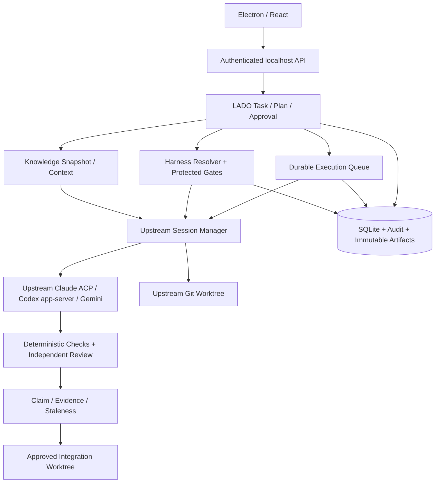

# LADO — Technical Design Document

- Version: 1.1 (fork-based architecture proposal)
- Date: 2026-10-18
- Status: Implementation blueprint; decisions marked **TBD** require an ADR
- Related: `PRD.md`, `HARNESS.md`

## 1. Selected architecture and process boundaries (conditional)
**Recommended fork:** `OrchestratorInc/agent-orchestrator` pinned at `6f299014062c392b82b820b23dc08affcaaff04f` for PoC. Preserve upstream Go daemon, Electron/React UI, SQLite, CLI/Chat drivers, session manager, worktree manager and reviewer as far as feasible. This is a *conditional* choice until Windows PoC passes; Tauri/Rust is not the default and requires a measured ADR.



**Lifetime:** daemon is the sole writer of execution transitions. Configure persistent daemon as default; UI close, explicit Stop, OS shutdown and upgrade are distinct events. Upstream desktop default may terminate the daemon; `AO_KEEP_DAEMON` and headless mode need live validation. Keep local-only MVP; do not depend on private `ao-cloud` submodule.

**Trust boundary:** worktree is isolation for Git changes, not a security sandbox. Job Object process cleanup is not filesystem/network isolation. Enforce approval centrally and explicitly reject a runtime that cannot meet mandatory tool restrictions.

## 2. Modules and contracts
- `project-service`: repository registration, sync, knowledge versions.
- `task-service`: task/issue mapping, proposal/plan revision and approvals.
- `harness-service`: rule registry, bindings, resolution, snapshots, AI change proposals.
- `runtime-registry`: providers, credential references, model capabilities.
- `scheduler`: durable queue, dependencies, resource admission and fairness.
- `worker-supervisor`: launch, cancel, timeout, process-tree cleanup, reconciliation.
- `git-service`: worktree lifecycle, baseline validation, diff and integration.
- `verification-service`: deterministic checks and optional independent review.
- `evidence-service`: claims, provenance and source validation.
- `audit-service`: append-only events and structured logs.

Each service exposes typed request/response and domain events. UI does not directly mutate SQLite or worker process state.

## 3. Storage schema (logical SQLite DDL)
```sql
CREATE TABLE projects (
 id TEXT PRIMARY KEY, name TEXT NOT NULL, path TEXT NOT NULL UNIQUE,
 repo_url TEXT, base_branch TEXT NOT NULL, created_at TEXT NOT NULL
);
CREATE TABLE knowledge_snapshots (
 id TEXT PRIMARY KEY, project_id TEXT NOT NULL REFERENCES projects(id),
 commit_sha TEXT NOT NULL, version INTEGER NOT NULL, artifact_path TEXT NOT NULL,
 created_at TEXT NOT NULL, UNIQUE(project_id, version)
);
CREATE TABLE tasks (
 id TEXT PRIMARY KEY, project_id TEXT NOT NULL REFERENCES projects(id),
 title TEXT NOT NULL, memo TEXT NOT NULL, priority TEXT, status TEXT NOT NULL,
 github_issue_number INTEGER, created_at TEXT NOT NULL
);
CREATE TABLE proposals (
 id TEXT PRIMARY KEY, task_id TEXT NOT NULL REFERENCES tasks(id),
 version INTEGER NOT NULL, content_path TEXT NOT NULL, created_at TEXT NOT NULL,
 UNIQUE(task_id, version)
);
CREATE TABLE plans (
 id TEXT PRIMARY KEY, task_id TEXT NOT NULL REFERENCES tasks(id),
 proposal_id TEXT NOT NULL REFERENCES proposals(id), version INTEGER NOT NULL,
 base_commit TEXT NOT NULL, content_path TEXT NOT NULL,
 approval_state TEXT NOT NULL, created_at TEXT NOT NULL,
 UNIQUE(task_id, version)
);
CREATE TABLE harness_rules (
 id TEXT NOT NULL, version INTEGER NOT NULL, definition_json TEXT NOT NULL,
 protected INTEGER NOT NULL DEFAULT 0, created_at TEXT NOT NULL,
 PRIMARY KEY(id, version)
);
CREATE TABLE harness_bindings (
 rule_id TEXT NOT NULL, scope TEXT NOT NULL, scope_id TEXT NOT NULL,
 override_state TEXT NOT NULL, updated_at TEXT NOT NULL,
 PRIMARY KEY(rule_id, scope, scope_id)
);
CREATE TABLE harness_snapshots (
 id TEXT PRIMARY KEY, canonical_json TEXT NOT NULL, sha256 TEXT NOT NULL UNIQUE,
 created_at TEXT NOT NULL
);
CREATE TABLE executions (
 id TEXT PRIMARY KEY, task_id TEXT NOT NULL REFERENCES tasks(id),
 plan_id TEXT NOT NULL REFERENCES plans(id),
 harness_snapshot_id TEXT NOT NULL REFERENCES harness_snapshots(id),
 runtime_profile_id TEXT NOT NULL, base_commit TEXT NOT NULL,
 worktree_path TEXT, branch_name TEXT, worker_pid INTEGER,
 state TEXT NOT NULL, created_at TEXT NOT NULL, updated_at TEXT NOT NULL
);
CREATE TABLE execution_events (
 id INTEGER PRIMARY KEY AUTOINCREMENT, execution_id TEXT NOT NULL REFERENCES executions(id),
 event_type TEXT NOT NULL, payload_json TEXT NOT NULL, created_at TEXT NOT NULL
);
CREATE TABLE claims (
 id TEXT PRIMARY KEY, task_id TEXT NOT NULL REFERENCES tasks(id),
 artifact_type TEXT NOT NULL, artifact_id TEXT NOT NULL,
 statement TEXT NOT NULL, classification TEXT NOT NULL
);
CREATE TABLE evidence (
 id TEXT PRIMARY KEY, source_type TEXT NOT NULL, source_uri TEXT,
 commit_sha TEXT, source_hash TEXT, collected_at TEXT NOT NULL,
 verification_state TEXT NOT NULL, metadata_json TEXT NOT NULL
);
CREATE TABLE claim_evidence (
 claim_id TEXT NOT NULL REFERENCES claims(id), evidence_id TEXT NOT NULL REFERENCES evidence(id),
 PRIMARY KEY(claim_id, evidence_id)
);
CREATE TABLE verifications (
 id TEXT PRIMARY KEY, execution_id TEXT NOT NULL REFERENCES executions(id),
 reviewer_profile_id TEXT, verdict TEXT NOT NULL, findings_path TEXT,
 created_at TEXT NOT NULL
);
CREATE TABLE integrations (
 id TEXT PRIMARY KEY, execution_id TEXT NOT NULL REFERENCES executions(id),
 target_branch TEXT NOT NULL, state TEXT NOT NULL, result_commit TEXT,
 created_at TEXT NOT NULL
);
CREATE INDEX idx_tasks_project_status ON tasks(project_id, status);
CREATE INDEX idx_exec_state ON executions(state, created_at);
CREATE INDEX idx_events_execution ON execution_events(execution_id, id);
```
Enable foreign keys, WAL mode and migrations. `scope_id` is a stable sentinel (`global`) for Global bindings; validate scope/override enums at service boundary and add DB CHECK constraints in production migrations. Store secrets in OS credential vault, never SQLite plaintext. Content artifacts use atomic write + hash and referenced paths. **TBD:** artifact garbage collection and backup/restore.

## 4. State machine and transactional rules
Primary path: `DRAFT -> PROPOSED -> PLANNED -> APPROVED -> QUEUED -> RUNNING -> VALIDATING -> INTEGRATION_PENDING -> COMPLETED`. Exceptional states: `BLOCKED`, `NEEDS_REVISION`, `FAILED`, `CANCELLED`, `INTERRUPTED`. Revisions create new immutable plan versions; execution references exactly one approved version.

- `PLANNED -> APPROVED`: user approval recorded with plan ID/version.
- `APPROVED -> QUEUED`: effective harness resolves without fatal conflicts.
- `QUEUED -> RUNNING`: resource admission, baseline recheck, worktree and snapshot ready.
- `RUNNING -> VALIDATING`: worker exits successfully and changes captured.
- `VALIDATING -> INTEGRATION_PENDING`: required checks pass; optional review policy satisfied.
- `INTEGRATION_PENDING -> COMPLETED`: approved integration succeeded or explicitly closed as non-merged outcome with distinct disposition.
- Any active state may transition to `CANCELLED` on authorized request; crash reconciliation uses `INTERRUPTED`.

State change and event append occur in one SQLite transaction. Use optimistic version columns in actual schema migration to prevent double transitions. Exactly-once external Git/API side effects are not assumed; use idempotency keys and reconciliation.

## 5. Runtime adapter contract
```ts
interface AgentRuntime {
  id: string;
  capabilities(): Promise<Capabilities>;
  run(req: RunRequest): AsyncIterable<AgentEvent>;
  cancel(executionId: string): Promise<void>;
  resume?(checkpoint: Checkpoint): AsyncIterable<AgentEvent>;
}
interface RunRequest {
  executionId: string;
  workspacePath: string;
  role: string;
  taskArtifactIds: string[];
  harnessSnapshotId: string;
  credentialRef: string;
  permissions: Permissions;
  limits: { maxSeconds: number; maxCostUsd?: number };
}
type AgentEvent =
  | { type: 'started'; executionId: string }
  | { type: 'log'; text: string }
  | { type: 'tool_request'; tool: string; argsRef: string }
  | { type: 'usage'; inputTokens?: number; outputTokens?: number; costUsd?: number }
  | { type: 'completed'; resultArtifactId: string }
  | { type: 'failed'; code: string; retryable: boolean };
```
CLI adapters spawn officially supported non-interactive processes and normalize stdout/stderr, cancellation and exit status. API adapters own bounded tool loops, tool schemas, token budgets and retry/backoff. Capability flags determine whether tool permission control, structured output, session resume and usage data are truly supported. A CLI with no required host enforcement cannot be treated as sandboxed.

## 6. Harness resolution and application
Implementation semantics and schema are defined in `HARNESS.md`. Resolution runs at queue admission and the effective snapshot becomes immutable immediately. Relevant binding changes before dispatch mark the execution REVIEW_REQUIRED; do not silently re-resolve or replace the snapshot. Host-enforced validators and workflow gates execute independently from prompts. Natural-language harness edits are `draft -> schema_validation -> conflict_analysis -> approval -> commit`; log each change.

## 7. Scheduler and worker lifecycle
Queue ordering: eligible approved tasks only; enforce dependency DAG and per-project concurrency. Admission considers worker count, memory pressure, CPU utilization, runtime availability and estimated cost. Resource thresholds throttle new starts; do not assume reliable termination of running processes from CPU spikes alone. Worker supervisor persists launch intent before spawning, then PID/session identifiers; on restart reconcile OS process existence, Git worktree and event stream. Bound retries and distinguish infrastructure errors from code/test failures.

## 8. Git isolation and integration
- Verify repository is clean enough for selected operation and capture exact base SHA.
- Create branch `agent/<task-id>/<execution-id>` and worktree outside the primary checkout.
- Never execute simultaneous workers in the same worktree.
- Before start and before integration, compare baseline to target and detect overlapping paths/API/schema changes.
- Generate immutable diff/test/report artifacts and require merge approval.
- Integration uses a separate worktree and records resulting SHA; regression checks run on integrated state.
- Cleanup only when no active worker references worktree and all artifacts/commits are preserved.

## 9. Project knowledge
Initial sync gathers manifest, directory structure, dependencies, docs, build/test commands and targeted code samples; store source paths and commit SHA. Incremental sync uses Git diff plus dependency-aware invalidation. Agent specialist profiles reference a knowledge snapshot rather than living processes. Do not send entire repositories or secrets to providers by default. Operational status is unknown unless an authorized integration provides actual data.

## 10. Evidence and verification
Every significant claim is `CONFIRMED`, `INFERRED` or `UNSUPPORTED` with linked evidence. Provenance verification checks source URI/path, commit, hash and timestamps; semantic relevance is separately reviewed. Source changes can mark evidence `STALE`. Deterministic validation runs first; optional independent reviewer sees requirement, plan, diff and evidence, not merely implementer's summary. Review policy has maximum rounds, cost and inconclusive handling.

## 11. Security model
Trust boundaries: user UI; orchestrator; untrusted repo contents; CLI/API workers; network; GitHub. Local IPC authenticates callers and restricts socket/pipe access. Credentials use OS vault. Secrets and prompts are redacted from logs. Use command allowlists/approval, filesystem access controls and OS-level sandboxing where available. Windows sandbox guarantee and cross-platform behavior are **TBD**; no claims of strict isolation until tested. Protected workflow gates must be enforced in the daemon, not only through prompts.

## 12. IPC and event API (initial contract)
Commands: `project.register`, `project.sync`, `task.create`, `proposal.generate`, `plan.generate`, `plan.approve`, `harness.rule.propose`, `harness.rule.apply`, `harness.resolve`, `execution.enqueue`, `execution.cancel`, `integration.approve`. Queries: `projects.list`, `tasks.list`, `execution.get`, `events.subscribe`, `harness.rules.list`, `harness.effective.get`. Every command includes request ID and actor; mutating commands use idempotency key and return structured errors.

## 13. Testing and acceptance
- Unit: rule resolution, priority sorting, state transitions, budget calculations.
- Integration: SQLite atomic events, CLI cancellation, worktree lifecycle, GitHub retries, validator gates.
- E2E: note -> proposal -> plan approval -> code change -> tests -> integration approval.
- Fault injection: kill UI, daemon and worker at each state; restart and reconcile without duplicate side effects.
- Security: protected rule bypass, malicious repository prompt injection, secret leak prevention, path traversal.
- Performance: measure baseline RAM/CPU with multiple IDE windows versus daemon + workers under equivalent tasks.

## 14. ADRs and unresolved design decisions
- ADR-001: Preserve upstream Go/Electron for PoC; revisit Tauri/Rust only after measured results.
- ADR-002: IPC transport and authentication on Windows.
- ADR-003: First supported CLI adapter and feature compatibility matrix.
- ADR-004: API tool sandbox approach and command permission model.
- ADR-005: Evidence artifact retention, backups and SQLite migrations.
- ADR-006: Integration completion semantics for PR-only workflows.

## 15. Initial implementation slices
1. Domain types, SQLite migrations and event transaction helper.
2. Wrap existing upstream Git worktree/session manager with a mock or one real CLI driver; avoid rebuilding those services.
3. Harness registry/resolver with ON/OFF inheritance and snapshot tests.
4. One real CLI adapter, execution monitor and cancellation.
5. Proposal/plan workflow, approval gates and evidence capture.
6. API adapter, independent verification and parallel scheduling.

## 16. Fork integration map and change boundaries (v1.1)
Source map below is from the Codex technical review at the pinned commit, not from a fresh Windows run.

| Upstream boundary | Confirmed code location | LADO action |
|---|---|---|
| Native CLI adapter contract | `backend/internal/ports/agent.go` | Wrap, do not replace wholesale; translate lifecycle into LADO events |
| Structured chat driver | `backend/internal/ports/chat.go` | Capability probe, streaming, approval/cancel mapping |
| Provider registry | `backend/internal/adapters/agent/registry/registry.go` | Start with one provider; test compatibility |
| Session lifecycle | `backend/internal/session_manager/` | Link 1 execution to N sessions; recovery reconciliation |
| Git worktree | `backend/internal/adapters/workspace/gitworktree/` | Pin base SHA; separate integration workspace |
| Chat message queue | `backend/internal/service/chat/queue.go` | **Do not** mistake for approved task execution queue |
| Automation claim/lease | `backend/internal/service/automation/scheduler.go` | Reuse pattern, not necessarily schema, for durable admission |
| Reviewer | `backend/internal/review/` | Attach immutable target SHA and independent evidence |
| SQLite | `backend/internal/storage/sqlite/` | Extend migrations, transactions and audit |
| Daemon lifetime | `frontend/src/main/daemon-owner.ts` | Persistent-by-default behavior and shutdown modes |
| Windows process ownership | `backend/internal/adapters/chatdriver/persistenthost/child_windows.go` | Test selected driver cancellation and descendants |

**Proposed new packages** (not claimed to exist upstream): `lado/task`, `lado/approval`, `lado/harness`, `lado/execution`, `lado/knowledge`, `lado/evidence`, `lado/verification`, `lado/integration`.

## 17. Execution authorization and data consistency
1. `Task` contains memo and references to `Proposal` and immutable `PlanRevision`.
2. `PlanApproval` binds `plan_revision_id`, plan content hash, actor, timestamp and authorized scope. Any plan mutation creates a new revision and invalidates approval.
3. `Execution` binds `approved_plan_revision_id`, `base_commit_sha`, `harness_snapshot_id`, `runtime_profile_id`, budget and unique idempotency key.
4. At **queue admission**, resolve harness and persist canonical immutable snapshot + hash in the same transaction as queue entry, execution state and audit event.
5. On policy/plan/baseline change before start, move affected queued execution to `REVIEW_REQUIRED` rather than silently re-resolving. Resubmission requires explicit confirmation and a new snapshot.
6. During running, ordinary toggles only affect future executions. Emergency protected-policy revocation requests cancellation and creates a separate audit event.
7. All paths capable of launching a worker (UI, HTTP API, automation, retry, resume, direct API) must call a central `AuthorizeExecution` boundary; every integration path calls `AuthorizeIntegration` independently.
8. Database commit and external Git/process side effects are not atomically exactly-once. Use idempotency keys, process/session identity, Git reconciliation and a recovery state instead of assuming atomic execution.

### Proposed relational extensions (logical, not yet upstream migrations)
- `lado_tasks`, `lado_proposals`, `lado_plan_revisions`, `lado_plan_approvals`.
- `lado_rule_definitions`, `lado_rule_versions`, `lado_rule_bindings`, `lado_harness_snapshots`.
- `lado_executions` (state/version/idempotency/base SHA), `lado_execution_sessions`, `lado_queue_claims`, `lado_audit_events`.
- `lado_knowledge_snapshots`, `lado_agent_profiles`, `lado_claims`, `lado_evidence`, `lado_claim_evidence`, `lado_verification_runs`, `lado_integration_approvals`.
- Prefer FK constraints and optimistic versioning; state transition + audit event in one SQLite transaction. Do not assume existing logical DDL in §3 is production migration code.

## 18. Runtime compatibility and enforcement
The original `AgentRuntime` TypeScript interface in §5 is a **LADO domain contract**, not an upstream Go interface. Implement an adapter/translation layer over `ports.Agent` and `ports.Chat`, without rewriting upstream drivers. Capability matrix includes streaming, cancellation, restore, tool approval, shell/file/network restrictions, token accounting, API tool-loop support and deterministic tool event metadata. `UNSUPPORTED` is a first-class outcome; mandatory constraints fail closed.

The upstream native CLI, Claude ACP and Codex app-server paths have different control surfaces. A prompt saying 'do not merge' is not a security boundary. Require integration-only credentials, Git branch protections or isolated tool permissions as appropriate; test malicious/unexpected direct `git merge` and `git push` attempts. Exact enforcement feasibility is a PoC question, not a current guarantee.

Direct API model execution with a bounded tool loop is **not confirmed** in the recommended fork; treat as P1 new implementation or a separate OpenHands SDK integration ADR. Subscription CLI auth is not interchangeable with API credentials.

## 19. Windows PoC and adoption decision
- Days 1–2: pinned fork build, one live Codex app-server **or** Claude ACP driver, UI-close persistence, log/cancel and Windows process-tree tests.
- Day 3: minimal task/plan/approval schema and launch guard, including API bypass attempt.
- Day 4: Global/Project/Task resolver, protected gate, immutable snapshot tests.
- Day 5: durable queue + base SHA worktree + execution/session mapping.
- Day 6: deterministic host test runner; exit code/log/hash evidence.
- Day 7: review screen and separately authorized integration, rejection tests.
- Day 8: two workers, daemon kill/restart, duplicate-start and orphan-worktree reconciliation.
- Day 9: minimal knowledge snapshot and natural-language **draft only** rule proposal.
- Day 10: measured CPU/RAM, Windows matrix, threat/limitation report and ADR go/no-go.

**Adopt fork only if:** approved plan cannot be bypassed; policy snapshots are stable; Windows driver can be stopped without orphaned children; UI-close daemon persistence and crash recovery are proven; deterministic tests override agent self-report; base integration cannot occur without separate approval; unsupported mandatory enforcement is blocked.

**Rollback/alternative:** if native Windows/process-control or upstream modification burden fails, evaluate OpenHands + `software-agent-sdk` (API tool-loop strength, higher Node/Python/ACP packaging complexity), or build a smaller Go host with selected reusable components. `stefan1294` is a reference, not preferred base.

## 20. Source provenance, licensing and unresolved verification
Source: LADO_Open_Source_Technical_Review.md (Codex, 2026-10-18; inspected commits AO 6f299014, OpenHands 852132d3, stefan1294 f78e1b06). Review checked source/CI/test files but did **not** run native Windows builds, paid CLI authentication, full CI, resource profiling or a security audit. Upstream root license reported Apache-2.0; `frontend/package.json` reportedly says MIT, and `.gitmodules` contains private `ao-cloud`. Before redistribution, confirm file-level notices, dependency/media licenses and exclusion of private assets. Pin commit for PoC and record upstream sync strategy. See `PRD.md` and `HARNESS.md` for authoritative product and policy semantics.
